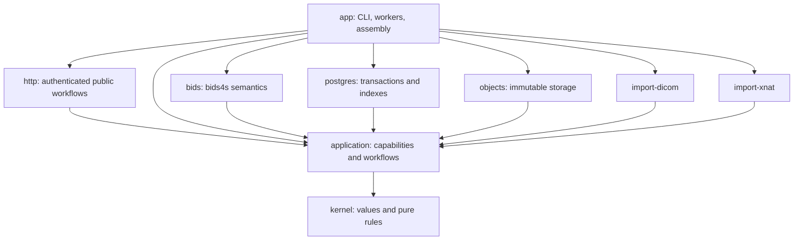

# Sanctity implementation plan

Version 0.6 — engineering baseline and implementation evidence\
Updated 10 October 2026

Build complete scientific lifecycles around immutable accepted states, current authority, and one acceptance protocol. The [PRD](prd.md) remains the product contract; this plan distinguishes executable slices from full pilot qualification.

**Current priority:** scientific-core development, following the user's 7 October direction. The [scientific workstream](scientific-core.md) advances explicit relationships, companion resolution, image/table consistency and coherent materialization. Institutional identity and additional service features follow this work; their broader pilot requirements remain open.

The native and PostgreSQL slices now extend across the four requested areas: scientific queries, scientific views, durable operations/recovery, and initial DICOM/XNAT adapters. The authority prerequisite is implemented through durable principals and action-specific dataset/fixed-release grants. [README](../README.md) documents runnable commands and supported profiles.

| Work package | Implemented evidence | Remaining qualification |
| --- | --- | --- |
| WP-02 | Scala 3.3.8; Cats Effect 3.5.7; FS2 3.11.0; http4s 0.23.30; direct sibling bids4s dependency and source fingerprints | Published/revision pin, CI and deployment packaging |
| WP-03 | Checked IDs/paths/manifests, immutable evidence, pure admission/authority rules, scoped queries, versioned relationship graphs/closure/impact, projections and leases | Real fixture/domain review and scale |
| WP-04 | Versioned inheritance/origins, strict JSON/participant TSV, explicit query interpretation identity, B0/IntendedFor evidence, inherited DWI/BOLD companions, typed selection evidence, DWI gradient/header checks, historical decoding | Full schema context, implicit fieldmap/stimulus dependencies, event content, validator/oracle corpus |
| WP-05 | Streamed/verified immutable bytes, flushes, retained evidence, isolated full exports | Reclamation, filesystem/power-loss qualification, representative corpus |
| WP-06 | Incremental checked migrations V001–V005; atomic acceptance, required query projections, receipts/audit/outbox; crash and rollback evidence | Production transaction/index scale and deployment review |
| WP-07 | Durable principal records, custody/curator separation, action grants, fixed-release scopes, policy audit, revocable expiring API credentials, current authority on reads/writes/retries/delivery | Verified login bindings, memberships, grant expiry, delegation, full source-evidence API |
| WP-08 | Correlated artifact/participant/session queries; SQL/reference agreement; lexical participant values; persisted frozen selections and stable pages | Acquisition/dataset-wide operator expansion, generated large oracle corpus, performance targets |
| WP-09 | Import inventory/file checkpoints, renewable leases, stale-worker publication fencing, response-loss recovery, independent outbox delivery targets; authenticated curation/query/grant/file HTTP routes and resumable operator CLI | Remote upload/view/operations/evidence resources, metrics, failure-administration UI, production external consumers |
| WP-10 | Catalog/blob backup and transactional closed restore gate; integrity verification; separately supplied current policy reconciliation; restored API credentials invalidated | Withdrawal journal, independently operated policy authority, production backup medium and RPO/RTO |
| WP-11 / WP-12 | MRI view compiler, filtered participant fields, flattened approved metadata, normal assessment/acceptance and fixed-release sharing; hidden-field noninterference; cross-session fieldmap and inherited-event omissions blocked | Additional dependency profiles, pipeline bundles, bounded delegation and institutional approval |
| WP-13 | Pinned real dcm2niix conversion; explicit mapping/supplements/exclusions; retained input/output/log evidence; independent synthetic voxel/world-coordinate check | Scanner/vendor fixtures, representative geometry/timing review, automatic mapping and assignment registry |
| WP-14 | Explicit XNAT API resource inventories and ZIP exports; streaming/checksums, experiment paging, source-change checks, local HTTP/API-export equivalence | Named installation, project/session/assessor survey, custom fields, participant reconciliation, full migration report and cutover |

The current implementation represents a prepared view as an ordinary release in a separate dataset, accompanied by projection evidence. This reuses acceptance, immutable interpretation, export, custody and grants. A saved query remains a separate frozen selection. Source disclosure authority is required to prepare and accept a projected release; recipients can read that release without source access.

### Verification record

The complete PostgreSQL runner passed **145 tests: 85 ordinary tests and 60 PostgreSQL tests**. The ordinary suite includes kernel/relationship/codec checks, strict HTTP JSON/query grammar, 37 lifecycle contracts, XNAT API/export and loopback HTTP tests, and process cancellation/output/runtime checks. The database suite reruns the same 37 lifecycle contracts, adds 10 transaction/migration tests, five operation/fencing/recovery-gate tests and eight HTTP/credential/CLI tests.

The scientific relationship slice adds four kernel laws, two persistence/legacy-decoding tests and four lifecycle cases run against both catalogs. It proves grouped fieldmap correction impact, unchanged image bytes and historical relationships, rejection of dangling declarations, legacy/unsupported reference handling and protection against cross-session subset omissions. The companion slice adds three kernel cases, two codec cases and five lifecycle cases per catalog. It proves inherited selection, exact event exports, direct dependency-byte impact, paired/missing gradients, immutable history and inherited-event subset protection. Upstream `sbt compileAll testAll 'docs/mdoc'` passed **159 JVM tests, 140 Scala.js tests and 11 executable documentation files**; 17 portable cases cover explicit fieldmaps, 15 cover companion selection and 16 cover gradient/header consistency. The DWI slice adds five kernel evidence cases, two codec/legacy cases, five bounded-read/resource cases and five lifecycle cases per catalog. It verifies count/norm rejection, input binding, unchanged heads, historical checks/exports and both NIfTI byte orders/versions. OpenAPI JSON and all local schema references also validate.

The runner also completed these demonstrations outside the test count:

1. Stage a correction, forcibly terminate PostgreSQL, restart it on the same volume, and accept from a fresh application process.
2. Retry from another process and recover the exact receipt/timestamp, with exactly two releases, receipts, acceptance audit entries and outbox events.
3. Grant a guest access and create a catalog/blob backup.
4. Revoke the grant, independently capture current policy, and restore the older backup into a fresh database/storage root.
5. Confirm restored access is closed, verify bytes, reconcile current authority, confirm the guest remains denied, and export both historical releases again.

Local evidence is retained under `target/postgres-check.s4c672/`, including the backup, current policy digest, server logs and restored exports. The executable reproduction is `scripts/check-postgres.sh`.

The real-converter demonstration uses the checksum-pinned official **dcm2niix v1.0.20260724** macOS arm64 binary. It converts a three-slice synthetic explicit-VR MR fixture, records all outputs, maps to BIDS, assesses, accepts and exports. The independent checker verifies dimensions, every voxel value, scaling and RAS world coordinates. Use `scripts/fetch-dcm2niix.py` followed by `scripts/check-dicom.sh`; this evidence is separate from representative scanner qualification.

Two failures found during implementation became explicit regressions: fixed-release grants must apply to metadata explanations, and cancelling a silent converter must terminate the process before waiting for its blocked pipe. A post-acceptance/pre-journal-completion interruption also has a dedicated recovery test.

### Gate status

These implementations supply evidence for portions of G1–G5. They do **not** close G2 operational acceptance, G3's full institutional/delegation profile, G4 scientific qualification or G5 a real migration. Institutional identity integration, the selected institution/source, representative fixtures, qualification owners, production lifecycle policies and measurements are still required.

The authenticated API slice exposes curation, exact releases, metadata explanations, grants, frozen selections and file delivery. It uses opaque operator-issued credentials with transaction-time liveness checks and chunk-boundary reauthorization. All restored credentials are invalidated before reopening. A real server/client test preserves historical metadata and acceptance receipts; other cases prove fixed-release head isolation, expiry/revocation, strict inputs and private credential-file handling. See the [API runbook](http-api.md) and [OpenAPI contract](http-api.openapi.json). OIDC, memberships, general remote ingestion/view/operations resources and production deployment qualification remain open.

All managed bytes are retained conservatively. No garbage collector or withdrawal operation is implemented. The restore proof covers revocation with a separately available authoritative policy snapshot; without current authority evidence, the service remains closed. Source listings establish declared observation scope, not an atomic global XNAT snapshot.

The local library remains `../bids4s`. The scientific slices add portable fieldmap and companion resolvers, downstream API specimens, documentation and JVM/Scala.js cases alongside the existing inheritance improvements. [bids4s integration](bids4s-integration.md) records their scope and evidence.

## 1. Planning assumptions

The proposed capacity is two experienced full-time Scala/backend engineers, approximately 0.5 FTE scientific/curation support, approximately 0.25 FTE platform support, and a product owner who resolves scope promptly. Technical leadership is included in engineering capacity. Graphical UI work needs separate frontend capacity after the pilot.

A named XNAT source, representative data, institution-specific access/disclosure rules, and the production environment are not yet known. No dates below are commitments.

The estimate uses elapsed phase ranges for that team, with no assumed overlap savings:

| Phase | Duration | Cumulative nominal range | Exit |
| --- | --- | --- | --- |
| P0: scope, evidence, dependency baseline | 1–2 weeks | 1–2 | G0 |
| P1: semantic kernel and native lifecycle | 3–4 weeks | 4–6 | G1 |
| P2: durable operational core | 5–7 weeks | 9–13 | G2 core alpha |
| P3: restricted views and collaboration | 4–6 weeks | 13–19 | G3 |
| P4: qualified DICOM ingestion | 3–5 weeks | 16–24 | G4 |
| P5: XNAT migration | 4–6 weeks | 20–30 | G5 |
| P6: extension proofs and pilot qualification | 3–5 weeks | 23–35 | G6 |
| Explicit contingency | 3–5 weeks | 26–40 total | Reserve for identified risks |

The resulting rough pilot envelope is **26–40 weeks**, conditional on the assumptions. It replaces the earlier 26–32-week hypothesis because the pilot now explicitly includes restricted views, bounded delegation, identity/access behavior, and derivative destination separation.

These are planning estimates, not statistical confidence intervals. P0 re-estimates after the source/dependency survey; G2 re-estimates after measured core throughput and implementation complexity. DICOM qualification and XNAT source discovery can begin earlier where prerequisites permit, but the estimate does not count the same engineers twice or assume that overlap is free.

## 2. Architecture and dependency direction

Start with one deployable service and separately runnable workers from the same codebase. PostgreSQL coordinates scientific roots, access/lifecycle state, indexes, journals, and outbox. Managed filesystem storage is the initial byte backend unless P0 identifies a deployment constraint.

Dependencies point inward. The application layer defines capabilities; adapters implement them. BIDS-specific public operations reuse bids4s types in the BIDS integration boundary. The preservation kernel does not require every stored path to parse as a BIDS name.

| Module | Initial contents | Boundary to enforce |
| --- | --- | --- |
| kernel | IDs, paths, digests, manifest records, changes, preparation/release/view references, findings, evidence, authority scope values, pure transitions | No database/HTTP/process classes, effect runtime, or mutable service registry |
| application | Admission/read/view/access/source/object/job capabilities; use cases; query model; operation state transitions | No concrete adapter construction; explicit access context |
| bids | Profile selection, bids4s adaptation, resolution evidence, typed dependencies, impact, reference interpreter, materialization rules | No institutional policy engine or private database writes |
| postgres | Schema/migrations, admission transaction, SQL query interpreter, policy/journal persistence, outbox | Own complete transactions and concurrency checks |
| objects | Streaming write/hash/read, immutable install, leases, integrity, materialization primitives | No direct caller access to canonical filesystem paths |
| import-dicom | Header evidence, pinned converter wrapper, mapping, qualification fixtures | Produce drafts and receipts through public capabilities |
| import-xnat | Export/API inventory, observation evidence, acquisition, reconciliation | No direct release/head mutation |
| http | Credential authentication boundary, explicit request/response grammar, workflow routing | No private evidence serialization, raw blob endpoints or arbitrary internal object submission |
| app | Configuration, Resource assembly, IO runtime, CLI, HTTP server, worker entry points | Product flows invoke application operations |

Keep package boundaries initially practical. An external derivative producer and Neurobagel projection can begin as separately testable adapters; extract additional build modules when coupling and ownership justify them.

Use the existing proposed stack: Scala 3, Cats/Cats Effect, FS2, http4s, Tapir, Circe, Doobie/HikariCP, PostgreSQL, MUnit, and ScalaCheck. Pin a compatible set in P0 instead of choosing versions independently. Toolchain/publication availability is an early executable check.

## 3. Kernel construction

### Values and identity

Define opaque types for consequential identifiers, validated safe relative paths, digest algorithm/value, byte length, versions, and generation counters. Decode external records through checked constructors.

Represent manifests as immutable logical entries referenced by a manifest identity. Canonical encoding specifies ordering, path encoding, entry kinds, artifact/content references, and composition. Storage adapters can stream entries; the public contract must not require a million-entry Vector in every request.

The deterministic identity law applies to the same logical entries and artifact identities. A distinct import that deliberately creates different artifact identities need not receive the same scientific manifest identity merely because its payload bytes match.

Keep exact authored bytes. Parsed JSON/TSV values support interpretation and query; they do not replace original documents for full export. Generated edits/projections record their serializer/materializer profile and resulting bytes.

Proposed initial preservation policy: regular files and explicit directories; no path traversal, absolute paths, device nodes, or silent case/normalization rewrites. Symlinks produce a blocking preservation finding until a qualified resolution policy exists. The inventory still records rejected objects, so they cannot silently disappear from completion accounting.

### Pure rules

Implement change application/conflict detection, draft generations, candidate applicability, release binding, finite-scope attenuation, and query/reference semantics as pure functions over bounded inputs or manifest abstractions.

Stable operation/error states use closed ADTs. Scientific vocabularies use versioned profiles/descriptors. Unknown or unsupported semantics stay explicit.

Do not create a generic workflow DSL or claim arbitrary changes form a commutative algebra. Prove actual laws: identity, fidelity, conflict behavior, historical meaning, view agreement, and authority containment.

### Capabilities

The first application capabilities should cover:

| Capability | Core contract |
| --- | --- |
| Manifest access | Stream/read an identified immutable logical tree |
| Object staging | Stream bytes, verify digest/length, install immutable content, maintain lease |
| Semantic preparation | Interpret exact content and produce typed dependencies/findings/index input |
| Assessment | Run identified checks against exact inputs; persist completed evidence |
| Admission | Atomically accept one exact prepared candidate or return typed denial/conflict/failure |
| Scientific read | Query a pinned release or prepared view; return stable pagination and supported explanations |
| View preparation | Resolve selection, closure, transformations, and exact output interpretation |
| Authority | Decide an explicit action/scope/context; issue/revalidate bounded use where supported |
| Operation journal | Persist checkpoints, attempts, lease ownership, cancellation, and results |
| Source access | Page qualified source observations and stream identified source objects |

Choose F[_] at effectful boundaries, Stream for large inventories/bytes, and Resource for clients, workspaces, subprocesses, and connections. Select IO at assembly.

PreparedCandidateId is an addressable reference, not proof of perpetual readiness or authorization. Admission rechecks persisted evidence and current state.

Queries over a release can use its full representation directly. The shared read model does not require materializing or persisting a new view for every ordinary query.

## 4. Persistence and transaction design

Begin with explicit relational families rather than committing to a final table count:

- Dataset/head, content revision, manifest entry/partition, artifact, blob location/status.
- Interpretation, typed entity/value projections, relationships, field origins.
- Assessment/findings, draft/change generation, preparation/candidate.
- Release/admission receipt, activity/derivation, idempotency record.
- Principal/binding, organization/workspace/membership, custody, grant/policy version.
- Source scope/inventory/observation/disposition, mapping assignments.
- View/spec/membership/projection manifest, materialization/use lease.
- Operation/attempt/checkpoint, outbox/delivery generation, audit.
- Retention roots, tombstones, staging leases, integrity and recovery records.

Ordinary columns serve common predicates; extension values can use JSONB. Start with simple complete candidate membership and bulk loading, then measure catalog amplification. Retain the ability to introduce partition sharing without changing scientific identities.

Preparation builds private complete semantic projections before head publication. A physical index generation can be replaced only after semantic equivalence checks; otherwise prepare a new interpretation.

The acceptance transaction should:

1. Authorize the caller and resolve an existing scoped idempotency receipt.
2. Lock/check the relevant dataset head and draft generation.
3. Verify candidate binding, assessment/admission applicability, index readiness, and protected storage references.
4. Persist the release and receipt, advance the head, and transfer/add durable retention roots.
5. Write audit and outbox records, then commit.

A reused idempotency key with different intent conflicts. A lost response is resolved by rereading its durable receipt. New datasets use an explicit no-head expectation. Storage staging remains leased across the transition so collection cannot delete candidate bytes between verification and acceptance.

The local access/lifecycle state used for acceptance must have transactionally checked versions. External identity claims enter through verified bindings and a declared refresh contract; do not imply a distributed transaction with an identity provider.

Full-tree export promises logical paths and file bytes, not original filesystem ownership, inode identity, or timestamps unless a later explicit preservation profile adds them.

## 5. Work packages and traceability

Every work package produces code, fixtures, and reviewable evidence. The requirement column is its implementation responsibility; final gate review checks all applicable requirements end to end.

| Work package | Phase | Dependencies | Deliverable and requirement coverage |
| --- | --- | --- | --- |
| WP-01 Scope and fixture contract | P0 | None | Pilot survey, safe representative corpus, owners, profile/measurement contract; I-05, I-07, NF-03, NF-05, NF-10 |
| WP-02 Dependency and build baseline | P0 | None | Pinned Scala/libs/bids4s/tools, build/CI, dependency direction checks; K-03, NF-09 |
| WP-03 Pure kernel and manifest identity | P1 | WP-01, WP-02 | IDs, canonical manifests, changes, states, errors and laws; K-01, K-02, K-05, K-09, NF-09 |
| WP-04 BIDS semantic preparation | P1 | WP-03 | Inheritance/origins, relationships, assessment/profile binding, edit impact; K-03, K-04, S-01, S-02, S-03, S-06 |
| WP-05 Bytes and native lifecycle | P1 | WP-03, WP-04 | Bounded staging, native inventory, in-memory admission reference, exact export; K-08, V-02, I-01, I-02, NF-03 |
| WP-06 PostgreSQL admission and indexes | P2 | WP-04, WP-05, WP-07 | Transaction, receipts, constraints, generation-bound indexes/outbox; K-06, K-07, S-07, O-02, NF-02 |
| WP-07 Authority baseline | P2 | WP-03 | Principal/binding/custody, dataset actions, local policy versions, initial leases; A-01, A-02, A-04, A-05, A-09, NF-06, NF-07 |
| WP-08 Scientific queries | P2 | WP-04, WP-06 | SQL/reference agreement, typed values, frozen universe and pagination; S-04, S-05, S-06, NF-01 |
| WP-09 Durable workflows and CLI/API | P2 | WP-06, WP-07, WP-08 | Journals, bounded workers, curation operations, diagnostics and stable outcomes; K-09, O-01, O-05, E-03, NF-08 |
| WP-10 Alpha recovery and packaging | P2 | WP-06, WP-07, WP-09 | Install/configuration, backup/restore, access/lifecycle reconciliation; O-04, NF-05, NF-10 |
| WP-11 View compiler and agreement | P3 | WP-04, WP-08, WP-09 | One closure/projection profile, frozen result, tool-input contract; V-01, V-03, V-04, V-05, V-06 |
| WP-12 Restricted grants and use | P3 | WP-07, WP-11 | View scopes, one-level attenuation, all-surface disclosure and lease enforcement; A-03, A-04, A-05, A-06, NF-06, NF-07 |
| WP-13 DICOM qualification | P4 | WP-05, WP-09 | Inspection/conversion/mapping, stable assignments, scientist-reviewed profiles; I-03, I-04, K-08, A-09 |
| WP-14 XNAT adapters and reconciliation | P5 | WP-09, WP-13 | Export/API convergence, qualified identity, resume and scoped final report; I-05, I-06, I-07, K-02 |
| WP-15 Bounded derivative producer | P6 | WP-11, WP-12 | Approved recipe, exact bundle, separate destination, resumed output collection; A-07, A-08, E-01, V-06 |
| WP-16 Neurobagel projection proof | P6 | WP-11, WP-12 | Compatible approved fixture, downstream-tool check, generation-aware delivery; E-02, O-02 |
| WP-17 Scale, lifecycle, and upgrades | P6 | WP-10, WP-11, WP-14 | GC/lease races, integrity, withdrawal, index/schema upgrade, realistic benchmarks; O-03, O-06, S-07, V-02, NF-01, NF-02, NF-03, NF-04, NF-05, NF-08 |
| WP-18 Pilot rehearsal and handover | P6 | WP-14, WP-15, WP-16, WP-17 | Full evidence manifest, source/cutover report, restore drill, operator/curator exercise; all remaining PRD gates, NF-10 |

WP-07 is scheduled before final WP-06 integration; its numbering is not execution order. The dependency graph is acyclic. Source surveying and scientific fixture preparation start in P0, even though production XNAT and converter adapters arrive later.

## 6. Phase exit plans

### P0 — Close the highest-impact unknowns

Name acceptance owners and select one source collection. Inventory its accessible resource types, custom fields, source consistency options, scale, and intended MRI profiles. Establish permitted fixture use without placing private source data in the repository.

Pin the dependency baseline and execute a minimal bids4s parse/load/query example. Review inheritance and association behavior against the selected schema. The current [coverage ledger](https://github.com/canardlapin/bids4s/blob/main/docs/pybids-parity.md) marks inherited metadata partial and association lookups as not yet matched; turn relevant gaps into concrete upstream tasks and fixtures.

Record proposed ADRs for scientific identities, path/preservation rules, interpretation retention, acceptance concurrency/idempotency, authority consistency, and storage/lifecycle roots. Each ADR includes alternatives, consequences, and evidence required; none is accepted solely by this plan.

**G0:** a runnable build, accessible qualified source/fixture plan, named owners, pinned dependency/tool revisions, initial support matrix, and updated estimate. If the real source is unavailable, synthetic kernel work can proceed, but G0's source-readiness item remains open.

### P1 — Prove the semantic lifecycle

Implement the pure records and laws, then connect them to filesystem staging and a reference admission interpreter. Build a small dataset with shared metadata, local overrides, companion files, malformed/unsupported entries, and nested boundaries.

The demonstration must import, explain a value, propose an authored correction, show its effects, accept a second state, and export both exactly. The demonstration uses explicit test authority and reference persistence; it does not establish production concurrency/durability.

Fix reusable semantic deficiencies in bids4s when suitable. Keep repository policy, database coordination, and institutional authority in Sanctity.

**G1:** executable native lifecycle, exact manifests/exports, field-origin and impact evidence, and a documented support boundary. Advance only when the data model supports the workflow without bypasses.

### P2 — Make the core durable and usable

Implement current dataset authority before integrating atomic PostgreSQL acceptance. Bulk-load private semantic projections, use explicit SQL constraints/head checks, and persist idempotency receipts/audit/outbox.

Build the SQL interpreter against the reference query language. Freeze multi-dataset release universes in one consistent catalog snapshot; later delivery checks current authority without silently shrinking a saved selection.

Provide journals, bounded workers, CLI/API curation, full export, structured redacted diagnostics, and install/backup/restore runbooks. Build conservative retention tracking now; automated reclamation can remain disabled until race qualification in P6.

**G2 core alpha:** every A requirement passes within the declared profile, including conflict/retry/failure injection, query agreement, action-specific access, bounded mediated-use checks, and a basic restore that preserves current restrictions.

### P3 — Prove the view model

Choose one restricted profile: selected participants/acquisitions, approved table columns/metadata fields, explicit source-evidence exclusion, supported fieldmap/companion behavior, and declared provenance disclosure.

Implement closure, sanctioned document rewriting, reassessment, and a separate interpretation of the emitted representation. Compare query results against the materialized output under the same profile.

Implement fixed-view grants and one child-grant level. Exercise counts, predicates, errors, explanations, receipts, cache reuse, expiry, and revocation. A view of a view must never recover hidden source data through private lineage.

**G3:** an external collaborator can use the exact approved representation; forbidden dependencies block or transform explicitly; changed excluded information does not alter permitted deterministic outputs beyond approved disclosures.

### P4 — Qualify DICOM ingestion

Wrap a pinned converter using bounded subprocess resources and controlled temporary workspaces. Record exact input/output inventories, tool identity, configuration, and source evidence. Version mapping profiles and persist assignments.

Support the agreed acquisitions, including supplied events and the chosen fieldmap family. Missing facts and ambiguous relationships remain curator findings.

Scientific review must inspect geometry, orientation, scaling, timing, and associations on representative protocol examples. Conversion exit status and BIDS conformance are separate evidence.

**G4:** every advertised profile has a qualification report and regression fixture; every source/output relationship and exclusion is accounted for. Unqualified acquisitions retain an explicit unsupported status.

### P5 — Rehearse XNAT migration

Implement export/API adapters against the same durable source-observation model. Treat display labels, native accession identity, project context, and installation identity separately.

Test partial access, pagination, transient remote failure, same-size changed content, missing resources, custom evidence, and source mutations during inventory/acquisition. Store source credentials outside scientific records and redacted diagnostics.

Repeat representative export/API acquisition into the same mapping/acceptance workflow. Reconcile by declared observation strength. A weakly observed live source must produce a qualified consistency claim.

**G5:** representative migration resumes after interruption, every observed object has a supported disposition, mappings are stable, and both source routes produce equivalent intended scientific content when supplied equivalent evidence. Exact receipts may differ because acquisition histories differ.

### P6 — Qualify extensions, lifecycle, and operations

Run one approved deterministic-or-explicitly-characterized producer over a prepared input bundle into a separately governed destination draft. Test bounded credentials, exact inputs, disallowed actions, expiry, and interrupted output collection.

Export BIDS derivative provenance under the selected profile, including required GeneratedBy information, while retaining richer internal execution evidence and respecting provenance disclosure. [BIDS derivative description](https://bids-specification.readthedocs.io/en/stable/modality-agnostic-files/dataset-description.html#derived-dataset-and-pipeline-description).

Produce the approved Neurobagel fixture through normal view/query/export contracts and verify it with a pinned downstream tool. Neither extension may introduce a private acceptance shortcut.

Qualify conservative GC and leases, integrity checks, withdrawal of shared references, schema/index upgrades, source migration at representative scale, and restoration after intervening access changes. Record warm/cold query behavior, transaction contention, import/semantic-rebuild throughput, memory, and catalog growth.

**G6:** all pilot requirements have evidence; every migration completion dimension passes; operator and curator complete the documented workflows; the source/cutover report identifies limitations and owners. Operational cutover remains a separately authorized action.

## 7. First ten working days

This is a proposed allocation under the staffing assumption. It prioritizes evidence and an executable path, not large interface inventories.

| Days | Engineer A | Engineer B | Scientist / operator / product |
| --- | --- | --- | --- |
| 1–2 | Draft manifest/release/interpretation model and initial pure laws | Pin build and bids4s/tool compatibility; executable minimal integration | Select source/profiles; assign acceptance owners; choose fixture handling and deployment assumptions |
| 3–4 | Implement safe paths, logical entries, canonical encoding, changes/generation behavior | Build native inventory and streaming immutable staging spike | Supply/review inheritance, acquisition, and ambiguous-mapping examples; source access survey |
| 5–6 | Prepare first content/interpretation binding and authored-metadata change | Integrate bids4s resolution and full export; identify upstream gaps | Review preservation/interpretation distinctions and initial disclosure profile |
| 7–8 | Add pure draft/acceptance reference transitions and exact evidence references | Run native correction/export scenario; adversarial metadata/path fixtures | Review scientific output and operational storage assumptions |
| 9–10 | Consolidate ADR proposals and dependency boundaries from the working slice | Capture G0 evidence, initial scale observations, and next work package issues | Close G0 inputs where available; re-estimate P1/P2; record unresolved source inputs honestly |

The day-10 output is a buildable starter slice and evidence for foundation decisions. G1's full semantic demonstration still has the phase P1 allowance, especially where upstream semantic work is needed.

## 8. Validation strategy

Use MUnit for representative examples and integration tests, ScalaCheck for pure laws and generated query/manifest cases, and PostgreSQL integration fixtures for concurrency/visibility. Use real temporary storage/process boundaries for resource and integrity tests.

| Layer | Necessary evidence |
| --- | --- |
| Pure model | Canonical identity, validated paths, change conflicts, draft transitions, finite grant attenuation |
| Semantics | Dataset boundaries, inheritance, origins, association groups, old/new impact, lexical values |
| Queries | Generated reference/SQL agreement, missing values, correlation, stable ordering/pagination |
| Admission | Concurrent heads/drafts, repeated keys, response loss, partial preparation, authorization races |
| Views | Closure and transformations, materialized/query agreement, hidden-source noninterference |
| Storage | Stream cancellation, immutable installs, disk full, corruption, GC/lease races, writable-copy isolation |
| Ingestion | Source mutation, denied scope, many-to-many conversion, stable assignments, truthful dispositions |
| Operations | Outbox retries/order, worker expiry, rollback/restore, historical indexes and current restrictions |
| Scientific qualification | Human-reviewed representative acquisitions and explicit profile coverage |
| Extensions | Public API use, bounded authority, separate custody, normal output acceptance |

Differential tools such as a BIDS validator or PyBIDS can supply useful evidence for their qualified profiles. Record versions and divergences; no external tool is an unquestionable oracle for every repository behavior.

Store evidence with requirement IDs, fixture identifiers/checksums, source/tool revisions, configuration, raw results, and reviewer where needed. Keep private fixture data outside the repository; version safe fixture generators, schemas, and permitted manifests.

For performance, use approximately 10k, 100k, and 1m indexed entries with documented metadata distributions and independent payload sizes. Benchmark the configured service including authorization and serialization; avoid presenting a parser microbenchmark as repository latency.

CI should gate pure/semantic contracts, query agreement, and representative adapter tests. Expensive scientific qualification and scale/restore suites run as explicit release-gate jobs with retained results.

## 9. Definition of done

A work package is complete when its behavior is reachable through the intended contract, relevant tests/fixtures pass, errors and interruption states are inspectable, and evidence identifies the requirements covered.

A phase is complete when the gate review covers integrated behavior, not only the union of passing unit tests. Each gate produces a concise receipt:

- Exact code/dependency/schema/profile revisions.
- Requirements and fixtures exercised, with results and limitations.
- Supported deployment and scientific coverage.
- Current unresolved decisions and their impact on the next phase.
- Scientific, technical, custody, and operational acceptance as applicable.

Maintain a requirement-to-evidence manifest under project documentation once implementation begins. A missing required fixture is an open requirement, not an assumed pass.

## 10. Decision deadlines

| Decision | Responsible role | Due before |
| --- | --- | --- |
| Pilot collection, resource scope, scanner profiles, evidence owners | Product + scientist + source owner | G0 |
| Canonical manifest/preservation rules and initial path policy | Technical lead + curator | WP-03 completion |
| bids4s revision/publication strategy and semantic gap ownership | Technical lead | G0; recheck at G1 |
| Interpretation retention and index-equivalence contract | Technical lead | WP-06 |
| Admission policy and expected-head/idempotency semantics | Technical lead + curator | WP-06 |
| Identity provider, local policy consistency, membership refresh | Custodian + operator + technical lead | WP-07 |
| Storage/durability, recovery journal, backup medium | Operator + technical lead | WP-10 |
| Restricted view fields, dependencies, source/provenance disclosure | Custodian + scientist | WP-11 |
| Delivery/run lease enforcement and supported delegation | Custodian + technical lead | WP-12 |
| Qualified conversion profiles and assignment rules | Scientist + curator | WP-13 |
| XNAT observation strength and cutover acceptance | Source owner + curator + operator | WP-14 |
| Derivative obligations, approved recipe, destination admission | Custodians + scientist | WP-15 |
| Retention, withdrawal, collection, and recovery authority | Custodian + operator | WP-17 |
| Production pilot capacity/targets and operational cutover | Product + all acceptance owners | G6 |

These decisions correspond to the existing OPEN register, but add execution deadlines. A missing source or institutional choice should not block independent pure-model work; it does block the associated readiness gate.

## 11. Risk responses and scope control

| Trigger | Response | What remains mandatory |
| --- | --- | --- |
| Inheritance/association gaps are larger than expected | Fund targeted upstream work; narrow interpreted scientific profile | Honest findings, authored-byte fidelity, pinned interpretation |
| Projection work exceeds P3 allowance | Narrow the one supported profile and block other transformations | No unauthorized dependency expansion; query/export agreement |
| XNAT custom resource scope expands | Inventory and retain unsupported evidence; revise scope/estimate with source owner | Complete declared accounting and truthful consistency claims |
| DICOM examples fail scientific review | Exclude profile from qualified automation until fixed | Preserve evidence and disclose unsupported status |
| Catalog/index amplification exceeds capacity | Optimize internal sharing/partition layout using measured cases | Stable scientific identity and historical meaning |
| Execution backend cannot enforce lease limits | Keep the pilot on the controlled local approved producer | Bounded run authority and truthful revocation contract |
| Staffing falls below assumptions | Re-estimate calendar and reduce optional coverage | Core laws and declared pilot acceptance evidence |
| A benchmark misses target | Diagnose measured workload, optimize, or formally revise capacity/target before release | Report actual conditions; preserve correctness |

Candidate schedule reductions include additional modalities, richer disclosure profiles, production Neurobagel hosting, object-store deployment, and broader execution infrastructure. They do not include atomicity, current authority, scientific qualification for advertised conversions, or truthful accounting.

## 12. After the controlled pilot

Build the UI over the existing resources: dataset exploration, metadata origins/impact, import mapping, revision history, prepared views, and durable operation status. Validate curator usability before adding more scientific coverage.

Then select a production execution backend and qualify a real fMRIPrep workflow against exact bundle/derivative contracts. Expand identity administration, disclosure profiles, and federation according to observed institutional needs.

OpenNeuro/DataLad exchange, DRS retrieval, further GA4GH integrations, and additional storage adapters remain separate qualified integrations. They inherit the same scientific object and authority rules.

Success for this plan is a core whose next adapter needs a new interpreter or capability implementation, with no exception to the meaning of accepted data.
