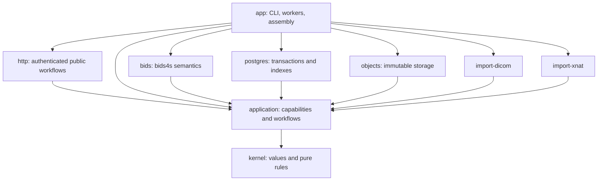

# Sanctity implementation plan

Version 0.22 — recovery foundations before browser workspace expansion\
Updated 14 October 2026

Build complete scientific lifecycles around immutable accepted states, current authority, and one acceptance protocol. The [PRD](prd.md) remains the product contract; this plan distinguishes executable slices from full pilot qualification.

**Current priority:** deliver the [core repository vision](vision.md) through labs,
projects, institutional identity, complete user workflows and dependable operations.
First prove a [reliable local installation and guided demonstration](local-demo-plan.md)
on the product owner's computer, with a guide suitable for seeking institutional
interest. No institutional pilot has been approved.
The [institutional readiness plan](institutional-readiness-plan.md) assesses the current
implementation; the [granular pilot epics](institutional-pilot-epics.md) define the
next tasks, acceptance gates and mote dependencies. They supersede
the earlier priority on further scientific expansion. Preserve scientific guarantees
and fix supported-data defects; additional numerical recipes are deferred.

The first tranche completes F01's [organization](decisions/001-institutional-organization.md),
[authority](decisions/002-institutional-authority.md) and
[migration/offboarding](decisions/003-institutional-lifecycle.md) contracts, with 38
reusable authorization scenarios, and O01.1's [Java service distribution](service-distribution.md).
The [six-area core-hardening plan](core-hardening-plan.md) now governs delivery:
EP9 reuses existing work, adds eight engineering tasks and coordinates six area
reviews plus one integrated release. T1 is complete: protected configuration, checked
reference organization records, runtime/migration database roles, a preserved and
executed old/current compatibility corpus, and frozen workload/budget oracles.
[Execution receipts](evidence/core-hardening-t1/receipt.json) identify exact evidence.
The first T2 slice completes O03.1's policy durability contract and F02.2's PostgreSQL
organization migration, with [candidate-specific evidence](evidence/core-hardening-t2/receipt.json).
F03.1's pure policy matrix now passes all 38 ADR cases, six 500-case properties and
the focused 71-test run, with [retained evidence](evidence/institutional-pilot/F03.1/receipt.json).
F03.2 now enforces that model in PostgreSQL and joins organization/grant/credential
history in one local transaction; see [its evidence](evidence/institutional-pilot/F03.2/receipt.json)
and [mutation inventory](policy-transactions.md). O03.6.1 now supplies the
[qualified standalone witness](evidence/institutional-pilot/O03.6.1/receipt.json).
O03.6.2 adds [qualified catalog enrollment, synchronous acknowledgment and bounded admission](evidence/institutional-pilot/O03.6.2/receipt.json),
with an [operator guide](policy-catalog.md). O03.6.3 now passes the
[integrated process qualification](evidence/institutional-pilot/O03.6.3/receipt.json),
and all six unchanged [O03.6 parent criteria](evidence/institutional-pilot/O03.6/receipt.json)
are complete. Next is H03.1 verified backup automation; it still blocks O03.7.
Organization-aware
recovery remains unavailable until the subsequent restore work is qualified.
Prioritize H03.1, then O03.7/O03.8 restore and source-isolation qualification
before browser workspace expansion; F02.3/F03.3/F03.4 provide its administration and
access prerequisites. Existing O03.2/O03.4/O03.5 retain full identity/session coverage.
Explicit stewardship and exact grants already govern migrated data; inherited roles,
public administration and independent recovery remain open. All six area reviews and
institutional readiness remain open.

The work-package evidence and original pilot phases below remain useful history and
requirements. Their completion is not implied by the new institutional-beta plan;
the broader original pilot gates, source qualification and production cutover remain
separate obligations. Use the core-hardening plan for current engineering order and review cadence.

The native and PostgreSQL slices now extend across the four requested areas: scientific queries, scientific views, durable operations/recovery, and initial DICOM/XNAT adapters. The authority prerequisite is implemented through durable principals and action-specific dataset/fixed-release grants. [README](../README.md) documents runnable commands and supported profiles.

| Work package | Implemented evidence | Remaining qualification |
| --- | --- | --- |
| WP-02 | Scala 3.3.8; Cats Effect 3.5.7; FS2 3.11.0; http4s 0.23.30; verified complete bids4s source pin, source fingerprints, isolated build runner and CI workflow | Published upstream release, hosted CI execution and deployment qualification (O01.1 packaging is complete) |
| WP-03 | Checked IDs/paths/manifests, immutable evidence, pure admission/authority rules, scoped queries, versioned relationship graphs/closure/impact, projections, simultaneous file edits, bound change receipts and leases | Real fixture/domain review and scale |
| WP-04 | Versioned inheritance/origins, strict JSON/participant TSV, explicit query interpretation identity, B0/IntendedFor evidence, inherited DWI/BOLD companions, typed selection evidence, DWI gradient/header and strict event/timing checks, reference/scans repair planning and old/new dependency scope, explicit registry/rule context, declared-version separation, profile adoption, historical decoding, pinned example/validator comparison, independent MRI header observations and phasediff plus phase1/phase2 magnitude families | Full official-schema interpretation, broader dependency profiles and representative conformance corpus |
| WP-05 | Streamed/verified immutable bytes, flushes, retained evidence, isolated full exports | Reclamation, filesystem/power-loss qualification, representative corpus |
| WP-06 | Incremental checked migrations V001–V007; atomic acceptance, required query projections, receipts/audit/outbox; explicit publication bindings; crash and rollback evidence; bounded query/observation scale measurements | Production transaction/index scale and deployment review |
| WP-07 | Durable principal records, custody/curator separation, action grants, fixed-release scopes, policy audit, revocable expiring API credentials, current authority on reads/writes/retries/delivery | Verified login bindings, memberships, grant expiry, delegation, full source-evidence API |
| WP-08 | Correlated artifact/participant/session queries; SQL/reference agreement; lexical participant values; persisted frozen selections, stable pages and exact-input derivative observation/coverage queries | Acquisition/dataset-wide operator expansion, production-scale capacity targets |
| WP-09 | Import inventory/file checkpoints, renewable leases, stale-worker publication fencing, response-loss recovery, independent outbox delivery targets; authenticated curation/query/grant/file HTTP routes, resumable operator CLI and reviewed v4g browser console | Console adoption gates below; remote upload/view/operations/evidence resources, metrics, failure-administration UI, production external consumers |
| WP-10 | Catalog/blob backup and transactional closed restore gate; integrity verification; separately supplied current policy reconciliation; restored API credentials invalidated | Withdrawal journal, independently operated policy authority, production backup medium and RPO/RTO |
| WP-11 / WP-12 | MRI closure/compiler v8 with context identity, localized events/gradients, participant/session/scan projection, EPI/phasediff/phase-pair and multi-echo closure, local stimulus assets and reference rewriting, exact transformation receipts, export/re-import equivalence and fixed-release sharing; hidden-column noninterference; versioned readiness, frozen MRI header-QC bundles and creator-only private inputs under current source authority | Additional dependency/recipe profiles, bounded delegation and institutional approval |
| WP-13 | Pinned real dcm2niix conversion; explicit mapping/supplements/exclusions; retained input/output/log evidence; independent synthetic voxel/world-coordinate check | Scanner/vendor fixtures, representative geometry/timing review, automatic mapping and assignment registry |
| WP-14 | Explicit XNAT API resource inventories and ZIP exports; streaming/checksums, experiment paging, source-change checks, local HTTP/API-export equivalence | Named installation, project/session/assessor survey, custom fields, participant reconciliation, full migration report and cutover |
| WP-15 | External header-QC producer, exact input bundle/target/request/software/output receipts, explicit derivative profile, separately governed destination, staged/resumable collection, source-bound returned-value checks, durable local runs, explicit-base replacement releases, full scalar payload assessment, qualified temporal mean/SD maps through a common recipe interface and atomic admission | General execution scheduling, remote run credentials, stronger sandboxing, broader analysis/derivative qualification |

The current implementation represents a prepared view as an ordinary release in a separate dataset, accompanied by projection evidence. This reuses acceptance, immutable interpretation, export, custody and grants. A saved query remains a separate frozen selection. Source disclosure authority is required for a separately shared projected release; recipients can read that release without source access. Private processing bundles use a distinct activity kind and require their creator to retain current access to the fixed source; they cannot acquire independent sharing grants.

The subsequent F01 contracts, O01.1 service artifact and L01.1 demo contract are
complete. Current engineering follows [EP9 and its ordered tranches](core-hardening-plan.md);
the [epic and task guide](institutional-pilot-epics.md) retains later institutional work.

### Console baseline and adoption

**Planning baseline: v4g, implemented and reviewed; adoption qualification remains
open.** Close the broad design-review loop and carry the bounded console forward
under **WP-09**, alongside scientific-core development. Further review is driven by
a reproduced defect, an accessibility failure or a changed workflow/API contract.
Reviewer scores inform this decision; they are not acceptance thresholds.

The supported slice covers release/file inspection, metadata origins, grouped
findings and relationships, JSON sidecar correction with preview and acceptance,
queries/frozen selections, and grant/revoke workflows over the existing `/v1` API.
It reuses current authority and the ordinary acceptance protocol. Import mapping,
processing, general operations administration and institutional login remain
separate scope. This console milestone supplies evidence toward P2/G2 and the
WP-18 curator exercise; it does not close either gate by itself.

#### Baseline and evidence

The four original console commits on local `main` are `6c3d5d9` (initial console),
`6fbb2bc` (edited new-sidecar path), `2eb473d` (review fixes) and `a1420b0` (safe
correction carry-over). The supplied handoff calls the last state **v4g** and says
the commits were not pushed. Backend integration, ConsoleSuite and the later
table-column evidence label are now committed as `cb082fe`; recovered reviews,
portable browser checks, CI and manual-test fixtures are committed as `4b62084`.
The [adoption receipt](evidence/console/adoption.json) binds the integrated source
and exact check results. No push or deployment is part of this adoption work.

| Evidence | Result and qualification |
| --- | --- |
| Recovered [v4f visual](evidence/console/original/critiques/v4f-visual.md), [function](evidence/console/original/critiques/v4f-function.md) and [user](evidence/console/original/critiques/v4f-user.md) reviews | Visual/function/user means: v4d **8.2 / 7.9 / 7.7**; v4f **8.1 / 7.9 / 8.2**. No v4g scores were supplied. The user reviewer completed all five tasks at desktop and phone widths and recommended adoption conditional on real backend inheritance evidence. |
| Recovered [v4g gate log](evidence/console/original/logs/gate-v4g.log) and [portable runner](../scripts/check-console.sh) | The handoff said 51 probes; the raw log contains **59 passing behavior assertions, 27 UI configurations and six layout observations**, plus syntax checks. The current replay retains those checks. All seven new defect probes fail on the original v4f build, including the FlipAngle revert; three older assertions use v4g-specific DOM/wording and are classified separately. The earlier failed resize/focus run remains described in the original change notes. |
| [ConsoleSuite](../modules/integration/src/test/scala/sanctity/postgres/ConsoleSuite.scala) and [backend qualification](evidence/console/adoption.json) | ConsoleSuite is committed in the normal PostgreSQL integration gate. Its real HTTP/PostgreSQL fixture shows a subject-level sidecar reaching the run and clearing the TR mismatch in the prepared candidate; a run-level sidecar is also accepted and the resulting release checked. This satisfies the backend inheritance condition within that fixture. The adoption receipt retains the new post-commit gate results and the earlier [13 October verification](evidence/analysis-input-verification.json). |
| Browser walkthrough from the headless connection | The [13 October walkthrough](evidence/console/browser-session/receipt.json) drove an isolated visible Chromium through metadata, subject-sidecar preview/acceptance, relationships, query, grant/revoke and concurrent correction. Ten observations passed. Ordinary interactions used 1440×900; conflict recovery and acceptance used 390×844. Captures at both widths are retained. The accepted correction preserved FlipAngle **60** alongside EchoTime **0.031**. This is synthetic browser evidence, not a complete VoiceOver exercise. |
| Browser → real HTTP → PostgreSQL | The [backend rehearsal](evidence/console/backend/receipt.json), run with `bash scripts/check-console-backend.sh`, passes nine scenarios using the normal console and API with an imported synthetic NIfTI fixture. Two authenticated editors trigger a real 409 and recover without losing FlipAngle **60**; accepted EchoTime is **0.031**. A malformed events onset is blocked with its row marked, and corrected onsets are accepted and become the head. A subject-level correction clears the mismatch, frozen results and historical values survive later releases, and fixed-release access stops after revocation. Independent SQL checks after browser/server shutdown confirm five releases/receipts, the head, selection and revoked grant. CI has a separate `console-backend` job; hosted execution awaits a push. |
| VoiceOver | The [original script](evidence/console/original/voiceover-script.md) is recovered. The [current runbook](http-api.md#console-checks-and-voiceover-exercise) covers the five reviewed workflows plus concurrent correction recovery and an events-table correction (blocked row, paired row changes, phone reading order). A local synthetic fixture is runnable with `node tests/console/serve.js`. The [native automation attempt](evidence/console/browser-session/native-desktop.json) found a desktop, but macOS reported Accessibility and Screen Recording permissions unavailable, and VoiceOver scripting provided no usable speech/navigation. A real human result remains required; browser automation does not close this gate. |

The external [Tracker Version 11](https://claude.ai/artifact/KLneD8WuWk4SJA5Ctys4CN)
remains a provenance pointer. CON-01 recovered 80 original files from the prior
temporary review workspace, including raw reports/logs, v4f/v4g builds and selected
captures. The [recovery manifest](evidence/console/recovery-manifest.json) records
their original paths and hashes; originals are unchanged. The frozen UI assets
match `2eb473d` for v4f and `a1420b0` for v4g. This repository now retains the review
evidence independently of the external tracker and temporary workspace.

#### Behaviors to preserve

These are regression obligations for the supported slice, linked to
[AT-13](prd.md#12-acceptance-scenarios), E-03 and the existing proof catalog.

| Contract | Required regression evidence | Traceability |
| --- | --- | --- |
| A correction cannot silently undo another accepted edit | Following “Correct the current head” restores the draft only when that file's content is unchanged from the draft's base. Otherwise the editor starts from current content and offers the earlier edit as a diff to re-apply. Reproduce a colleague's FlipAngle **60** remaining 60, rather than reverting to **52**; also retain the unchanged-file carry-over case. | PROOF-08; `a1420b0` |
| Preview makes the acceptance decision legible | Show blocking/new findings, no longer reported, not evaluated, then unchanged. Distinguish no longer reported from not evaluated. Flag a new sidecar with no effective impact beside Accept and remove Accept's primary emphasis; this warning does not itself prohibit acceptance. | PROOF-02; E-03 |
| Scientific explanations agree with the backend | Each grouped TR finding exposes both compared values for every file; row/column summaries remain readable. Subject-level inheritance reaches the run in the real backend. Label the admission policy and unused fieldmaps explicitly. | PROOF-02; PROOF-09; ConsoleSuite |
| Correction path and intent survive the workflow | Preserve an edited new-sidecar path through preview; reject whitespace and paths beneath an existing file. | PROOF-09; `6fbb2bc` |
| Responsive layout preserves the user's place | Resizing retains file-filter text, focus and active tree use. Tables, including content changes, stack at phone widths without duplicate screen-reader labels; grant actions follow form order. | AT-13; browser probes and manual VoiceOver |
| Table and gradient corrections are reviewed as content | Events/behavioural TSV and DWI gradients appear in the correction selector and file inspector. The editor types tabs and keeps Escape-then-Tab exit; ragged rows and empty cells are refused before a request. The preview leads with a row-level change, marks rows named by blocking findings, and carries the same lost-update protection as sidecars. | Backend `correctCompanion`; browser probes; backend rehearsal `table-correction` |
| Access outcomes are never overstated | `policy_pending` and `policy_outcome_unknown` grant/revoke responses say the change is unconfirmed, show the full operation id for an operator and advise against repeating it; a revocation is never reported as revoked or as not revoked. | ADR 004; browser probes |

#### Adoption work and completion criteria

Owners below identify responsible roles; a named assignee and result belong in each
completion receipt. No additional scored review round is required.

| Task | Status / owner | Dependency | Done when |
| --- | --- | --- | --- |
| CON-01 Retain the review and regression evidence | Complete / Codex as console maintainer | Supplied handoff | Originals and hash manifest committed in `4b62084`; run `bash scripts/check-console.sh`. The receipt names browser/dependency versions, viewports, current-source results and the seven v4f defect reproductions. The five original task descriptions and VoiceOver script are retained. |
| CON-02 Commit the backend contract proof | Complete / Codex as backend maintainer | Backend changes used by ConsoleSuite | Integrated in `cb082fe`; the post-commit `bash scripts/check-postgres.sh` passed **414 tests (265 ordinary, 149 PostgreSQL)**, including ConsoleSuite, plus crash/retry and coordinated restore with current revocation. Log and source binding are retained in the adoption receipt. |
| CON-03 Complete the real VoiceOver exercise | Deferred by product decision (15 October 2026) until the first screen-reader user; not an adoption blocker / curator or accessibility reviewer | Recovered script and tested synthetic fixture | Automated accessibility checks stay in the console gate. When a screen-reader user is expected, follow the current runbook; record tester, OS/browser/VoiceOver versions, source hashes, task outcomes and viewport method. Fix blocking failures and rerun affected tasks. The automated fixture smoke check is separate evidence and does not count as a VoiceOver pass. |
| CON-04 Record bounded console adoption | Adopted with a recorded limitation / product owner and maintainer | CON-01, CON-02, CON-05 | The [receipt](evidence/console/adoption.json) binds integrated code, browser/backend results and limitations, and records that screen-reader use is unverified. Carry the evidence into WP-18; add the VoiceOver result when CON-03 is run. |
| CON-05 Rehearse the console against the real backend | Complete / Codex as console maintainer | CON-02 and the browser workflows | A disposable PostgreSQL fixture, authenticated headless browser sessions and independent persistence checks pass through one repeatable command. Source-bound results, screenshots and CI job are retained. This additional integration proof does not close CON-03. |

CON-02 and CON-03 can proceed independently once their prerequisites are present.
Any code changes after recorded checks require the affected checks to be rerun;
the final receipt must make their source revisions explicit. The console is adopted
when CON-01–04 close, with no unresolved data-loss, authorization, blocking
workflow or accessibility defect in the supported slice. Broader pilot and
scientific qualification remain governed by their existing gates.

Keep the smaller review suggestions in the later backlog: correction-page column
balance, query export and age column, and principal-ID
discovery guidance. They do not block this baseline unless a concrete adoption
failure shows that one is necessary. Reopen design review only for such evidence
or a deliberately expanded workflow.

### Verification record

The coherent-analysis-input tranche's final gate on **13 October 2026** passed
**414 Sanctity tests**: **265 ordinary and 149 PostgreSQL**, including **122 shared
lifecycle cases per catalog**. `bash scripts/check-postgres.sh` passed actual crash,
retry and coordinated restore with historical bytes and current revocation.
Log: `target/analysis-postgres-final.log`. The isolated source build also passed all
265 ordinary tests: `target/analysis-clean-source.log`.

The final pinned upstream archive passed **243 JVM and 223 Scala.js tests**, both
external-package first-contact consumers and **11 executable documentation files**,
including when extracted into an isolated directory. Logs:
`target/analysis-upstream-final.log` and `target/analysis-upstream-isolated.log`.
A corrupted source archive was rejected at build load. The source pin SHA-256 is
`19f022d002f69292dec056eb0762b877438c47305cee6c176adf3e0f780e9146`. CI is configured; hosted execution awaits a future push.

All **12 pre-authored analysis-input cases** reproduce their reviewed official
validator results with NIfTI checks enabled and no ignored issues. NiBabel verifies
three headers and 72 voxel values, and the generator reproduces all 15 source files
and provenance exactly. The [demonstration receipt](evidence/analysis-input-demo.json)
binds 12 exported inputs and three output files, one selected versus three processed
echoes, historical EchoTime 0.02 after correction to 0.025, removed execution workspace,
and denied private-input/publication access after source revocation. Every exported
file was independently rehashed and the three QC rows checked against authored facts.

See the [plan and mote IDs](analysis-input-plan.md) and the
[final verification receipt](evidence/analysis-input-verification.json) for exact
commands, hashes, scientific profile limits and source fingerprints. The original
workspace checkpoint is retained at `target/analysis-input-checkpoint/`; existing
uncommitted work remains preserved.

The night tranche's final gate on **13 October 2026** passed **377 Sanctity tests**:
**245 ordinary and 132 PostgreSQL**, including **105 shared lifecycle cases per
catalog**. Command: `bash scripts/check-postgres.sh`. Log:
`target/night-final-postgres.log`; crash/retry and coordinated current-policy
restore: `target/postgres-check.ervHyJ/`. The separate publication crash/retry,
retained-output and current-policy restore gate passed at
`target/publication-recovery.qOFCU7/` (`bash scripts/check-publication-recovery.sh`).

Upstream `sbt compileAll testAll 'docs/mdoc'` passed **229 JVM tests, 209 Scala.js
tests**, both first-contact consumers and **11 executable documentation files**:
`target/night-bids4s-full.log`. Six legacy plus sixteen phase-pair official-validator
cases reproduce their reviewed results; NiBabel verifies twelve image headers.
The refreshed temporal oracle covers 22 cases and 1,129,616 output voxels with
maximum absolute error 6.821210263296962e-13. Artifacts:
`target/night-temporal-qualification/`.

The fresh [publication demonstration receipt](evidence/publication-demo.json)
records three distinct accepted derivative releases, the removed execution
workspace, five verified exported files and current source revocation. Its
retained publication maps pass the independent oracle with zero error.
The [final verification receipt](evidence/night-tranche-verification.json) retains
commands, log digests, exact source fingerprints, profile versions and all seven
migration digests. The [query-scale comparison](evidence/query-scale-summary.json)
retains two before/after pairs on one accepted snapshot. In the repeat pair,
100-input/one-release observations improved from 8.53 s to 355 ms and
100-input/100-release observations from 18.39 s to 9.68 s, with every result checked
against the independent oracle. Shared-host variance, raw plans, storage and
remaining costs are explicit; no timing SLA is asserted. The final runner includes
the optimized catalog and the strengthened same-release forged-input test.

Previous temporal verification on **12 October: 328 Sanctity tests passed** in the full
standard runner: **207 ordinary and 121 PostgreSQL tests**, including **96 shared
lifecycle cases per catalog**. Full log: `target/temporal-system.log`; crash/retry
and coordinated restore artifacts: `target/postgres-check.NARMV4/`. Both recovery
gates passed with historical bytes and current revocation preserved.

bids4s passed **213 JVM tests, 193 Scala.js tests**, both public first-contact
builds, and **11 executable documentation files**. Log:
`target/temporal-upstream.log`. The new scaling API leaves header-only behavior
unchanged.

The [independent temporal qualification report](evidence/temporal-qualification.json)
records 22 cases and 1,129,616 output voxels, with maximum observed absolute error
6.83e-13. It retains input, producer and oracle digests plus measured I/O/RSS.
Artifacts: `target/temporal-qualification-final/`.

The standalone temporal demo passed (`target/temporal-demo.log`), with artifacts
in `modules/app/target/temporal-demo-3511021965536462205/`. Both executions were
independently decoded and numerically checked; all five first-release output
hashes, producer/request hashes, completed run state, two distinct releases,
mean=5, SD=2 and revoked delivery were verified. See the
[temporal contracts and limits](scientific-core.md#implemented-slice-temporal-image-statistics).

Previous derivative-tranche verification on **11 October: 309 Sanctity tests passed** in the complete
standard runner: **192 ordinary tests and 117 PostgreSQL tests**, including **92
shared lifecycle cases per catalog**. This tranche adds six shared cases, three
kernel identity/state laws, one historical-codec case and one PostgreSQL
run-retention/recovery/index-completeness case.

The cases reject self-consistent but numerically incorrect QC, distinguish exact
input releases and metric units, preserve historical source evidence, prevent
private draft scope removal and access through pre-existing grants, enforce source
revocation, retain completed outputs before collection, deduplicate run/submission
retries, preserve two derivative releases and reject stale writers. Cancellation
leaves an interrupted record; unknown execution never causes an automatic rerun.

`scripts/check-postgres.sh` passed the full suite, process crash/retry and
coordinated restore with historical bytes and current revocation preserved.
Final evidence: `target/tranche-derivatives-verified.log` and
`target/postgres-check.ayvJvM/`. Migration V006 and legacy identity decoding passed.
The runnable `ProcessingDemo` now exercises private input preparation, durable
execution, two accepted derivative releases, exact-input observation queries and
source revocation. Its standalone result is recorded in
`target/tranche-derivatives-demo.log`. Its inspected artifacts are in
`modules/app/target/processing-demo-7325790785090451124/`; the output, code and request
digests were independently rehashed, and both release references, completed run
and two query results were checked.

The expanded contracts are documented in the
[scientific core](scientific-core.md#implemented-slice-derivative-evidence-observations-and-private-execution).
The new workflows remain application APIs with an executable CLI demonstration;
remote processing endpoints and production analysis qualification remain open.

Prior processing-slice verification on **11 October: 292 Sanctity tests passed** in the complete
standard runner: **182 ordinary tests and 110 PostgreSQL tests**, including **86
shared lifecycle cases on each catalog**. The processing slice adds ten shared
lifecycle cases, three kernel identity laws, one persistence/backward-compatibility
case, one process-environment case and one PostgreSQL recovery regression. The
external producer agrees with the independent licensed NIfTI-1/2 header oracle.

`scripts/check-postgres.sh` completed crash/retry and coordinated backup/restore,
retaining historical exports and current revocation. The new regression additionally
proves that a declared, undelivered output does not enter the stored-blob inventory
or block recovery reconciliation. Final log: `target/processing-final-check.log`;
recovery artifacts: `target/postgres-check.ihp3CI/`. The standalone processing demo
is reproduced by `sbt 'app/runMain sanctity.app.ProcessingDemo'`; its log is
`target/processing-demo.log`. Its verified exports and receipts are retained in
`modules/app/target/processing-demo-2160041650331339973/`; all three derivative
files, the exact producer request and producer code match their saved digests. The [processing contract](scientific-core.md#implemented-slice-processing-inputs-and-derivative-return)
defines its scope and intentional qualification limits. No new SQL migration was
needed. The existing bids4s MRI changes are consumed unchanged by this tranche.

Prior MRI-slice verification on **11 October: 266 distinct Sanctity tests passed** across
the full run and affected-suite reruns: **167 ordinary tests and 99 PostgreSQL
tests**, including **76 shared lifecycle cases on each catalog**. The MRI slice
adds eight shared lifecycle cases, eleven independent corpus cases and four
bounded-read/resource cases. bids4s passed **211 JVM tests, 191 Scala.js tests**,
both downstream first-contact builds and **11 executable documentation files**.

The full run retained in `target/mri-system-check.log` passed the PostgreSQL
scientific lifecycle, operations and transaction suites. It exposed one old HTTP
fixture that replaced an image with arbitrary bytes. That fixture now retains a
valid NIfTI header while exercising multi-chunk delivery. The affected HTTP suite
and all updated reference lifecycle cases passed in `target/mri-recovery-check.log`;
that run also completed crash/retry and coordinated backup/restore, preserving
historical exports and current revocation. Its artifacts are in
`target/postgres-check.khDc4i/`. The standard reproduction remains
`scripts/check-postgres.sh`; the focused recovery rerun used the same runner with
only the already-passing test suites omitted.

The independent MRI oracle verified six retained images with NiBabel 5.3.2 / NumPy
2.2.6. Six official-validator comparisons ran with NIfTI headers enabled and no
ignored issues; reviewed policy differences are explicit in the
[MRI corpus](../modules/app/src/test/resources/mri-conformance/README.md).
Reports: `target/mri-conformance-gz7u80tz/`; upstream log:
`target/mri-upstream-check.log`. The existing checksum-pinned real DICOM
conversion also passed under the new header profile, including independent voxel
values, scaling, dimensions and RAS coordinate verification. Evidence:
`target/mri-dicom-check.log` and `target/dicom-check.nmLqFH/`.

Prior verification on 10 October passed **235 tests: 144 ordinary tests and 91 PostgreSQL tests**. The ordinary suite includes kernel/relationship/codec checks, strict HTTP JSON/query grammar, 68 lifecycle contracts, XNAT API/export and loopback HTTP tests, and process cancellation/output/runtime checks. The database suite reruns the same 68 lifecycle contracts, adds 10 transaction/migration tests, five operation/fencing/recovery-gate tests and eight HTTP/credential/CLI tests.

The scientific relationship slice adds four kernel laws, two persistence/legacy-decoding tests and four lifecycle cases run against both catalogs. It proves grouped fieldmap correction impact, unchanged image bytes and historical relationships, rejection of dangling declarations, legacy/unsupported reference handling and protection against cross-session subset omissions. The companion slice adds three kernel cases, two codec cases and five lifecycle cases per catalog. It proves inherited selection, exact event exports, direct dependency-byte impact, paired/missing gradients, immutable history and inherited-event subset protection. Upstream `sbt compileAll testAll 'docs/mdoc'` passed **194 JVM tests, 174 Scala.js tests and 11 executable documentation files**; 17 portable cases cover explicit fieldmaps, 15 cover companion selection, 16 cover gradient/header consistency, 23 cover strict events/timing (including the sidecar regression), and five cover reusable strict TSV projection. The DWI slice adds five kernel evidence cases, two codec/legacy cases, five bounded-read/resource cases and five lifecycle cases per catalog. It verifies count/norm rejection, input binding, unchanged heads, historical checks/exports and both NIfTI byte orders/versions. The event slice adds five bounded-read/resource cases and six lifecycle cases per catalog. It verifies strict TSV/decimal content, explicit regular/variable/unavailable timing, exact input and metadata-origin binding, rejected corrections with unchanged heads, and historical checks/exports. Both upstream first-contact targets compile. OpenAPI JSON and all local schema references also validate.

The subset slice adds twelve lifecycle cases per catalog, four kernel receipt/profile laws, two persistence/legacy cases and five portable TSV cases. It proves dependency-aware materialization and re-import, column disclosure, variable timing, historical receipts, unsupported dependency rejection, bounded reads and cancellation.

The scientific-change slice adds ten lifecycle cases per catalog, four kernel laws and one persistence case. It proves explicit reference repairs, simultaneous structural edits, artifact/byte lineage, old/new dependency scope, exact-plan acknowledgment, current authority, stale receipt rejection and bounded verified document reads.

The context slice adds three kernel identity/bounds laws, one legacy/tamper codec case, eight independent conformance cases and three lifecycle cases per catalog. It proves same-content profile adoption, stable old query membership/metadata/assessments/exports, zero additional blob writes, mismatched compiler/profile refusal, and unchanged-content enforcement in both catalogs. Upstream adds six portable context laws plus loader parity; defaults and custom compound extensions pass both runtimes.

Five independent official-validator comparisons passed with validator 3.0.2, frozen dependencies and vendored BIDS 1.11.1 schema bytes. Empty placeholder images and header exclusions are explicit. Offline fixture tests and the reproducible runner are documented in the [conformance corpus](../modules/app/src/test/resources/conformance/README.md). External reports: `target/conformance-gr6_pdnp/`; upstream matrix log: `../bids4s/target/context-upstream-check.log`.

The runner also completed these demonstrations outside the test count:

1. Stage a correction, forcibly terminate PostgreSQL, restart it on the same volume, and accept from a fresh application process.
2. Retry from another process and recover the exact receipt/timestamp, with exactly two releases, receipts, acceptance audit entries and outbox events.
3. Grant a guest access and create a catalog/blob backup.
4. Revoke the grant, independently capture current policy, and restore the older backup into a fresh database/storage root.
5. Confirm restored access is closed, verify bytes, reconcile current authority, confirm the guest remains denied, and export both historical releases again.

Earlier tests, crash/retry and coordinated restore evidence are retained under `target/postgres-check.8ZCgnu/` (test output in `check.log`), including the backup, current policy digest, server logs and restored exports. The executable reproduction is `scripts/check-postgres.sh`.

The real-converter demonstration uses the checksum-pinned official **dcm2niix v1.0.20260724** macOS arm64 binary. It converts a three-slice synthetic explicit-VR MR fixture, records all outputs, maps to BIDS, assesses, accepts and exports. The independent checker verifies dimensions, every voxel value, scaling and RAS world coordinates. Use `scripts/fetch-dcm2niix.py` followed by `scripts/check-dicom.sh`; this evidence is separate from representative scanner qualification.

Two failures found during implementation became explicit regressions: fixed-release grants must apply to metadata explanations, and cancelling a silent converter must terminate the process before waiting for its blocked pipe. A post-acceptance/pre-journal-completion interruption also has a dedicated recovery test.

### Gate status

These implementations supply evidence for portions of G1–G5. They do **not** close G2 operational acceptance, G3's full institutional/delegation profile, G4 scientific qualification or G5 a real migration. Institutional identity integration, the selected institution/source, representative fixtures, qualification owners, production lifecycle policies and measurements are still required.

The authenticated API slice exposes curation, exact releases, metadata explanations, grants, frozen selections and file delivery. It uses opaque operator-issued credentials with transaction-time liveness checks and chunk-boundary reauthorization. All restored credentials are invalidated before reopening. A real server/client test preserves historical metadata and acceptance receipts; other cases prove fixed-release head isolation, expiry/revocation, strict inputs and private credential-file handling. See the [API runbook](http-api.md) and [OpenAPI contract](http-api.openapi.json). OIDC, memberships, general remote ingestion/view/operations resources and production deployment qualification remain open.

All managed bytes are retained conservatively. No garbage collector or withdrawal operation is implemented. The restore proof covers revocation with a separately available authoritative policy snapshot; without current authority evidence, the service remains closed. Source listings establish declared observation scope, not an atomic global XNAT snapshot.

The local library remains `../bids4s`. The scientific slices add portable fieldmap and companion resolvers, downstream API specimens, documentation and JVM/Scala.js cases alongside the existing inheritance improvements. [bids4s integration](bids4s-integration.md) records their scope and evidence.

## 1. Planning assumptions

The proposed capacity is two experienced full-time Scala/backend engineers, approximately 0.5 FTE scientific/curation support, approximately 0.25 FTE platform support, and a product owner who resolves scope promptly. Technical leadership is included in engineering capacity. The implemented console has a bounded adoption workstream under WP-09; broader graphical workflows still need dedicated frontend capacity.

A named XNAT source, representative data, institution-specific access/disclosure rules, and the production environment are not yet known. No dates below are commitments.

The estimate uses elapsed phase ranges for that team, with no assumed overlap savings:

| Phase | Duration | Cumulative nominal range | Exit |
| --- | --- | --- | --- |
| P0: scope, evidence, dependency baseline | 1–2 weeks | 1–2 | G0 |
| P1: semantic kernel and native lifecycle | 3–4 weeks | 4–6 | G1 |
| P2: durable operational core | 5–7 weeks | 9–13 | G2 core alpha |
| P3: restricted views and collaboration | 4–6 weeks | 13–19 | G3 |
| P4: qualified DICOM ingestion | 3–5 weeks | 16–24 | G4 |
| P5: XNAT migration | 4–6 weeks | 20–30 | G5 |
| P6: extension proofs and pilot qualification | 3–5 weeks | 23–35 | G6 |
| Explicit contingency | 3–5 weeks | 26–40 total | Reserve for identified risks |

The resulting rough pilot envelope is **26–40 weeks**, conditional on the assumptions. It replaces the earlier 26–32-week hypothesis because the pilot now explicitly includes restricted views, bounded delegation, identity/access behavior, and derivative destination separation.

These are planning estimates, not statistical confidence intervals. P0 re-estimates after the source/dependency survey; G2 re-estimates after measured core throughput and implementation complexity. DICOM qualification and XNAT source discovery can begin earlier where prerequisites permit, but the estimate does not count the same engineers twice or assume that overlap is free.

## 2. Architecture and dependency direction

Start with one deployable service and separately runnable workers from the same codebase. PostgreSQL coordinates scientific roots, access/lifecycle state, indexes, journals, and outbox. Managed filesystem storage is the initial byte backend unless P0 identifies a deployment constraint.

Dependencies point inward. The application layer defines capabilities; adapters implement them. BIDS-specific public operations reuse bids4s types in the BIDS integration boundary. The preservation kernel does not require every stored path to parse as a BIDS name.

| Module | Initial contents | Boundary to enforce |
| --- | --- | --- |
| kernel | IDs, paths, digests, manifest records, changes, preparation/release/view references, findings, evidence, authority scope values, pure transitions | No database/HTTP/process classes, effect runtime, or mutable service registry |
| application | Admission/read/view/access/source/object/job capabilities; use cases; query model; operation state transitions | No concrete adapter construction; explicit access context |
| bids | Profile selection, bids4s adaptation, resolution evidence, typed dependencies, impact, reference interpreter, materialization rules | No institutional policy engine or private database writes |
| postgres | Schema/migrations, admission transaction, SQL query interpreter, policy/journal persistence, outbox | Own complete transactions and concurrency checks |
| objects | Streaming write/hash/read, immutable install, leases, integrity, materialization primitives | No direct caller access to canonical filesystem paths |
| import-dicom | Header evidence, pinned converter wrapper, mapping, qualification fixtures | Produce drafts and receipts through public capabilities |
| import-xnat | Export/API inventory, observation evidence, acquisition, reconciliation | No direct release/head mutation |
| http | Credential authentication boundary, explicit request/response grammar, workflow routing | No private evidence serialization, raw blob endpoints or arbitrary internal object submission |
| app | Configuration, Resource assembly, IO runtime, CLI, HTTP server, worker entry points | Product flows invoke application operations |

Keep package boundaries initially practical. An external derivative producer and Neurobagel projection can begin as separately testable adapters; extract additional build modules when coupling and ownership justify them.

Use the existing proposed stack: Scala 3, Cats/Cats Effect, FS2, http4s, Tapir, Circe, Doobie/HikariCP, PostgreSQL, MUnit, and ScalaCheck. Pin a compatible set in P0 instead of choosing versions independently. Toolchain/publication availability is an early executable check.

## 3. Kernel construction

### Values and identity

Define opaque types for consequential identifiers, validated safe relative paths, digest algorithm/value, byte length, versions, and generation counters. Decode external records through checked constructors.

Represent manifests as immutable logical entries referenced by a manifest identity. Canonical encoding specifies ordering, path encoding, entry kinds, artifact/content references, and composition. Storage adapters can stream entries; the public contract must not require a million-entry Vector in every request.

The deterministic identity law applies to the same logical entries and artifact identities. A distinct import that deliberately creates different artifact identities need not receive the same scientific manifest identity merely because its payload bytes match.

Keep exact authored bytes. Parsed JSON/TSV values support interpretation and query; they do not replace original documents for full export. Generated edits/projections record their serializer/materializer profile and resulting bytes.

Proposed initial preservation policy: regular files and explicit directories; no path traversal, absolute paths, device nodes, or silent case/normalization rewrites. Symlinks produce a blocking preservation finding until a qualified resolution policy exists. The inventory still records rejected objects, so they cannot silently disappear from completion accounting.

### Pure rules

Implement change application/conflict detection, draft generations, candidate applicability, release binding, finite-scope attenuation, and query/reference semantics as pure functions over bounded inputs or manifest abstractions.

Stable operation/error states use closed ADTs. Scientific vocabularies use versioned profiles/descriptors. Unknown or unsupported semantics stay explicit.

Do not create a generic workflow DSL or claim arbitrary changes form a commutative algebra. Prove actual laws: identity, fidelity, conflict behavior, historical meaning, view agreement, and authority containment.

### Capabilities

The first application capabilities should cover:

| Capability | Core contract |
| --- | --- |
| Manifest access | Stream/read an identified immutable logical tree |
| Object staging | Stream bytes, verify digest/length, install immutable content, maintain lease |
| Semantic preparation | Interpret exact content and produce typed dependencies/findings/index input |
| Assessment | Run identified checks against exact inputs; persist completed evidence |
| Admission | Atomically accept one exact prepared candidate or return typed denial/conflict/failure |
| Scientific read | Query a pinned release or prepared view; return stable pagination and supported explanations |
| View preparation | Resolve selection, closure, transformations, and exact output interpretation |
| Authority | Decide an explicit action/scope/context; issue/revalidate bounded use where supported |
| Operation journal | Persist checkpoints, attempts, lease ownership, cancellation, and results |
| Source access | Page qualified source observations and stream identified source objects |

Choose F[_] at effectful boundaries, Stream for large inventories/bytes, and Resource for clients, workspaces, subprocesses, and connections. Select IO at assembly.

PreparedCandidateId is an addressable reference, not proof of perpetual readiness or authorization. Admission rechecks persisted evidence and current state.

Queries over a release can use its full representation directly. The shared read model does not require materializing or persisting a new view for every ordinary query.

## 4. Persistence and transaction design

Begin with explicit relational families rather than committing to a final table count:

- Dataset/head, content revision, manifest entry/partition, artifact, blob location/status.
- Interpretation, typed entity/value projections, relationships, field origins.
- Assessment/findings, draft/change generation, preparation/candidate.
- Release/admission receipt, activity/derivation, idempotency record.
- Principal/binding, organization/workspace/membership, custody, grant/policy version.
- Source scope/inventory/observation/disposition, mapping assignments.
- View/spec/membership/projection manifest, materialization/use lease.
- Operation/attempt/checkpoint, outbox/delivery generation, audit.
- Retention roots, tombstones, staging leases, integrity and recovery records.

Ordinary columns serve common predicates; extension values can use JSONB. Start with simple complete candidate membership and bulk loading, then measure catalog amplification. Retain the ability to introduce partition sharing without changing scientific identities.

Preparation builds private complete semantic projections before head publication. A physical index generation can be replaced only after semantic equivalence checks; otherwise prepare a new interpretation.

The acceptance transaction should:

1. Authorize the caller and resolve an existing scoped idempotency receipt.
2. Lock/check the relevant dataset head and draft generation.
3. Verify candidate binding, assessment/admission applicability, index readiness, and protected storage references.
4. Persist the release and receipt, advance the head, and transfer/add durable retention roots.
5. Write audit and outbox records, then commit.

A reused idempotency key with different intent conflicts. A lost response is resolved by rereading its durable receipt. New datasets use an explicit no-head expectation. Storage staging remains leased across the transition so collection cannot delete candidate bytes between verification and acceptance.

The local access/lifecycle state used for acceptance must have transactionally checked versions. External identity claims enter through verified bindings and a declared refresh contract; do not imply a distributed transaction with an identity provider.

Full-tree export promises logical paths and file bytes, not original filesystem ownership, inode identity, or timestamps unless a later explicit preservation profile adds them.

## 5. Work packages and traceability

Every work package produces code, fixtures, and reviewable evidence. The requirement column is its implementation responsibility; final gate review checks all applicable requirements end to end.

| Work package | Phase | Dependencies | Deliverable and requirement coverage |
| --- | --- | --- | --- |
| WP-01 Scope and fixture contract | P0 | None | Pilot survey, safe representative corpus, owners, profile/measurement contract; I-05, I-07, NF-03, NF-05, NF-10 |
| WP-02 Dependency and build baseline | P0 | None | Pinned Scala/libs/bids4s/tools, build/CI, dependency direction checks; K-03, NF-09 |
| WP-03 Pure kernel and manifest identity | P1 | WP-01, WP-02 | IDs, canonical manifests, changes, states, errors and laws; K-01, K-02, K-05, K-09, NF-09 |
| WP-04 BIDS semantic preparation | P1 | WP-03 | Inheritance/origins, relationships, assessment/profile binding, edit impact; K-03, K-04, S-01, S-02, S-03, S-06 |
| WP-05 Bytes and native lifecycle | P1 | WP-03, WP-04 | Bounded staging, native inventory, in-memory admission reference, exact export; K-08, V-02, I-01, I-02, NF-03 |
| WP-06 PostgreSQL admission and indexes | P2 | WP-04, WP-05, WP-07 | Transaction, receipts, constraints, generation-bound indexes/outbox; K-06, K-07, S-07, O-02, NF-02 |
| WP-07 Authority baseline | P2 | WP-03 | Principal/binding/custody, dataset actions, local policy versions, initial leases; A-01, A-02, A-04, A-05, A-09, NF-06, NF-07 |
| WP-08 Scientific queries | P2 | WP-04, WP-06 | SQL/reference agreement, typed values, frozen universe and pagination; S-04, S-05, S-06, NF-01 |
| WP-09 Durable workflows and CLI/API/console | P2 | WP-06, WP-07, WP-08 | Journals, bounded workers, curation operations, diagnostics, stable outcomes and bounded console adoption (CON-01–04); K-09, O-01, O-05, E-03, AT-13, NF-08 |
| WP-10 Alpha recovery and packaging | P2 | WP-06, WP-07, WP-09 | Install/configuration, backup/restore, access/lifecycle reconciliation; O-04, NF-05, NF-10 |
| WP-11 View compiler and agreement | P3 | WP-04, WP-08, WP-09 | One closure/projection profile, frozen result, tool-input contract; V-01, V-03, V-04, V-05, V-06 |
| WP-12 Restricted grants and use | P3 | WP-07, WP-11 | View scopes, one-level attenuation, all-surface disclosure and lease enforcement; A-03, A-04, A-05, A-06, NF-06, NF-07 |
| WP-13 DICOM qualification | P4 | WP-05, WP-09 | Inspection/conversion/mapping, stable assignments, scientist-reviewed profiles; I-03, I-04, K-08, A-09 |
| WP-14 XNAT adapters and reconciliation | P5 | WP-09, WP-13 | Export/API convergence, qualified identity, resume and scoped final report; I-05, I-06, I-07, K-02 |
| WP-15 Bounded derivative producer | P6 | WP-11, WP-12 | Approved recipe, exact bundle, separate destination, resumed output collection; A-07, A-08, E-01, V-06 |
| WP-16 Neurobagel projection proof | P6 | WP-11, WP-12 | Compatible approved fixture, downstream-tool check, generation-aware delivery; E-02, O-02 |
| WP-17 Scale, lifecycle, and upgrades | P6 | WP-10, WP-11, WP-14 | GC/lease races, integrity, withdrawal, index/schema upgrade, realistic benchmarks; O-03, O-06, S-07, V-02, NF-01, NF-02, NF-03, NF-04, NF-05, NF-08 |
| WP-18 Pilot rehearsal and handover | P6 | WP-14, WP-15, WP-16, WP-17 | Full evidence manifest, source/cutover report, restore drill, operator/curator exercise; all remaining PRD gates, NF-10 |

WP-07 is scheduled before final WP-06 integration; its numbering is not execution order. The dependency graph is acyclic. Source surveying and scientific fixture preparation start in P0, even though production XNAT and converter adapters arrive later.

## 6. Phase exit plans

### P0 — Close the highest-impact unknowns

Name acceptance owners and select one source collection. Inventory its accessible resource types, custom fields, source consistency options, scale, and intended MRI profiles. Establish permitted fixture use without placing private source data in the repository.

Pin the dependency baseline and execute a minimal bids4s parse/load/query example. Review inheritance and association behavior against the selected schema. The current [coverage ledger](https://github.com/canardlapin/bids4s/blob/main/docs/pybids-parity.md) marks inherited metadata partial and association lookups as not yet matched; turn relevant gaps into concrete upstream tasks and fixtures.

Record proposed ADRs for scientific identities, path/preservation rules, interpretation retention, acceptance concurrency/idempotency, authority consistency, and storage/lifecycle roots. Each ADR includes alternatives, consequences, and evidence required; none is accepted solely by this plan.

**G0:** a runnable build, accessible qualified source/fixture plan, named owners, pinned dependency/tool revisions, initial support matrix, and updated estimate. If the real source is unavailable, synthetic kernel work can proceed, but G0's source-readiness item remains open.

### P1 — Prove the semantic lifecycle

Implement the pure records and laws, then connect them to filesystem staging and a reference admission interpreter. Build a small dataset with shared metadata, local overrides, companion files, malformed/unsupported entries, and nested boundaries.

The demonstration must import, explain a value, propose an authored correction, show its effects, accept a second state, and export both exactly. The demonstration uses explicit test authority and reference persistence; it does not establish production concurrency/durability.

Fix reusable semantic deficiencies in bids4s when suitable. Keep repository policy, database coordination, and institutional authority in Sanctity.

**G1:** executable native lifecycle, exact manifests/exports, field-origin and impact evidence, and a documented support boundary. Advance only when the data model supports the workflow without bypasses.

### P2 — Make the core durable and usable

Implement current dataset authority before integrating atomic PostgreSQL acceptance. Bulk-load private semantic projections, use explicit SQL constraints/head checks, and persist idempotency receipts/audit/outbox.

Build the SQL interpreter against the reference query language. Freeze multi-dataset release universes in one consistent catalog snapshot; later delivery checks current authority without silently shrinking a saved selection.

Provide journals, bounded workers, CLI/API curation, full export, structured redacted diagnostics, and install/backup/restore runbooks. Build conservative retention tracking now; automated reclamation can remain disabled until race qualification in P6.

Qualify the implemented console through [CON-01–04](#console-baseline-and-adoption), including correction conflict recovery and backend contract evidence. The real VoiceOver exercise (CON-03) is deferred until a screen-reader user is expected. This is a bounded client of the same HTTP workflows; it adds no alternate acceptance path.

**G2 core alpha:** every A requirement passes within the declared profile, including conflict/retry/failure injection, query agreement, action-specific access, bounded mediated-use checks, and a basic restore that preserves current restrictions.

### P3 — Prove the view model

Choose one restricted profile: selected participants/acquisitions, approved table columns/metadata fields, explicit source-evidence exclusion, supported fieldmap/companion behavior, and declared provenance disclosure.

Implement closure, sanctioned document rewriting, reassessment, and a separate interpretation of the emitted representation. Compare query results against the materialized output under the same profile.

Implement fixed-view grants and one child-grant level. Exercise counts, predicates, errors, explanations, receipts, cache reuse, expiry, and revocation. A view of a view must never recover hidden source data through private lineage.

**G3:** an external collaborator can use the exact approved representation; forbidden dependencies block or transform explicitly; changed excluded information does not alter permitted deterministic outputs beyond approved disclosures.

### P4 — Qualify DICOM ingestion

Wrap a pinned converter using bounded subprocess resources and controlled temporary workspaces. Record exact input/output inventories, tool identity, configuration, and source evidence. Version mapping profiles and persist assignments.

Support the agreed acquisitions, including supplied events and the chosen fieldmap family. Missing facts and ambiguous relationships remain curator findings.

Scientific review must inspect geometry, orientation, scaling, timing, and associations on representative protocol examples. Conversion exit status and BIDS conformance are separate evidence.

**G4:** every advertised profile has a qualification report and regression fixture; every source/output relationship and exclusion is accounted for. Unqualified acquisitions retain an explicit unsupported status.

### P5 — Rehearse XNAT migration

Implement export/API adapters against the same durable source-observation model. Treat display labels, native accession identity, project context, and installation identity separately.

Test partial access, pagination, transient remote failure, same-size changed content, missing resources, custom evidence, and source mutations during inventory/acquisition. Store source credentials outside scientific records and redacted diagnostics.

Repeat representative export/API acquisition into the same mapping/acceptance workflow. Reconcile by declared observation strength. A weakly observed live source must produce a qualified consistency claim.

**G5:** representative migration resumes after interruption, every observed object has a supported disposition, mappings are stable, and both source routes produce equivalent intended scientific content when supplied equivalent evidence. Exact receipts may differ because acquisition histories differ.

### P6 — Qualify extensions, lifecycle, and operations

Run one approved deterministic-or-explicitly-characterized producer over a prepared input bundle into a separately governed destination draft. Test bounded credentials, exact inputs, disallowed actions, expiry, and interrupted output collection.

Export BIDS derivative provenance under the selected profile, including required GeneratedBy information, while retaining richer internal execution evidence and respecting provenance disclosure. [BIDS derivative description](https://bids-specification.readthedocs.io/en/stable/modality-agnostic-files/dataset-description.html#derived-dataset-and-pipeline-description).

Produce the approved Neurobagel fixture through normal view/query/export contracts and verify it with a pinned downstream tool. Neither extension may introduce a private acceptance shortcut.

Qualify conservative GC and leases, integrity checks, withdrawal of shared references, schema/index upgrades, source migration at representative scale, and restoration after intervening access changes. Record warm/cold query behavior, transaction contention, import/semantic-rebuild throughput, memory, and catalog growth.

**G6:** all pilot requirements have evidence; every migration completion dimension passes; operator and curator complete the documented workflows; the source/cutover report identifies limitations and owners. Operational cutover remains a separately authorized action.

## 7. First ten working days

This is a proposed allocation under the staffing assumption. It prioritizes evidence and an executable path, not large interface inventories.

| Days | Engineer A | Engineer B | Scientist / operator / product |
| --- | --- | --- | --- |
| 1–2 | Draft manifest/release/interpretation model and initial pure laws | Pin build and bids4s/tool compatibility; executable minimal integration | Select source/profiles; assign acceptance owners; choose fixture handling and deployment assumptions |
| 3–4 | Implement safe paths, logical entries, canonical encoding, changes/generation behavior | Build native inventory and streaming immutable staging spike | Supply/review inheritance, acquisition, and ambiguous-mapping examples; source access survey |
| 5–6 | Prepare first content/interpretation binding and authored-metadata change | Integrate bids4s resolution and full export; identify upstream gaps | Review preservation/interpretation distinctions and initial disclosure profile |
| 7–8 | Add pure draft/acceptance reference transitions and exact evidence references | Run native correction/export scenario; adversarial metadata/path fixtures | Review scientific output and operational storage assumptions |
| 9–10 | Consolidate ADR proposals and dependency boundaries from the working slice | Capture G0 evidence, initial scale observations, and next work package issues | Close G0 inputs where available; re-estimate P1/P2; record unresolved source inputs honestly |

The day-10 output is a buildable starter slice and evidence for foundation decisions. G1's full semantic demonstration still has the phase P1 allowance, especially where upstream semantic work is needed.

## 8. Validation strategy

Use MUnit for representative examples and integration tests, ScalaCheck for pure laws and generated query/manifest cases, and PostgreSQL integration fixtures for concurrency/visibility. Use real temporary storage/process boundaries for resource and integrity tests.

| Layer | Necessary evidence |
| --- | --- |
| Pure model | Canonical identity, validated paths, change conflicts, draft transitions, finite grant attenuation |
| Semantics | Dataset boundaries, inheritance, origins, association groups, old/new impact, lexical values |
| Queries | Generated reference/SQL agreement, missing values, correlation, stable ordering/pagination |
| Admission | Concurrent heads/drafts, repeated keys, response loss, partial preparation, authorization races |
| Console | Retained browser probes, safe carry-over after head advancement, PostgreSQL/API shape and inheritance contracts, responsive focus and real screen-reader task results |
| Views | Closure and transformations, materialized/query agreement, hidden-source noninterference |
| Storage | Stream cancellation, immutable installs, disk full, corruption, GC/lease races, writable-copy isolation |
| Ingestion | Source mutation, denied scope, many-to-many conversion, stable assignments, truthful dispositions |
| Operations | Outbox retries/order, worker expiry, rollback/restore, historical indexes and current restrictions |
| Scientific qualification | Human-reviewed representative acquisitions and explicit profile coverage |
| Extensions | Public API use, bounded authority, separate custody, normal output acceptance |

Differential tools such as a BIDS validator or PyBIDS can supply useful evidence for their qualified profiles. Record versions and divergences; no external tool is an unquestionable oracle for every repository behavior.

Store evidence with requirement IDs, fixture identifiers/checksums, source/tool revisions, configuration, raw results, and reviewer where needed. Keep private fixture data outside the repository; version safe fixture generators, schemas, and permitted manifests.

For performance, use approximately 10k, 100k, and 1m indexed entries with documented metadata distributions and independent payload sizes. Benchmark the configured service including authorization and serialization; avoid presenting a parser microbenchmark as repository latency.

CI should gate pure/semantic contracts, query agreement, and representative adapter tests. Expensive scientific qualification and scale/restore suites run as explicit release-gate jobs with retained results.

## 9. Definition of done

A work package is complete when its behavior is reachable through the intended contract, relevant tests/fixtures pass, errors and interruption states are inspectable, and evidence identifies the requirements covered.

A phase is complete when the gate review covers integrated behavior, not only the union of passing unit tests. Each gate produces a concise receipt:

- Exact code/dependency/schema/profile revisions.
- Requirements and fixtures exercised, with results and limitations.
- Supported deployment and scientific coverage.
- Current unresolved decisions and their impact on the next phase.
- Scientific, technical, custody, and operational acceptance as applicable.

Maintain a requirement-to-evidence manifest under project documentation once implementation begins. A missing required fixture is an open requirement, not an assumed pass.

## 10. Decision deadlines

| Decision | Responsible role | Due before |
| --- | --- | --- |
| Pilot collection, resource scope, scanner profiles, evidence owners | Product + scientist + source owner | G0 |
| Canonical manifest/preservation rules and initial path policy | Technical lead + curator | WP-03 completion |
| bids4s revision/publication strategy and semantic gap ownership | Technical lead | G0; recheck at G1 |
| Interpretation retention and index-equivalence contract | Technical lead | WP-06 |
| Admission policy and expected-head/idempotency semantics | Technical lead + curator | WP-06 |
| Identity provider, local policy consistency, membership refresh | Custodian + operator + technical lead | WP-07 |
| Storage/durability, recovery journal, backup medium | Operator + technical lead | WP-10 |
| Restricted view fields, dependencies, source/provenance disclosure | Custodian + scientist | WP-11 |
| Delivery/run lease enforcement and supported delegation | Custodian + technical lead | WP-12 |
| Qualified conversion profiles and assignment rules | Scientist + curator | WP-13 |
| XNAT observation strength and cutover acceptance | Source owner + curator + operator | WP-14 |
| Derivative obligations, approved recipe, destination admission | Custodians + scientist | WP-15 |
| Retention, withdrawal, collection, and recovery authority | Custodian + operator | WP-17 |
| Production pilot capacity/targets and operational cutover | Product + all acceptance owners | G6 |

These decisions correspond to the existing OPEN register, but add execution deadlines. A missing source or institutional choice should not block independent pure-model work; it does block the associated readiness gate.

## 11. Risk responses and scope control

| Trigger | Response | What remains mandatory |
| --- | --- | --- |
| Inheritance/association gaps are larger than expected | Fund targeted upstream work; narrow interpreted scientific profile | Honest findings, authored-byte fidelity, pinned interpretation |
| Projection work exceeds P3 allowance | Narrow the one supported profile and block other transformations | No unauthorized dependency expansion; query/export agreement |
| XNAT custom resource scope expands | Inventory and retain unsupported evidence; revise scope/estimate with source owner | Complete declared accounting and truthful consistency claims |
| DICOM examples fail scientific review | Exclude profile from qualified automation until fixed | Preserve evidence and disclose unsupported status |
| Catalog/index amplification exceeds capacity | Optimize internal sharing/partition layout using measured cases | Stable scientific identity and historical meaning |
| Execution backend cannot enforce lease limits | Keep the pilot on the controlled local approved producer | Bounded run authority and truthful revocation contract |
| Staffing falls below assumptions | Re-estimate calendar and reduce optional coverage | Core laws and declared pilot acceptance evidence |
| A benchmark misses target | Diagnose measured workload, optimize, or formally revise capacity/target before release | Report actual conditions; preserve correctness |

Candidate schedule reductions include additional modalities, richer disclosure profiles, production Neurobagel hosting, object-store deployment, and broader execution infrastructure. They do not include atomicity, current authority, scientific qualification for advertised conversions, or truthful accounting.

## 12. After the controlled pilot

Extend the adopted console over the existing resources as new workflows qualify: import mapping, richer revision history, prepared views, processing and durable operation status. Preserve the v4g correction and accessibility contracts; validate each new curator workflow before expanding it. The implemented release/curation/query/access console is already tracked under WP-09.

Then select a production execution backend and qualify a real fMRIPrep workflow against exact bundle/derivative contracts. Expand identity administration, disclosure profiles, and federation according to observed institutional needs.

OpenNeuro/DataLad exchange, DRS retrieval, further GA4GH integrations, and additional storage adapters remain separate qualified integrations. They inherit the same scientific object and authority rules.

Success for this plan is a core whose next adapter needs a new interpreter or capability implementation, with no exception to the meaning of accepted data.
