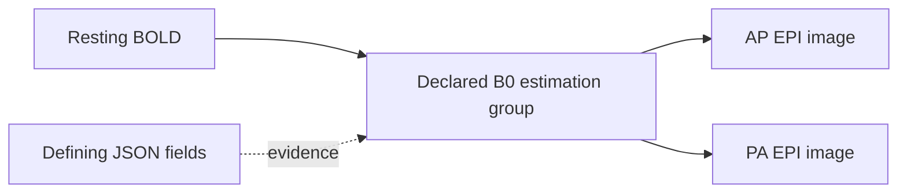

# Scientific core: explicit relationships and reproducible meaning

The immediate engineering priority is scientific interpretation: metadata, acquisition relationships, coherent selections, and the evidence needed to trust an analysis input.

An accepted release binds three scientific facts together: exact authored content, its recorded interpretation, and the assessment under which that interpretation was accepted. A correction produces another state. Historical meaning stays fixed.

## Implemented slice: explicit MRI relationships

The reusable semantics live in [bids4s' portable resolver](../../bids4s/modules/core/shared/src/main/scala/bids4s/BidsFieldmaps.scala). Sanctity records the result in its [relationship model](../modules/kernel/src/main/scala/sanctity/kernel/Relationships.scala) and [BIDS interpreter](../modules/bids/src/main/scala/sanctity/bids/BidsInterpreter.scala).

This slice resolves declarations on NIfTI images:

- `B0FieldIdentifier` names an estimation group within one participant's dataset tree.
- `B0FieldSource` connects an acquisition to every image in each named group.
- `IntendedFor` connects its named target to the image carrying the declaration.
- Each relationship retains the defining image, source JSON document and field.
- Self-reference is permitted. Several group members are represented together; multiple declared groups remain separate.
- Identical identifiers in different participants or independent datasets remain separate.
- Current-dataset BIDS URIs and deprecated participant-relative paths are supported. Legacy paths produce a finding.
- Missing identifiers/targets, malformed declarations, unsafe paths, dataset-boundary violations, unsupported targets and unpinned external datasets produce blocking findings for new acceptance.

The scientific basis is the explicit declaration rules in the [BIDS MRI specification](https://bids-specification.readthedocs.io/en/stable/modality-specific-files/magnetic-resonance-imaging-data.html#expressing-the-mr-protocol-intent-for-fieldmaps), inspected at version 1.11.2. B0 identifiers are scoped to the participant tree, which may contain multiple sessions. `IntendedFor` remains an explicit relationship kind; its presence alone does not establish that an image is a usable distortion-correction fieldmap.

Both declaration mechanisms can coexist. Their evidence is retained independently; the resolver does not silently choose precedence or select an analysis algorithm.

## The kernel contract

`ScientificRelationship` records a target artifact, a versioned interpretation's relationship kind, a vector of associated source artifacts, an optional group label, and field-origin evidence.

`RelationshipGraph.from` checks membership and evidence against the interpreted artifacts, rejects empty/dangling/duplicate groups, and orders the result canonically. Interpretation identity includes the graph and its resolver version. Shuffling inventory, group members or evidence does not change that identity.

The graph remains scientific state. It confers no access authority, and provenance does not select an execution policy.

`Interpretation.relationshipClosure(roots)` computes the transitive closure under the **recorded relationship vocabulary**, preserving groups and collecting the applicable authored metadata documents. It terminates on valid self-links and cycles.

For example, an acquisition naming a two-image estimation group yields:

This is an explainable set of declared associated inputs. It is not yet a complete fMRIPrep input bundle or a BIDS subset export. Implicit magnitude/phase companions, gradients, events, tables, reference rewriting and tool-specific requirements need their own rules.

The bounded resolver accepts at most 1024 values per declaration field, 4096 characters per value, 100000 total declaration references and 100000 expanded source members. A budget failure is a blocking finding. The repository already bounds inventory and metadata bytes independently.

## Correction and historical behavior

A useful demonstration now runs in both reference and PostgreSQL lifecycle tests:

1. Accept a BOLD acquisition that names one fieldmap group containing one image.
2. Correct another fieldmap image's identifier so it joins that group.
3. Preview the affected BOLD relationship even though the BOLD file and its own effective metadata are unchanged.
4. Accept the correction.
5. Retrieve the earlier and later releases: the earlier graph still has one source, the later graph has two.
6. Export and verify that all image bytes remain unchanged.

Correction previews now contain `relationshipChanges` alongside content and metadata changes. Public release inspection includes the recorded graph; stored interpretation decoding revalidates its identity.

New interpretations use the v3 canonical identity format and `native-reference-v2` semantic profile. Historical v1/v2 interpretations decode with their original identities. A missing graph means **not assessed under this relationship profile**, rather than a claim that no relationships exist. Historical releases remain readable and exportable as recorded.

The subset compiler is now `sanctity-mri-view-v2`. It requires recorded relationship coverage and rejects selected targets whose associated inputs need a fuller closure/rewrite profile. This fixes a concrete earlier gap: an `IntendedFor` fieldmap from a different session could escape the old same-session companion check and be omitted from a subset. That case has a shared lifecycle regression.

The new graph is stored in the canonical interpretation payload. No SQL relationship-query index is claimed yet.

## Scientific work that follows

| Order | Slice | Acceptance proof |
| --- | --- | --- |
| 1 | Explicit association groups and origin evidence — implemented | Cross-session dependencies, participant/dataset scope, correction impact and immutable history |
| 2 | DWI gradients and task-event companion resolution | Deterministic inheritance/applicability, grouped companions, explicit absence/ambiguity; no arbitrary nearest-file selection |
| 3 | Image/table consistency | Gradient counts versus NIfTI volumes, finite values and orientation conventions; event timing/table rules against a declared profile |
| 4 | Complete scientific subset profiles | Required files, metadata, tables and rewritten references survive export and re-import with equivalent interpretation |
| 5 | General scientific change preparation | Rename/removal impact, reference repair proposals, before/after dependency scope and conflict handling |

Alongside these slices, the semantic layer needs a consistent explicit schema/registry context and broader independent conformance fixtures. Every new profile must name its coverage and preserve older interpretations.

Institutional login and additional service features remain outside this immediate scientific workstream.

## Qualification boundary

These checks establish declaration semantics, evidence, bounded closure and repository consistency. They do not establish image registration, fieldmap geometry compatibility, phase-encoding correctness, a complete BIDS validation result, anonymization, or clinical/scanner qualification. The tests use synthetic data.

Reproduce with `sbt compileAll testAll 'docs/mdoc'` in `../bids4s`, and `scripts/check-postgres.sh` in Sanctity. The latter checks both catalog implementations, stored history, acceptance/rejection, materialization, and recovery.
