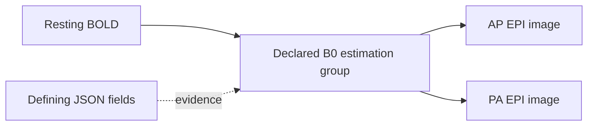

# Scientific core: reproducible interpretation, curation and processing

The immediate engineering priority is scientific interpretation: metadata, acquisition relationships, coherent selections, and the evidence needed to trust an analysis input.

An accepted release binds three scientific facts together: exact authored content, its recorded interpretation, and the assessment under which that interpretation was accepted. A correction produces another state. Historical meaning stays fixed.

## Implemented slice: explicit MRI relationships

The reusable semantics live in [bids4s' portable resolver](../../bids4s/modules/core/shared/src/main/scala/bids4s/BidsFieldmaps.scala). Sanctity records the result in its [relationship model](../modules/kernel/src/main/scala/sanctity/kernel/Relationships.scala) and [BIDS interpreter](../modules/bids/src/main/scala/sanctity/bids/BidsInterpreter.scala).

This slice resolves declarations on NIfTI images:

- `B0FieldIdentifier` names an estimation group within one participant's dataset tree.
- `B0FieldSource` connects an acquisition to every image in each named group.
- `IntendedFor` connects its named target to the image carrying the declaration.
- Each relationship retains the defining image, source JSON document and field.
- Self-reference is permitted. Several group members are represented together; multiple declared groups remain separate.
- Identical identifiers in different participants or independent datasets remain separate.
- Current-dataset BIDS URIs and deprecated participant-relative paths are supported. Legacy paths produce a finding.
- Missing identifiers/targets, malformed declarations, unsafe paths, dataset-boundary violations, unsupported targets and unpinned external datasets produce blocking findings for new acceptance.

The scientific basis is the explicit declaration rules in the [BIDS MRI specification](https://bids-specification.readthedocs.io/en/stable/modality-specific-files/magnetic-resonance-imaging-data.html#expressing-the-mr-protocol-intent-for-fieldmaps), inspected at version 1.11.2. B0 identifiers are scoped to the participant tree, which may contain multiple sessions. `IntendedFor` remains an explicit relationship kind; its presence alone does not establish that an image is a usable distortion-correction fieldmap.

Both declaration mechanisms can coexist. Their evidence is retained independently; the resolver does not silently choose precedence or select an analysis algorithm.

## The kernel contract

`ScientificRelationship` records a target artifact, a versioned interpretation's relationship kind, a vector of associated source artifacts, an optional group label, and field-origin evidence.

`RelationshipGraph.from` checks membership and evidence against the interpreted artifacts, rejects empty/dangling/duplicate groups, and orders the result canonically. Interpretation identity includes the graph and its resolver version. Shuffling inventory, group members or evidence does not change that identity.

The graph remains scientific state. It confers no access authority, and provenance does not select an execution policy.

`Interpretation.relationshipClosure(roots)` computes the transitive closure under the **recorded relationship vocabulary**, preserving groups and collecting the applicable authored metadata documents. It terminates on valid self-links and cycles.

For example, an acquisition naming a two-image estimation group yields:



This is an explainable set of declared associated inputs. It is not yet a complete fMRIPrep input bundle or a BIDS subset export. The companion slice below adds gradients and events. Implicit magnitude/phase companions, stimulus files, table transformations, reference rewriting and tool-specific requirements need further rules.

The bounded resolver accepts at most 1024 values per declaration field, 4096 characters per value, 100000 total declaration references and 100000 expanded source members. A budget failure is a blocking finding. The repository already bounds inventory and metadata bytes independently.

## Correction and historical behavior

A useful demonstration now runs in both reference and PostgreSQL lifecycle tests:

1. Accept a BOLD acquisition that names one fieldmap group containing one image.
2. Correct another fieldmap image's identifier so it joins that group.
3. Preview the affected BOLD relationship even though the BOLD file and its own effective metadata are unchanged.
4. Accept the correction.
5. Retrieve the earlier and later releases: the earlier graph still has one source, the later graph has two.
6. Export and verify that all image bytes remain unchanged.

Correction previews now contain `relationshipChanges` alongside content and metadata changes. Public release inspection includes the recorded graph; stored interpretation decoding revalidates its identity.

The first relationship slice introduced the v3 canonical identity format and `native-reference-v2` semantic profile. Historical v1/v2 interpretations decode with their original identities. A missing graph means **not assessed under this relationship profile**, rather than a claim that no relationships exist. Historical releases remain readable and exportable as recorded.

That slice introduced subset compiler `sanctity-mri-view-v2`. It requires recorded relationship coverage and rejects selected targets whose associated inputs need a fuller closure/rewrite profile. This fixes a concrete earlier gap: an `IntendedFor` fieldmap from a different session could escape the old same-session companion check and be omitted from a subset. That case has a shared lifecycle regression.

The new graph is stored in the canonical interpretation payload. No SQL relationship-query index is claimed yet.


## Implemented slice: inherited DWI and event companions

The portable [companion resolver](../../bids4s/modules/core/shared/src/main/scala/bids4s/BidsCompanions.scala) adds a second kind of relationship evidence. JSON declarations retain `MetadataField` evidence. `CompanionSelection` records the selected document, versioned rule, dataset root, matched filename entities and applicable candidate hierarchy.

The resolver supports NIfTI DWI `bval`/`bvec` files and NIfTI BOLD `events.tsv` files. It selects the lowest applicable file without merging contents. Multiple applicable files at any one directory level are ambiguous, even if a lower override exists. Nested datasets and declared derivative roots bound the search; unrelated participants, sessions and sibling directories cannot donate files. Numeric run indices follow bids4s equivalence; participant labels remain lexical. A run's event table can apply to all its echoes.

The source rules are [BIDS inheritance](https://bids-specification.readthedocs.io/en/v1.11.2/common-principles.html#the-inheritance-principle), [DWI gradients](https://bids-specification.readthedocs.io/en/v1.11.2/modality-specific-files/magnetic-resonance-imaging-data.html#required-gradient-orientation-information) and [events](https://bids-specification.readthedocs.io/en/v1.11.2/modality-agnostic-files/events.html). The library distinguishes selected, missing, ambiguous, unsupported and over-budget outcomes. Its default budget is 10,000 examined candidates per resolution.

Sanctity requires both gradient files before recording one `bids.dwi-gradients` group. Missing gradients and ambiguous companion selection block acceptance. Missing non-rest BOLD events produce a warning in this bounded profile; absent rest events do not. This admission policy does not assert full BIDS conformance.

`NativeRepository.correctCompanion` adds or replaces a bounded UTF-8 gradient/event document through the ordinary draft, preparation and acceptance flow. It retains an existing artifact's identity. The HTTP correction endpoint continues to edit JSON; this new application capability has no separate HTTP write route yet.

Correction previews identify changed selections and direct selected dependency bytes via `changedDependencies`. They do not claim transitive content-impact analysis for every relationship. Adding a local table affects its applicable acquisition while other participants keep their inherited table. Editing an existing selected table affects its consumers even when the graph's paths remain equal.

Closure contains selected companions and their applicable JSON documents. Overridden candidate tables remain evidence, and are not included as processing inputs. At that stage event content was unassessed. The event slice below adds it; stimulus-file references, implicit fieldmap companions and complete processing-bundle closure remain open.

The companion slice introduced semantic profile `native-reference-v3` and admission policy `reference-admission-v3`. Relationship evidence encoding 2 produces canonical interpretation v4. Historical v1/v2/v3 interpretation identities remain intact; a fixed v3 digest and legacy envelopes test compatibility. The combined relationship-profile identity names both resolver versions. That subset-planning version (`sanctity-mri-view-v3`) required this coverage and refused omitted event/gradient dependencies. The v4 compiler below materializes the supported closure.

Five new lifecycle cases run against both catalogs: local inherited-event replacement with exact exports and immutable history; selected-table byte correction; ambiguous event admission; complete/missing DWI gradient groups; and blocking a subset that would omit root-level events. Kernel and persistence cases cover evidence scope, identity, legacy decoding and tamper rejection.

## Implemented slice: DWI content consistency

The portable [gradient parser and policy](../../bids4s/modules/core/shared/src/main/scala/bids4s/DwiConsistency.scala) and [NIfTI header facts](../../bids4s/modules/core/shared/src/main/scala/bids4s/NiftiHeaderFacts.scala) are pure, checked APIs. Sanctity's [content-check adapter](../modules/bids/src/main/scala/sanctity/bids/DwiContentChecks.scala) supplies bounded reads over the selected, managed gradient and image files.

The named profile checks:

- One row of nonnegative finite b-values and three equally sized rows of finite vector components. Decimal/scientific notation, spaces, tabs and CRLF are supported. Malformed numbers, overflow, nonzero underflow, ragged/transposed tables and unsupported sizes become findings; no normalization or repair occurs.
- Single-file NIfTI-1 and NIfTI-2 headers in either byte order: signature, positive dimensions, supported scalar datatype/bit depth, integral voxel offset and overflow-safe minimum byte size. Uncompressed files must be at least that size.
- Three-dimensional images have one volume; four-dimensional images use the fourth dimension. Other ranks are outside this DWI profile. Both gradient counts must equal the image volume count.
- Vector norm must be within 0.01 of one. For b-values at most 50 s/mm², a vector norm at most 1e-6 is also allowed. These are explicit `bids-dwi-consistency-v1` policy choices, not numerical constants mandated by BIDS. Components retain the FSL image-axis convention; no reorientation is performed.

Reading is bounded: 4 MiB per gradient document, 32 MiB of distinct selected documents per preparation, 100,000 gradient columns and 64 numeric diagnostics per parser. Each uncompressed image contributes at most 540 bytes to header inspection. Gzip inspection reads at most 64 KiB of compressed input and decompresses only the header; an overlong gzip header produces a limit finding. Shared gradient documents are read once per preparation, then checked against each acquisition independently. Storage errors remain operational failures; cancellation releases read resources.

The generic kernel `ContentCheck` binds a named rule, target, exact input paths/digests/sizes, observed facts and findings. The same contract supports event/table checks without putting MRI concepts into the kernel. Observations do not overwrite authored metadata or become inferred query facts. The assessment includes all check findings automatically, and admission verifies every recorded input against the candidate manifest.

Checks participate in canonical assessment v2 identity and persist with the assessment. Historical assessments without checks retain v1 identities and decode without the new field. Public candidate/release assessments expose `checks`. No database migration or additional acceptance pathway is needed.

The DWI slice introduced semantic/admission profiles `native-reference-v4` and `reference-admission-v4`. The check rule also records `nifti-scalar-header-v1` and `sanctity-prefix-v1`; source fingerprints bind the implementations. Interpretation encoding stays v4.

The shared lifecycle proof accepts valid DWI, rejects an extra gradient without advancing the head, accepts a corrected b-value, and retrieves/exports both historical states with unchanged image bytes. Further cases cover malformed/nonunit vectors, big-endian NIfTI-2 gzip, short images, and one inherited gradient pair applied to acquisitions with different volume counts.

These are header and gradient consistency checks. They do not verify affine orientation against anatomy, gradient ordering against acquisition evidence, phase encoding, voxel contents, compressed payload completeness/CRC, full BIDS conformance or scanner qualification. Full managed-blob digest verification still runs at acceptance; it establishes the identity of stored bytes, not scientific correctness of their contents.

## Implemented slice: task-event content and timing

Selected BOLD event tables now use bids4s' `CheckedEvents` and `EventTiming` APIs through [EventContentChecks](../modules/bids/src/main/scala/sanctity/bids/EventContentChecks.scala). The kernel, persistence encoding and acceptance protocol are unchanged. Each result is an ordinary `ContentCheck` within assessment v2.

The strict event profile validates TSV structure, required column order, exact decimal onset/duration and optional response time, explicit missing values, and nonnegative durations. Quoted tabs/newlines, Unicode, legal negative onsets, overlap and zero-duration events are supported. Custom columns and authored bytes remain intact. Unsorted onsets warn. The permissive bids4s readers retain their previous behavior.

Acquisition context is explicit:

| Context | Comparison window | Admission behavior |
| --- | --- | --- |
| Regular `RepetitionTime` | Nominal stored volume count × TR | Exceedance warns; it is not a measured physical scan end |
| `VolumeTiming` and `FrameAcquisitionDuration` | Last relative volume onset + frame duration | Counts and supplied values must agree; exceedance warns |
| `VolumeTiming` and only `SliceTiming` | Final end unavailable | Preserve variable starts and warn; no median-TR or last-interval extrapolation |
| Timing absent | Unavailable | Warn explicitly; malformed event content still blocks |
| Invalid/conflicting timing or volume-count mismatch | Unavailable | Block acceptance |

All comparisons use the first stored volume as the event origin. Discarded-volume counts do not alter onsets. Variable volume starts are normalized by the first supplied start, with that origin recorded in the receipt.

Each check binds the exact table, image, and applicable image/event metadata documents, including inherited and overridden sources. Facts include row/missing-value counts, columns, timing mode, volume count, comparison end when known, its derivation, and effective timing fields with their origins. Timing edits therefore produce fresh checking evidence even when image and event bytes are unchanged. Missing context and absent event cells are never converted to zero.

Tables are read and parsed once per distinct selected path. Limits are 4 MiB per table, 32 MiB selected tables per preparation, 100,000 rows, 256 columns and 64 findings per portable assessment/comparison. Event numeric tokens are at most 128 characters/128 significant digits with absolute decimal scale at most 308; arithmetic preserves exact accepted decimal values. Each receipt permits at most 98 supporting metadata documents plus the image and table. Invalid UTF-8 becomes a content finding; storage failures remain operational failures, and cancellation releases resources. Event and DWI checks share the same bounded NIfTI prefix reader; no voxel array is loaded.

The event slice introduced `native-reference-v5` and `reference-admission-v5`. Event rule identities include `bids-events-content-v1`, `bids-events-timing-v1`, `nifti-scalar-header-v1` and `sanctity-prefix-v1`, with implementation source fingerprints in the interpretation. Earlier releases retain their original assessments and profile coverage.

Six shared lifecycle cases exercise invalid-duration rejection with an unchanged head; corrected labels and exact historical exports; metadata corrections that change one acquisition's timing context; nonuniform timing and count rejection; missing context; unknown final frame duration; and gzip NIfTI-2 with quoted TSV. Adapter cases check shared-table reads, bounds, encoding, operational failures and cancellation.

Coverage is selected NIfTI BOLD event content and contextual timing. It does not resolve stimulus files, validate HED or arbitrary column dictionaries, qualify other recording modalities, compare TR against NIfTI time units, or certify task/scanner synchronization. Both the [BIDS event rules](https://bids-specification.readthedocs.io/en/stable/modality-agnostic-files/events.html) and [MRI timing definitions](https://bids-specification.readthedocs.io/en/stable/modality-specific-files/magnetic-resonance-imaging-data.html#required-fields) informed the profile; warnings about the comparison window are an explicit repository policy.

## Implemented slice: coherent MRI subsets

The [MRI view compiler](../modules/bids/src/main/scala/sanctity/bids/MriViewCompiler.scala) now implements `sanctity-mri-view-v4`: T1w/T2w, single-echo BOLD and DWI roots, resolved event/gradient companions, and explicit EPI fieldmap groups. The subset is still an ordinary assessed release in a separate dataset. No alternative admission path or database migration is introduced.

Planning has two pure stages around bounded effectful reads. `documents` identifies the required source TSVs and dataset description. `plan` consumes those documents and the pinned interpretation, producing retained/generated files, transformation steps and per-source dispositions (`selected`, `dependency`, `transformation-input`, `excluded`). The application verifies document sizes, digests and UTF-8, rechecks source access at each read chunk, and releases streams on cancellation. A direct planner caller must supply documents from the exact source release; `ScientificViews.prepare` enforces this boundary.

The compiler:

- Follows the recorded relationship graph and preserves explicit EPI groups, including calibration sessions. It cannot add an unselected primary acquisition or a participant outside the selected scope. Query hits for companions/summary tables are accepted only when covered by those selected acquisitions; a DWI suffix query can therefore include its local gradients without promoting them to acquisition roots.
- Keeps image bytes and paths. It localizes inherited events and gradients beside each acquisition. Unchanged tables and gradients reuse exact blobs; multiple localized copies have distinct artifact identities and recorded source mappings.
- Flattens approved effective image metadata into local sidecars. Required task/timing and fieldmap/reference fields must be authorized. Variable timing is preserved without inventing TR or final frame duration.
- Retains only `IntendedFor` targets present in the subset, writing current-dataset BIDS URIs. It preserves used B0 groups and removes unused identifiers. It never pulls excluded targets into the result to avoid rewriting a reference.
- Filters event columns through an explicit mask, preserving retained lexical values, row order and explicit missingness. Quoted TSV parsing/rendering is reusable in bids4s as `CheckedTsv`. Full retained event tables preserve original bytes; transformed tables use deterministic LF/quoting.
- Filters participant/session/scan rows and approved columns. Present session/scan tables must contain the selected keys without duplicates; scan filenames must be safe relative paths. Optional absent tables are not invented, except for a minimal participant listing. Retained participant values must agree with the source query interpretation; a quoted value interpreted differently by the older native participant reader blocks subsetting pending reinterpretation. Included calibration sessions receive their applicable summary rows.
- Projects column dictionaries for retained fields. Column authorization includes that column's definition; this is not nested dictionary-field redaction or dictionary semantic validation. Excluded dictionaries and arbitrary root documentation are not copied.
- Generates a neutral dataset description, preserving the declared BIDS version. A present source license must be explicitly retained by the metadata mask.

`DisclosureProfile` adds optional `eventFields` and sets of `sessionFields`/`scanFields`. Event access is absent by default; an authorized event mask must include onset and duration. The original two-field profile keeps its v1 identity when all new settings are absent. Profiles using the new settings have v2 identity.

The generic [projection receipt](../modules/kernel/src/main/scala/sanctity/kernel/Projection.scala) binds the source release/selection/profile/compiler specification, source content and interpretation, exact output manifest, and every output's operation plus contributing source paths/digests/sizes. Its factory checks source/output membership and exact copy claims. Admission verifies the specification and output binding. Persistence verifies canonical identity; old projection records without receipts remain readable without inventing evidence. These internal provenance records are separate from exported BIDS files; there is no new remote provenance or view API in this slice.

Bounds: 4 MiB per read or generated document, 32 MiB total in each direction, at most 10,000 output files (also subject to the repository's entry limit), 256 contributing inputs per output and 100,000 total input references. Shared event sources are read, parsed and rendered once per preparation. The planner stops accumulating generated documents at the budget, including when many acquisitions use one inherited table.

Twelve shared lifecycle cases cover MRI export/re-import; exact shared companion copies; rejected masks; stimulus refusal; summary key/path failures and plan explanations; hidden-column/source-release isolation; variable timing; shared reads/cancellation; oversized input rejection before reads; explicit rejection of EPI gradients; participant-parser disagreement; and ordinary DWI suffix selections containing local gradients. Four kernel cases cover receipt identity, membership/copy laws, admission and profile compatibility. Two codec cases cover receipt tampering and historical projections. Five portable TSV cases cover strict syntax, lexical projection and limits.

Round-trip equivalence compares supported metadata, relationships and content-check observations after accounting for permitted field removal and localized companion paths. Re-import creates new repository identities; equality of interpretation hashes across independent imports is not claimed. The tests verify that generated metadata origins are local and that later source corrections cannot change an accepted subset's receipt or bytes.

Unsupported cases remain explicit: multi-echo/file collections, SBRef/physiology, stimulus references, event HED (including nested event dictionaries), EPI gradients, external/nested datasets, arbitrary dictionary semantics and pipeline-specific requirements. The profile does not establish full BIDS conformance, fMRIPrep readiness, fieldmap geometry suitability or anonymization. The [summary-table rules](https://bids-specification.readthedocs.io/en/v1.11.2/modality-agnostic-files/data-summary-files.html), [event/stimulus rules](https://bids-specification.readthedocs.io/en/v1.11.2/modality-agnostic-files/events.html), and [fieldmap declarations](https://bids-specification.readthedocs.io/en/v1.11.2/modality-specific-files/magnetic-resonance-imaging-data.html#expressing-the-mr-protocol-intent-for-fieldmaps) define the scientific context; the coverage and budgets above are this implementation's explicit limits.

## Implemented slice: scientific file changes

[`FileEdits`](../modules/kernel/src/main/scala/sanctity/kernel/FileEdits.scala) adds a pure, bounded structural operation over one base manifest. Moves and removals are simultaneous: swapping two filenames requires no temporary path and produces the same result regardless of request ordering. A source can appear only once. Occupied destinations, duplicate outputs, directory/file conflicts, and case/Unicode collisions fail explicitly. Moves preserve artifact identity and exact blobs. Required parent directories are added; explicitly inventoried empty directories remain. Both the input and output inventories are limited to 10,000 entries.

[`ScientificChanges`](../modules/application/src/main/scala/sanctity/application/ScientificChanges.scala) separates inspection from preparation:

1. `plan(context, release, edits)` reads a pinned source and returns structural changes, proposed document repairs, and the exact prospective manifest. It performs no writes.
2. The caller inspects each repair's original file reference, replacement text, output path and rule, then supplies that plan's digest to `prepare` with a reason. Preparation recomputes the plan and rejects a mismatched digest or stale head before writing repair bytes.
3. The resulting ordinary draft is interpreted and assessed through `NativeRepository.prepare`. The preview contains file deltas, metadata origins/values, relationship changes, and before/after reverse dependency scope.
4. Ordinary atomic acceptance checks current authority, head, generation, content assessments and evidence binding. Blocking findings, including missing required DWI gradients or an unresolved declared B0 group, prevent head advancement. Existing warning-level policies, such as absent non-rest events, remain explicit assessment findings.

The new generic `DependencyImpact` walks reverse metadata and scientific relationship edges independently in the old and new interpretations. It includes transitive consumers and terminates on cycles. It catches newly applicable metadata as well as removed applicability. This is a conservative dependency scope: an artifact may depend on a changed document while retaining an unchanged effective value through an override. Field deltas explain that distinction.

The [`BidsChangeCompiler`](../modules/bids/src/main/scala/sanctity/bids/BidsChangeCompiler.scala) implements `sanctity-bids-file-edits-v1` with both library and repository source fingerprints. It supports the current raw MRI relationship profile: T1w/T2w, BOLD, DWI, EPI, JSON sidecars, events and gradients. Image renames retain participant/session placement, scientific suffix and format. Sidecar/companion relocation is explicit and reassessed; the compiler never guesses which companion should follow an image.

Repairs have two supported rules:

- `bids.intended-for.v1` follows moved target identities and removes explicitly removed targets. Changed declarations use current-dataset BIDS URIs; an empty declaration is removed. Legacy participant-relative references require unambiguous source scope. A moved legacy document is rewritten so its old relative reference cannot silently acquire a new meaning.
- `bids.scans-filename.v1` rewrites moved recording paths and removes deleted rows. It preserves column order, row order, retained lexical cell values and explicit missingness through bids4s `CheckedTsv`; quoted multiline cells survive. Duplicate, unsafe and absent source filenames are rejected. Cross-table row migration is unsupported.

`B0FieldSource` and `B0FieldIdentifier` are left authored. Removing a provider is reassessed against the complete remaining group; the compiler does not erase a scientific dependency to make validation pass. Participant/session summaries are retained, and structural relabeling of participants or sessions requires a later profile. Known unsupported reference vocabularies (`Sources`, `RawSources`, `AssociatedEmptyRoom`, `M0Scan`, `DatasetLinks`), external/nested datasets and direct edits to dataset/summary structure fail explicitly. Arbitrary strings in accessory documents are not treated as understood references. This profile does not establish full BIDS conformance or automatically migrate every modality's references.

Each repair retains the authored document's artifact identity. Unchanged documents and all image payloads reuse their exact blobs. A versioned UTF-8 receipt records the source release/content/interpretation, compiler, requested operations, repair input/output digests and sizes, prospective manifest and plan identity. It is retained through the existing activity-evidence mechanism. `ChangeEvidence` binds that receipt to the exact base and output at preparation and acceptance. Revising a draft cannot carry the earlier binding over to another manifest. Historical activities lacking the new optional field remain readable; new scientific-change activities require it. No database schema migration or second acceptance path is introduced.

Reads are verified against the source manifest and current content authority at each 64 KiB chunk. Limits are 4 MiB per source or generated document, 32 MiB total in each direction, and 4 MiB for the receipt. Reasons are required and limited to 4,096 characters. These are in-process application operations; the existing HTTP interface does not yet expose a file-change planner.

The shared lifecycle proof covers reference/scan repair, image and document lineage, exact historical export and re-import, removal accounting, missing B0 and DWI dependency rejection, old/new inheritance scope, plan/head conflicts, revocation, stale draft evidence and bounded verified reads. Kernel laws cover simultaneous swaps, collisions, parent inventory and transitive/cyclic impact; persistence tests cover receipt binding and compatibility. The [BIDS scans table](https://bids-specification.readthedocs.io/en/v1.11.2/modality-agnostic-files/data-summary-files.html#scans-file) and existing bids4s fieldmap resolver supply the reference semantics; the supported repair vocabulary remains an explicit repository profile.

## Implemented slice: explicit semantic context and profile evolution

A checked portable `BidsContext` carries the ordered registry, target specification
version (when claimed), coverage statement and named rule versions. Parsing,
manifest file roles, queries, metadata origins, companion selection and explicit
fieldmaps use that context. Sync/effect loaders retain their default behavior and
accept an explicit context. Custom compound extensions use the same path.

Sanctity records a `SemanticContext` descriptor, registry digest and context
digest in profile `native-reference-v6`; interpreter/library source fingerprints
remain part of identity. The authored `dataset_description.json` BIDSVersion is
recorded separately on `Interpretation`. The selected target version is not a
claim that the registry implements the complete official schema. Default coverage
remains explicitly partial and has no target specification version.

Interpretation encoding v5 binds the new evidence. Historical v1–v4 records keep
their old digest calculation and decode without synthetic context fields. Reads
and queries use stored interpretation facts. They never reinterpret old releases.

`NativeRepository.reinterpret(ctx, base, reason)` proposes unchanged content under
the configured interpreter. It goes through ordinary preparation, assessment and
atomic acceptance. It writes no new file blobs. Both catalogs check the immutable base content during preparation and acceptance, so a revised draft cannot disguise a content change as reinterpretation. A changed registry can make a
previously preserved suffix queryable in a new release while old selections,
metadata, assessments and exports retain their exact meaning. Current permission,
retry and stale-head checks still apply. This is an application API; a profile
administration UI/HTTP endpoint is not introduced in this slice.

Curation and projection preparation refuse implicit profile changes. BIDS edit
and MRI view compilers check the recorded source context; compiler identities
include the context digest. Adopting a new implementation/context must precede
those transformations. The rule applies to legacy records with absent context
as well: they remain readable/exportable and can be explicitly reinterpreted.

Three shared lifecycle cases exercise these laws against both catalogs, with
kernel framing/bounds tests, legacy/tamper codec coverage and upstream portable
context/loader checks. The [independent conformance corpus](../modules/app/src/test/resources/conformance/README.md)
contains pinned ds001/ds114 examples, reviewed inheritance/companion expectations,
and three negative metadata mutations. Official validator 3.0.2 with pinned BIDS
1.11.1 schema bytes agrees on the five error outcomes under documented empty-image
exclusions. This is bounded conformance evidence; an official validation result
is not automatically attached to each repository release.

## Implemented slice: independent MRI evidence and phase-difference families

The `native-reference-v7` / `reference-admission-v7` profile introduced bounded
MRI header assessments and a phasediff dependency family. Scientific state uses
the existing interpretation, ContentCheck, relationship and acceptance records;
there is no new kernel concept or database migration. Rule identities and source
fingerprints distinguish the new profile, and historical releases remain attached
to their original interpretation and assessments. Existing releases use explicit
reinterpretation before adopting the expanded compiler context.

### Header observations and checks

Portable `NiftiHeaderFacts` v2 reads both NIfTI versions and byte orders. It retains
spatial/time unit codes, pixel dimensions, coded qform/sform parameters and their
availability, without choosing a preferred affine or assuming orientation.
`MriHeaderConsistency` checks T1w/T2w, BOLD, DWI, EPI, phasediff and magnitude1/2.
The repository includes these observations and exact image/metadata inputs in a
versioned ContentCheck. Nonfinite unused fields remain explicit text observations;
coded nonfinite transforms produce errors rather than encoding failures.

Invalid spatial sizes, unsupported image ranks, negative transform codes,
malformed coded quaternions and singular/nonfinite coded sforms block acceptance.
Static images allow three dimensions or a singleton fourth dimension. Missing
units/transforms warn. Coded qform and sform may describe different spaces; neither
is silently preferred and their difference alone is not treated as corruption.

Regular BOLD TR comparison uses declared seconds/milliseconds/microseconds with
max(1 microsecond, 1e-5 × TR) tolerance. A discrepancy warns, preserving the ability
to record an explicit authored correction without rewriting an image. This differs
from the pinned official validator, which reports a conformance error. Missing
or singleton time axes are unavailable for comparison. Variable VolumeTiming
never acquires uniform spacing from pixdim. No observed header fact overwrites
an authored metadata field or enters the scientific query index implicitly.

Each preparation reads an image header once and shares its parsed result across
MRI, DWI and event checks. Prefix budgets remain 540 uncompressed header bytes or
64 KiB compressed input; complete payload/CRC checks are outside this reader.
Each header receipt allows 99 metadata inputs plus the image. Operational read
failures remain operational failures, and cancellation closes the stream.

### Phase-difference closure and curation

`BidsPhaseDifferenceResolver` matches one phasediff with required magnitude1 and
optional magnitude2 in the same directory and with matching sub/ses/acq/run
entities. Numeric run padding is equivalent; subject/session labels remain
lexical. Duplicate compressed/uncompressed members are ambiguous. Missing
metadata, mismatched dataset context, invalid placement and nonpositive/reversed
echo times produce explicit errors. Matching is indexed and capped at 10,000
phase/magnitude images; it does not infer consumers or phase1/phase2 families.

The `bids.phasediff-magnitudes` relationship binds each companion through the
existing versioned selection evidence. Explicit B0/IntendedFor relationships
connect consumers to the phase image; ordinary transitive closure includes the
magnitude companions even in another calibration session. This establishes
structural dependency, not fieldmap geometry suitability or registration.

The v6 MRI subset compiler retains the complete recorded family, preserves
EchoTime1/EchoTime2 and any present EchoTime, and uses the existing reference
rewrites, exact byte copies and transformation receipts. Required echo fields
cannot be removed by disclosure masks. Unselected targets remain excluded.
File-edit compiler v2 admits phase/magnitude moves and removals through the
existing inspected-plan path. A rename does not infer companion moves; incomplete
families fail reassessment. Required companion removal cannot advance the head.

### Independent evidence

The [MRI corpus](../modules/app/src/test/resources/mri-conformance/README.md)
retains six real images with MIT/CC0 notices and complete source digests, plus
OpenNeuro's original fieldmap metadata and scoped functional inventory. NiBabel
5.3.2 independently supplies header observations. The original phase family and
nine declared targets are tested directly; cross-session and negative cases are
labeled mutations. Existing ds001/ds114 coverage of inherited companions remains.

The official comparison enables header checks and ignores no issues. Complete
and optional-magnitude cases pass; the recorded negative signatures expose
both agreement and differences from local admission policy. Passing those cases
does not certify every rule or the scientific usability of these assembled inputs.

Shared lifecycle tests exercise import, inspection, echo correction, ordinary
acceptance, disclosure, export/re-import, immutable image bytes, exact receipts,
optional/required members, ambiguity, malformed headers and historical evidence.
They run against the reference and PostgreSQL catalogs. Resource tests exercise
bounded large-image reads, shared header reuse, nonfinite observations, operational
errors and cancellation.

## Implemented slice: processing inputs and derivative return

The first scientific processing loop uses ordinary accepted views and ordinary
output drafts. Its contracts are in [Processing.scala](../modules/kernel/src/main/scala/sanctity/kernel/Processing.scala),
[ProcessingInputs](../modules/application/src/main/scala/sanctity/application/ProcessingInputs.scala)
and [DerivativeSubmissions](../modules/application/src/main/scala/sanctity/application/DerivativeSubmissions.scala).
There is no second publication transaction or mutable pipeline dataset.

### Versioned input requirements

`sanctity.mri-header-qc` version `1` evaluates 1–100 selected artifacts from one
pinned release. Each requirement records its target, evidence paths, explanation
and status: satisfied, missing, ambiguous, unsupported or disallowed. The report
binds the exact manifest, interpretation, assessment, contract and selection roots.

The profile supports single-echo, regularly sampled BOLD and explicitly selected
T1w images. Each BOLD must have TaskName, a positive authored RepetitionTime and
an observed four-dimensional, multi-volume header with known, agreeing timing.
The repository's warning about authored/header disagreement therefore blocks this
recipe without changing the repository's raw-data admission policy.

The contract accepts these optional parameters; omitted values use the defaults:

| Parameter | Default | Other supported value |
| --- | --- | --- |
| `anatomy` | `none` | `same-session`: exactly one selected T1w from the same participant and session |
| `events` | `optional` | `required`: one explicit selected event relationship |
| `fieldmaps` | `optional` | `required`: one explicit calibration group |

Several members can form one calibration group. Distinct competing groups remain
ambiguous for this profile; it never selects by proximity. Required anatomy is
not silently added from another participant or session. Group presence does not
prove geometric compatibility or establish a preprocessing recipe.

### Frozen bundles

`ProcessingInputs.prepare` first checks the source selection, then uses the MRI
view compiler and checks the actual emitted interpretation. A metadata mask that
removes a required field cannot produce a ready bundle. Preparation attaches the
complete report and projection receipt binding to an ordinary view draft; the
existing acceptance path freezes it. Existing disclosure authority is required
for creating that separately governed view.

`ContentTree` gives the path-sensitive bytes a deterministic identity independent
of new artifact allocation. The repository manifest continues to include logical
artifact identity. The bundle additionally binds interpretation, assessment,
recipe configuration and the exact projection receipt. This content-tree digest
is not an authorization token or a general computation-cache key.

Recipients can materialize their fixed bundle under current read permission.
Source corrections do not change it. Export/re-import preserves the emitted
scientific content; importing a BIDS directory alone does not recreate repository
bundle authority or a verified processing receipt.

### Derivative profile and collection

The first explicit derivative interpreter is `sanctity-header-qc-v1`. It accepts
exactly three root documents of at most 1 MiB each: `dataset_description.json`,
`qc.json` and `qc.tsv`. The table is a **repository-local QC format**, not a claim
that BIDS standardizes these QC columns or filenames. Its dataset description
uses derivative DatasetType, GeneratedBy, SourceDatasets and DatasetLinks according
to the [BIDS dataset description contract](https://bids-specification.readthedocs.io/en/stable/modality-agnostic-files/dataset-description.html#derived-dataset-and-pipeline-description).
The emitted BIDSVersion is 1.11.1; this profile is not a full official validator.

A processing receipt records invocation identity, exact accepted input bundle,
explicit target paths, producer code bytes/digest, exact generated request bytes, runtime identity, parameters and
all expected output paths/digests/sizes. The interpreter compares returned
provenance and table sources with that receipt. Its completed content check binds
all three output documents. Failed checks remain inspectable candidate findings;
acceptance refuses them.

`DerivativeSubmissions.begin` creates a durable draft in an empty, separate
destination; the following tranche adds explicit-base replacements through `beginAt`. Collection verifies each declared file and updates the draft using
its expected generation. Repeating a verified file is a no-op; undeclared files,
changed bytes and incomplete collections cannot become an accepted derivative.
`beginStaged` additionally verifies and retains all locally staged outputs;
collection can then resume by draft ID after the producer workspace is removed.
The ordinary `begin` records expected remote outputs without registering them as
stored bytes. Collected files become manifest members. This distinction prevents
an unfinished upload from making recovery demand a blob that never arrived.
Both paths retain producer code and the exact generated request. When calling the low-level producer directly, its complete receipt must be retained
until `begin` returns a draft ID. The following tranche adds `LocalQcRuns` to retain
execution state and completed outputs before collection begins.

The final catalog transaction checks current input read authority, the accepted
bundle binding, destination acceptance authority, complete inventory, assessment
and draft generation. PostgreSQL locks involved datasets in a consistent order.
An input reader can propose derivatives into a permitted destination without
source editing or grant-management powers. Output custody and grants remain those
of the destination. A worker with proposal authority cannot accept the release.

Historical receipts remain readable under destination metadata permission even
if later input access is revoked. New delivery, collection and acceptance retries
check current applicable authority. Revocation cannot recall files already
materialized outside the repository. Imported derivative provenance carries an
explicit warning that its local execution and authority have not been verified.

### External producer and executable proof

[processing-mri](../modules/processing-mri/src/main/scala/sanctity/processing/MriQcProducer.scala)
is a bounded adapter. A checked-in Python standard-library program reads NIfTI-1/2
headers, including gzip and both endian conventions, and emits dimensions, volume
counts and authored/observed timing. It reads no voxel metrics and estimates no
motion or registration. Its environment is explicitly replaced; the child gets
an isolated input copy and no repository credential. The local process remains a
trusted demonstration, not a hostile-code sandbox or compute-without-download
service. The runtime version and executable digest are recorded; the whole host
and standard library are not packaged as a reproducible container.

Run the inspectable demonstration with Java/sbt and `/usr/bin/python3`:

```sh
sbt 'app/runMain sanctity.app.ProcessingDemo'
```

It prints a fresh workspace containing an input export, derivative export, bundle
evidence and processing receipt. The producer API accepts an explicit Python
executable path. Shared catalog tests exercise readiness, participant/session
correlation, ambiguity, independent NIfTI-1/2 corpus expectations, deterministic
bundle bytes, source corrections, disclosure refusal, separate destinations,
worker restrictions, interrupted collection, repeated acceptance, false
provenance, revocation and export/re-import. These are application-level contracts;
remote processing endpoints, scheduling and production fMRIPrep qualification
remain later work.

Prior processing-slice verification, 11 October: **292 Sanctity tests passed** (182 ordinary, 110 PostgreSQL),
including 86 shared lifecycle cases per catalog. The complete standard runner also
passed crash/retry and coordinated restore with historical bytes and subsequent
revocation preserved. Final evidence: `target/processing-final-check.log` and
`target/postgres-check.ihp3CI/`. See the [verification record](implementation-plan.md#verification-record)
for scope and the runnable demonstration.

## Implemented slice: derivative evidence, observations and private execution

This tranche extends the processing loop through the same preparation and acceptance
protocol. The new contracts are [DerivativeScience](../modules/kernel/src/main/scala/sanctity/kernel/DerivativeScience.scala),
[ProcessingRuns](../modules/kernel/src/main/scala/sanctity/kernel/ProcessingRuns.scala),
[ScientificResults](../modules/application/src/main/scala/sanctity/application/ScientificResults.scala)
and [LocalQcRuns](../modules/processing-mri/src/main/scala/sanctity/processing/LocalQcRuns.scala).

### Source-bound scientific assessment

A `ReleasedArtifact` identifies a dataset/release, interpretation, assessment, path
and exact blob. `ContentCheck.external` records those qualified inputs in the
assessment identity; its existing `inputs` still identify files in the candidate.
The catalog checks external references against retained accepted inputs at
preparation and acceptance. Old checks without external inputs keep their identity.

The `sanctity-header-qc-v2` interpreter preserves the three-document v1 exchange
format and compares each row with the frozen bundle's recorded MRI observations.
Dimensions and volume counts must match exactly. Authored and observed timing use
an explicit maximum of 1 microsecond absolute or 1e-5 relative tolerance, matching
the bounded header comparison policy. The retained request must also agree with
the selected input paths, authored timing, columns and output declarations.
Changing a number and recomputing the output inventory therefore cannot hide a
scientific discrepancy. Failed comparisons remain inspectable assessment errors.

These are three different claims: the processing receipt declares software and
outputs; a durable local run records the adapter's execution lifecycle; source-bound
checks compare returned measurements with accepted observations. None is remote
execution attestation, voxel-quality qualification or a hostile-code sandbox.
Standalone derivative re-import preserves bytes and declared provenance but does
not fabricate source-verified observations.

### Queryable derivative observations

`ScientificObservation` binds a numeric value to a metric name/version/unit, an
exact source artifact, an output document and a checking rule. Interpretations
include those observations in their identity. PostgreSQL stores an indexed
projection and requires its completeness before acceptance; historical formats
without observations retain their original interpretation IDs.

`Catalog.observations` queries explicit accepted derivative releases and exact
input artifacts. `ScientificResults.coverage` returns a result group for every
requested input, including empty groups. Missing means missing within that pinned,
authorized derivative universe. It does not mean that no result exists elsewhere.
Metadata authority is required over both the contributing derivatives and the
specified inputs. A denied source or derivative fails the query rather than
silently reducing its universe. Metric versions and units never match implicitly.

The first six definitions are dimension counts, volume count, authored repetition
time and observed header spacing. Queries are bounded to 100 inputs and 100
explicit derivative releases. This does not add general provenance joins,
automatically evolving latest-result queries, or cohort-scale streaming pagination.

### Private input bundles

`ProcessingInputs.preparePrivate` reuses the MRI projection compiler and admission
path, requiring read authority over a fixed source and the creator's own empty
destination. It produces an immutable `PrivateBundle` release. The sharing-oriented
`prepare` method retains its explicit source-disclosure requirement.

A private bundle is accessible only to its creator under current source authority.
That rule applies to drafts, candidates, metadata, queries, files and acceptance
retries, even if the destination had grants before preparation. Its scope cannot
be stripped by revising the draft. The accepted private dataset cannot be edited
or independently granted access. Source revocation blocks further mediated use;
it cannot recall a working copy already delivered. Nested private bundles are
explicitly unsupported in this profile. Ordinary shared views continue to have
their separately approved grants and custody.

### Durable local runs and repeated derivative releases

`LocalQcRuns.execute` records a `RunSpec` before preparing the local workspace.
A principal/destination/request key identifies one request; a changed request
cannot reuse that key. Generation-checked transitions are:

`Planned -> Preparing -> Executing -> Completed`

Preparation or execution can instead end in `Failed` or `Interrupted`. Exact code
and request blobs are retained before process launch. Completed runs retain all
verified outputs before a collection draft exists. A fresh service can retrieve a
completed receipt and start collection after the execution workspace is removed.
The low-level `MriQcProducer.produce` remains an unjournaled adapter operation; use
`LocalQcRuns` for this recovery contract.

A process crash can leave `Preparing` or `Executing`. Retrying that request does
not launch another process automatically. An explicit interruption decision fences
late completion; a new request key starts an intentional retry. This is durable
single-host orchestration, with no general scheduler, lease takeover or claim of
exactly-once external computation. Marking an uncertain run interrupted is a
catalog decision and does not itself kill an independently running OS process.

Collection initiation is idempotent by destination and invocation. A recorded
local run also binds its owner, destination, base and exact completed receipt.
`begin`/`beginStaged` target an empty destination; `beginAt`/`beginStagedAt` target an
explicit accepted base. A replacement QC report preserves the logical identities
of the three report files and creates a new release. Competing writers cannot
overwrite an advanced head. This profile replaces the complete QC report; merging
partial reports or accumulating arbitrary pipeline outputs remains separate work.

Migration V006 adds the observation projection, processing-run records and unique
submission bindings. No historical manifest or acceptance record is rewritten.
Explicit publication now permits another destination or reviewed base while
recorded local runs retain their original destination and base; see the
[publication contract](#completed-run-publication-contract-night-tranche).
These workflows are application APIs, with remote processing endpoints left for
a later adapter.

Verified on 11 October: **309 Sanctity tests passed**, including 92 shared lifecycle
cases per catalog, with crash/retry and coordinated restore also passing. Final
log: `target/tranche-derivatives-verified.log`; recovery artifacts:
`target/postgres-check.ayvJvM/`. See the [verification record](implementation-plan.md#verification-record)
for counts, scope and the updated demonstration.

## Implemented slice: temporal image statistics

The second recipe computes temporal mean and population-standard-deviation maps
from 1–8 selected, single-echo 4D BOLD series. It uses all volumes, scaled signal,
float64 accumulation and output, and a shifted Welford calculation. Centering on
the first volume reduces loss of precision when signal offset is large relative
to temporal variation. There is no masking, censoring, motion correction,
registration or inference that these maps establish image quality.

### Qualification and preparation

`PayloadBidsInterpreter` is an opt-in semantic/admission profile. Existing native
header-only profiles keep their historical meaning. `TemporalInputPlanner`
requires successful full-payload evidence bound to each selected image, alongside
the existing regular timing and dependency checks. An accepted header-only
release can therefore be unready for this recipe. Explicit reinterpretation with
the payload profile provides the required assessment.

The full checker streams through scalar voxels and the gzip trailer. It checks
array extent, supported datatype, scaling and finite values. It accepts NIfTI-1
and NIfTI-2, either byte order, uncompressed or gzip. Supported scalar codes are
2, 4, 8, 16, 64, 256, 512 and 768. Signed/unsigned 64-bit integers are excluded;
conversion to float64 could lose integer precision. Paired/Analyze, complex/RGB,
and ranks other than 3/4 are unsupported. Recipe inputs specifically require
rank 4 with at least two volumes.

Limits are 8 GiB per encoded/logical image, 16,777,216 spatial voxels, a 1 MiB
voxel offset, and finite scaled magnitude at most 1e90. The producer additionally
limits the complete materialized bundle to 8 GiB. Trailing decompressed bytes
beyond the declared array are rejected. NIfTI extension contents are not
interpreted; output extensions are removed explicitly. The Java gzip checker
verifies consumed members/trailers; arbitrary non-member trailing compressed
bytes can be ignored by that decoder. The Python producer's complete gzip read
also rejects such trailing material before computation.

`bids4s.NiftiScaling` supplies portable checked scaling facts: zero/NaN slope
means identity; active slope and intercept must be finite. This is separate from
storage, decompression and numerical execution.

### Reusable execution and derivative admission

`LocalRecipe` is the narrow trusted adapter contract. `LocalProcessingRuns` owns
exactly the same durable state transitions, cancellation, pre-launch evidence,
output retention and uncertain-run behavior for header QC and temporal statistics.
`LocalQcRuns` remains a compatible entry point. No kernel or database migration
was needed to add this recipe.

The Python producer requires NiBabel 5.3.2 and NumPy 2.2.6. The setup script pins
its supporting packages in an isolated environment. Receipts retain exact source
code/request bytes and identify the Python executable and package versions. This
is a trusted local adapter, not a hermetic container or remote attestation.

Compressed inputs are inflated once to bounded temporary storage. Computation
uses a fixed number of spatial arrays and one volume at a time, with allocation
proportional to spatial voxels rather than the full four-dimensional array.
Working storage can reach approximately 18 GiB at the profile limits (8 GiB
input copy, 8 GiB scratch, up to 2 GiB maps). Failed workspaces remain available
for inspection and require operator cleanup. Numerical qualification records
measured process RSS and I/O; these fixtures do not qualify the maximum limits
or establish a production throughput SLA.

`TemporalDerivativeInterpreter` admits an explicit repository-local image
profile. Filenames use `desc-temporalMean_statmap.nii` and
`desc-temporalStddev_statmap.nii`; this is not a claim that the pinned official
BIDS schema standardizes these statistical maps. Dataset-level derivative
provenance uses BIDS fields. Each image has a sidecar declaring its exact source,
statistic and computation parameters.

Admission checks complete finite float64 output, three spatial dimensions,
identity scaling, nonnegative standard deviation, and exact agreement of source
spatial dimensions, spacings, units and separately coded qform/sform declarations.
It binds the retained request, selected input contract, producer and output
inventory. It does not independently recompute every submitted map. Recipe
numerical qualification, local execution evidence and structural output checks
are distinct claims; a foreign producer's receipt is not execution attestation.

Maps are selectable as `statmap` artifacts. Their assessed all-voxel spatial
means are indexed under `temporal-mean.spatial-mean` and
`temporal-stddev.spatial-mean`, metric version 1, with unspecified signal units.
Observations bind the exact source artifact/release/interpretation/assessment.
Returned summaries must also fit the shared decimal-index limits; an out-of-range
summary produces an explicit admission finding.
Their meaning includes background voxels because the recipe applies no mask.
Full export and re-import preserve map bytes and interpreted metadata. Re-import
records declared lineage, without fabricating locally verified observations.

### Reproduction and evidence

Verified on 12 October: **328 Sanctity tests** (207 ordinary, 121 PostgreSQL),
including 96 shared lifecycle cases per catalog, plus crash/retry and coordinated
restore. Upstream passed 213 JVM and 193 Scala.js tests and 11 documentation files.
Logs and inspected demo artifacts are listed in the
[verification record](implementation-plan.md#verification-record).

```sh
scripts/setup-mri-python.sh
export SANCTITY_MRI_PYTHON="$PWD/target/mri-python/bin/python"
sbt 'app/runMain sanctity.app.TemporalDemo'
"$SANCTITY_MRI_PYTHON" scripts/check-temporal-statistics.py --qualify target/temporal-qualification-new
scripts/check-postgres.sh
```

The demo creates a private bundle, accepts two successive derivative releases,
then publishes a third completed run stranded by the second release. It removes
the stranded execution workspace before collection and preserves all output
digests. `publication.json` links the original run and receipt to the reviewed base,
publication and accepted release. Its `publication-oracle` directory reconstructs
inputs, request and outputs from managed evidence for independent verification.
The demo queries all three exact-input results and demonstrates source revocation,
including denial of publication retries. Its hand-authored signal has temporal mean 5 and
population standard deviation 2. For a retained execution directory, run the
oracle with `--workspace PATH` to independently check its emitted voxels.

The retained [numerical qualification report](evidence/temporal-qualification.json)
records 22 cases and 1,129,616 checked output voxels. Maximum observed absolute
error was 6.83e-13. On this macOS arm64 fixture run, the fixed 64×64×32 grid used
about 50.9 MiB peak RSS for 4 volumes and 84.6 MiB for 64 volumes. This includes
mapped pages and runtime overhead; it does not measure maximum-profile use.

The stdlib-only oracle decodes bytes directly and uses a separate two-pass,
compensated summation calculation. Its corpus covers both versions/byte orders,
compressed and plain files, integer scaling, floating point, constant signal,
large-offset/small-variance signal, two licensed external MRI images, and a fixed
spatial grid with 4 versus 64 volumes. Tolerances are 1e-10 absolute plus 1e-12
relative. JVM payload fixtures separately cover every supported scalar datatype,
truncation, nonfinite data/scaling, extra payload, CRC/trailer corruption, and
historical header-only readiness. Shared catalog cases cover collection recovery,
workspace loss, false geometry/source declarations, current authority,
competing writers and cancellation before launch.

## Completed-run publication contract (night tranche)

`PublicationIntent` identifies the immutable completed run and receipt, its owner
as publisher, a separate destination, an explicit expected base (or empty
destination), and a publisher-scoped idempotency key. Every field participates in
its versioned digest. A retry of the same key must match the whole intent; changing
the run, destination or base requires a new key. Multiple intentional publications
of one completed run are permitted. Each replaces the complete declared output set
through ordinary collection, preparation and atomic acceptance.

Publication leaves `RunSpec`, execution evidence and `ProcessingEvidence` unchanged.
It requires current input read authority, including the original source behind a
private bundle, and destination proposal authority. Acceptance separately requires
current destination acceptance authority and current input access. The initial
profile permits only the run owner to publish; it adds no delegation or source
sharing powers. Old-destination write access is not a prerequisite for a new
publication. The catalog must verify that the supplied base belongs to the new
destination and still matches its head when starting a fresh publication and when
accepting. Retries recover the existing draft even after that draft was accepted.

Legacy `begin`/`beginAt` collection remains bound to the execution destination and
base. Historical run/receipt identities and records retain their previous meaning.
`DerivativeSubmissions.publish` verifies retained bytes and uses the same collection
and acceptance path. Both catalogs bind publisher/key to one intent and draft;
PostgreSQL migration V007 adds `processing_publication`. The publisher/key lock
precedes ordered dataset locks, and draft insertion and publication binding commit
together. A failed binding rolls back the draft. Publication intent cannot be
added, removed or replaced during draft revision. Legacy activities without the
optional publication field remain readable.

Focused evidence on 12 October: 10 kernel contract tests, 18 persistence tests,
four reference and four PostgreSQL lifecycle cases, three PostgreSQL processing
recovery cases and ten transaction cases passed. Logs:
`target/night-p1.log`, `target/night-publication-tests.log` and
`target/night-publication-postgres-check.log`. The final temporal publication demo
passed on 13 October in `modules/app/target/temporal-demo-5273967863392902356/`; its independently decoded
mean/SD voxels have zero error and all five exported file hashes match the retained
receipt. [Inspected demo evidence](evidence/publication-demo.json) records its
lineage and three exact-input observations.

`scripts/check-publication-recovery.sh` additionally passed actual PostgreSQL
SIGKILL/restart, separate-process collection/acceptance retries and coordinated
catalog/blob backup/restore. The execution workspace was removed before recovery.
One publication binding and three releases/events (source, bundle, derivative)
survived without duplication. A source revocation after backup was captured from
the authoritative database and supplied independently at restore. The closed gate
and then the reconciled current policy denied completed-run reads, publication
and acceptance retries. All restored blobs verified. Evidence:
`target/night-publication-recovery-final.log` and `target/publication-recovery.qOFCU7/`.
See the [verification record](implementation-plan.md#verification-record) for the
complete standard runner and separate independent checks.

## Scientific work that follows

| Order | Slice | Acceptance proof |
| --- | --- | --- |
| 1 | Explicit association groups and origin evidence — implemented | Cross-session dependencies, participant/dataset scope, correction impact and immutable history |
| 2 | DWI gradients and task-event companion resolution — implemented | Deterministic inheritance/applicability, grouped companions, explicit absence/ambiguity; no arbitrary nearest-file selection |
| 3 | DWI gradient/header consistency — implemented | Counts, finite values, named norm policy, bounded header inspection and historical check receipts |
| 4 | Task-event content consistency — implemented | Required/typed columns, timing semantics, explicit missing values and event-specific findings; exact table/header inputs |
| 5 | First coherent MRI subset profile — implemented | Supported dependencies, projected tables and rewritten references survive export and re-import with equivalent interpretation |
| 6 | Scientific change preparation — first bounded profile implemented | Rename/removal impact, reference repair proposals, before/after dependency scope and conflict handling |
| 7 | Explicit context and profile evolution — implemented | Same bytes under two profiles, stable historical meaning, contextual transformation gates, independent fixture/validator evidence |
| 8 | Independent MRI headers and phase-difference families — implemented | External image/header oracle, explicit family closure, cross-session curation/subset lifecycle and recorded conformance-policy differences |
| 9 | Processing input contract, frozen bundle and derivative return — implemented | Explainable readiness, pinned input bytes, external header QC, resumed output collection and ordinary acceptance with current authority |
| 10 | Source-bound derivative checks, observations, private bundles and durable local runs — implemented | Incorrect returned values rejected; exact-input coverage queries; inherited private authority; repeated releases and recoverable output collection |
| 11 | Full payload qualification and temporal image derivatives — implemented | Independent voxel oracle, source-grid checks, common execution lifecycle, private inputs, queryable map summaries and export/re-import |
| 12 | Explicit completed-run publication — implemented | Immutable execution, reviewed destination/base, retained bytes, concurrent retries and current-policy crash/restore |
| 13 | Phase1/phase2 families — implemented | Four-member closure, exact echo origins, coherent views/changes and sixteen reviewed official-validator cases |
| 14 | Query correctness and bounded scale — implemented | Independent seeded catalog/observation oracles, snapshot-based measurement and bounded source-loading optimization |
| 15 | Multi-echo BOLD and local stimulus dependencies — implemented | One-echo selection expands a complete recorded family; masks, reviewed moves, independent per-image QC and immutable publication history |

The independent MRI corpus and bounded processing loop now extend that evidence. The next scientific choices are additional dependency/recipe coverage and production capacity qualification; each requires its own declared requirements and independent evidence. Participant/session relabeling, additional reference vocabularies and cross-session scan-row migration remain later change profiles. Every new profile must name its coverage and preserve older interpretations.

Institutional login and additional service features remain outside this immediate scientific workstream.

## Qualification boundary

These checks establish declaration semantics, evidence, bounded closure and repository consistency. They do not establish image registration, fieldmap geometry compatibility, phase-encoding correctness, a complete BIDS validation result, anonymization, or clinical/scanner qualification. Synthetic lifecycle fixtures are supplemented by licensed independent image/header and fieldmap evidence. The MRI lifecycle assembles real image bytes under explicit test metadata; this does not establish an acquired study or scanner qualification.

Reproduce with `sbt compileAll testAll 'docs/mdoc'` in `../bids4s`, and `scripts/check-postgres.sh` in Sanctity. The latter checks both catalog implementations, stored history, acceptance/rejection, materialization, and recovery.

Prior MRI-slice verification, 11 October 2026: **266 distinct Sanctity tests** across the full run and
affected-suite reruns (167 ordinary, 99 PostgreSQL), including 76 shared lifecycle
cases per catalog. Crash/retry and coordinated restore passed with current
revocation and historical exports preserved. Evidence is retained in
`target/mri-system-check.log`, `target/mri-recovery-check.log` and
`target/postgres-check.khDc4i/`; see the [verification record](implementation-plan.md#verification-record)
for the corrected legacy HTTP fixture and precise rerun scope.

bids4s passed 211 JVM tests, 191 Scala.js tests, both downstream builds and 11
executable documentation files. Six external image headers match the independent
NiBabel oracle. Six official-validator comparisons with header checks enabled
match their reviewed signatures; reports are in `target/mri-conformance-gz7u80tz/`.

The pinned real DICOM conversion demonstration also passed under the new profile;
its independent voxel/scaling/world-coordinate check is retained in
`target/mri-dicom-check.log` and `target/dicom-check.nmLqFH/`.

## Implemented slice: phase1/phase2 fieldmap families

`native-reference-v8` (with the existing `reference-admission-v7` envelope) adds the portable
`bids-phase-pair-family-v1` resolver. Exactly one phase1, phase2, magnitude1 and
magnitude2 must share directory, dataset context and sub/ses/acq/run entities.
Subject/session labels are lexical; numeric run padding is equivalent. Both phase
EchoTimes must be finite and positive, with phase1 earlier than phase2. An optional
magnitude EchoTime must equal its corresponding phase. Missing/duplicate members,
unsupported entities and overlapping phasediff representation produce explicit
findings. Independent families with different acquisition entities remain valid.
The resolver never guesses consumers or computes a fieldmap.

Each member has a symmetric `bids.phase-pair-family` relationship to the other
three, with exact companion and EchoTime origin evidence. Explicit B0/IntendedFor
relationships may connect consumers across sessions. MRI view compiler v7 closes
that whole family, keeps required echo/reference metadata through disclosure,
rewrites retained targets and records exact image byte-copy receipts. File-edit
compiler v3 reassesses the family after reviewed simultaneous moves/removals;
existing reference/scans repair and lineage rules apply. The MRI header-QC input
contract is version 2; the producer retains version 1 support for frozen historical
bundles. Recorded historical interpretation identities are unchanged.

The [CC0 synthetic corpus](../modules/app/src/test/resources/mri-conformance/phase-pair/README.md)
retains six small images, source digests and sixteen independently specified cases.
It follows [BIDS 1.11.1, case 2](https://github.com/bids-standard/bids-specification/blob/v1.11.1/src/modality-specific-files/magnetic-resonance-imaging-data.md#case-2-two-phase-maps-and-two-magnitude-images)
and the repository's pinned schema. Pinned official-validator results retain all
warnings and enabled NIfTI checks. Several family-level failures are stricter
repository admission rules: the validator does not reject reversed phase times,
magnitude echo mismatch, ambiguous members or mixed representations. These
reviewed differences are recorded alongside the corpus, not treated as validator
agreement. NiBabel independently checks image dimensions, units and values.

This profile establishes dependency and metadata coherence. Phase-to-Hz physics,
scanner qualification, phase unwrapping, geometry suitability and registration
remain outside its scope. Phase image header admission is not added to the older
`MriHeaderConsistency` suffix policy; independently observed fixture headers do
not imply general phase payload validation.

## Scientific query qualification and scale harness

`QueryOracle` generates deterministic source facts and independently evaluates
set intersections for participant, artifact and same-session predicates. It does
not call catalog matching code or duplicate SQL. Explicit witnesses cover lexical
subject padding, numeric versus lexical age values, absent sessions and metadata,
strict decimal boundaries, cross-session conjunctions and repeated labels in
separate releases. Seed 17029 drives 37 query cases over accepted corpora in both
catalogs, including frozen order/paging, history after correction and revocation
of one member of the selected universe.

The observation oracle uses literal expected metric definitions and values from
independently generated image headers. Equal bytes in distinct input releases
remain distinct. Repeated derivative releases, absent coverage, metric versions
and units, inclusive lower/exclusive upper bounds and false external evidence
are checked through ordinary accepted releases. Revoking a source or derivative
scope denies the entire query; no partial result is returned.

Run the opt-in PostgreSQL harness with:

```sh
bash scripts/check-query-scale.sh
```

It uses the same pinned disposable PostgreSQL image as the standard runner,
generates accepted cohorts of 111, 832 and 9,993 inventory entries (29, 244 and
2,896 images), and publishes 100 accepted derivative releases over 100 exact
inputs. Fixture creation, preparation/index construction and acceptance are timed
separately from queries. The full observation case returns 10,000 source-bound
results. Every benchmark result must agree with the independent oracle.

The report records seed, source fingerprints, PostgreSQL version, machine/container
resources, relation/index sizes, row counts, first and three subsequent samples,
median/empirical p95 and `EXPLAIN ANALYZE BUFFERS`. SQL, complete catalog selection,
and selection encoding/idempotent persistence are measured separately. Complete
catalog timings include authorization and integrity checks. The first catalog
selection creates its frozen record; repeats exercise its idempotent write.
PostgreSQL restarts after setup; OS caches are not flushed and later cases share
warmed tables. These are local observations with a small sample count, not an SLA
or a CI timing threshold. The retained database snapshot supports repeating the
same accepted workload with `SANCTITY_SCALE_SNAPSHOT=<prior-workspace>`.

### Measured source-validation optimization — 13 October 2026

The [retained comparison](evidence/query-scale-summary.json) includes two before/after
pairs from the same accepted database snapshot, with complete raw reports and
plans. All fifteen selection cases and three observation cases matched the oracle
in every run. Only `PostgresCatalog.scala` differs among the four measured source
fingerprints. The change groups requested artifacts by exact input release, loads
that immutable release once in the request and still validates every artifact's
release, interpretation, assessment, path and blob. Current authorization, private
source checks, query SQL, historical identities and result ordering are unchanged.
No cross-request cache or new index/migration was introduced.

The repeat pair gives these local warm medians (three samples):

| Exact inputs | Derivative releases | Returned rows | Before | After |
| --- | --- | --- | --- | --- |
| 1 | 1 | 1 | 410 ms | 477 ms |
| 100 | 1 | 100 | 8,527 ms | 355 ms |
| 100 | 100 | 10,000 | 18,388 ms | 9,682 ms |

For 100 artifacts from one input release, source decoding falls from 100 calls to
one. Every artifact is still checked; a valid input cannot hide a second forged
identity from the same release. The first pair also improved, but unchanged
selection controls varied substantially with shared-host load. Both pairs are
retained rather than presenting their raw speedup as a uniform causal estimate.
The repeat pair has identical relation storage (31,023,104 bytes) and index storage
(13,885,440 bytes). The first-pair physical storage difference is visible in
the report. Grouping is bounded by the existing 100-input request limit.

The original setup took about 69 seconds to prepare/index the 9,993-entry cohort
and 4.4 seconds to accept it; building the 100-release observation history took
about 638 seconds on this shared host. Those setup samples are retained separately
and reused through the snapshot, not asserted as post-change ingestion timings.
No ingestion path, schema or index changed. SQL plans and raw timings remain in
the four linked reports. PostgreSQL 17.11 ran in a pinned ARM container with ten
logical CPUs and 8,218,034,176 bytes of configured container memory.

The remaining 100-release observation path still hydrates and checks each accepted
derivative and enforces every current scope; it remains a seconds-scale operation
on this workload. Large scientific selections also retain catalog decoding and
frozen-record costs beyond the SQL predicate. These measurements establish a
bounded synthetic operating envelope, not production capacity or a timing SLA.
Release contexts are loaded before cases and OS caches remain intact, so the
reported first samples must not be described as pristine cold-cache latency.


## Implemented slice: multi-echo BOLD and local stimulus assets

The [analysis-input tranche](analysis-input-plan.md) extends the native profile to
`native-reference-v9` / `reference-admission-v8`. It records symmetric
`bids.multi-echo-bold` families and `bids.event-stimuli` relationships under
`bids-mri-relationships-v6`. Table-column evidence uses encoding 3 and native
interpretation identity v7; previous identity domains and decoders stay intact.
The graph binds event-table evidence through the exact manifest, without inventing
JSON origins or granting access to source assets.

The portable echo profile groups 2–16 NIfTI BOLD images in the same dataset and
participant/session directory, with matching entities other than echo. Run/echo
indices compare numerically; participant/session/acquisition labels are lexical.
Duplicate echoes, mixed indexed/unindexed BOLD, unsupported collection entities,
missing metadata and inconsistent timing have blocking findings. Positive finite
EchoTime values increasing by echo index are explicit repository consistency
policy. A header-only content check binds every family image and compares scalar
dimensions, active pixel dimensions and units. Recorded completeness cannot prove
which echoes a scanner originally acquired, and these checks do not establish
registration, affine agreement, or scientific suitability for echo combination.

Selected event tables resolve literal `stim_file` paths beneath root `stimuli/`.
Missing `n/a` cells need no asset. Repeated assets deduplicate; unsafe/absolute/URI
paths and missing files block admission. Stimulus files are opaque, including JSON
assets. Tables are limited to 4 MiB each and 32 MiB total, 1,000 assets per table,
and 64 detailed findings plus a limit finding; existing strict TSV budgets apply.
HED, stimulus databases and external references remain outside the profile.

MRI view v8 expands a selected echo to its recorded family. It localizes shared
events once per run, retains required EchoTime/timing metadata, and includes only
assets referenced by retained `stim_file` columns. Masks that omit that column
omit its assets. Exact copies and generated documents remain bound in projection
receipts. File edits v4 require whole-family image moves/removals; local stimulus
moves rewrite selected event cells while preserving other lexical values and
inheritance. Referenced deletion, invalid destinations and stale plans fail.
Metadata-evidence changes now appear in relationship previews even when membership
and origin paths stay equal.

Header-QC input contract v3 assesses every expanded family member and produces
independent per-image observations. The producer retains accepted v1/v2 contract
support. No multi-echo combination algorithm is introduced; temporal-statistics v1
continues to require single-echo inputs. Private bundles remain creator-only and
require current fixed-source authority on retrieval/export/publication. Accepted
derivative releases retain their existing separately governed custody model.

`AnalysisInputsDemo` selects one echo, retains three echoes and two assets, runs
QC, deletes the execution workspace, publishes retained outputs, corrects source
EchoTime, verifies the historical bundle/output bytes, and enforces current source
revocation for private input access and publication retries. Its scenario and the
independent corpus run against both catalog implementations. Qualification commands
and receipts are recorded in the implementation plan.
