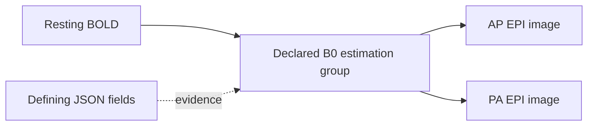

# Scientific core: explicit relationships and reproducible meaning

The immediate engineering priority is scientific interpretation: metadata, acquisition relationships, coherent selections, and the evidence needed to trust an analysis input.

An accepted release binds three scientific facts together: exact authored content, its recorded interpretation, and the assessment under which that interpretation was accepted. A correction produces another state. Historical meaning stays fixed.

## Implemented slice: explicit MRI relationships

The reusable semantics live in [bids4s' portable resolver](../../bids4s/modules/core/shared/src/main/scala/bids4s/BidsFieldmaps.scala). Sanctity records the result in its [relationship model](../modules/kernel/src/main/scala/sanctity/kernel/Relationships.scala) and [BIDS interpreter](../modules/bids/src/main/scala/sanctity/bids/BidsInterpreter.scala).

This slice resolves declarations on NIfTI images:

- `B0FieldIdentifier` names an estimation group within one participant's dataset tree.
- `B0FieldSource` connects an acquisition to every image in each named group.
- `IntendedFor` connects its named target to the image carrying the declaration.
- Each relationship retains the defining image, source JSON document and field.
- Self-reference is permitted. Several group members are represented together; multiple declared groups remain separate.
- Identical identifiers in different participants or independent datasets remain separate.
- Current-dataset BIDS URIs and deprecated participant-relative paths are supported. Legacy paths produce a finding.
- Missing identifiers/targets, malformed declarations, unsafe paths, dataset-boundary violations, unsupported targets and unpinned external datasets produce blocking findings for new acceptance.

The scientific basis is the explicit declaration rules in the [BIDS MRI specification](https://bids-specification.readthedocs.io/en/stable/modality-specific-files/magnetic-resonance-imaging-data.html#expressing-the-mr-protocol-intent-for-fieldmaps), inspected at version 1.11.2. B0 identifiers are scoped to the participant tree, which may contain multiple sessions. `IntendedFor` remains an explicit relationship kind; its presence alone does not establish that an image is a usable distortion-correction fieldmap.

Both declaration mechanisms can coexist. Their evidence is retained independently; the resolver does not silently choose precedence or select an analysis algorithm.

## The kernel contract

`ScientificRelationship` records a target artifact, a versioned interpretation's relationship kind, a vector of associated source artifacts, an optional group label, and field-origin evidence.

`RelationshipGraph.from` checks membership and evidence against the interpreted artifacts, rejects empty/dangling/duplicate groups, and orders the result canonically. Interpretation identity includes the graph and its resolver version. Shuffling inventory, group members or evidence does not change that identity.

The graph remains scientific state. It confers no access authority, and provenance does not select an execution policy.

`Interpretation.relationshipClosure(roots)` computes the transitive closure under the **recorded relationship vocabulary**, preserving groups and collecting the applicable authored metadata documents. It terminates on valid self-links and cycles.

For example, an acquisition naming a two-image estimation group yields:

This is an explainable set of declared associated inputs. It is not yet a complete fMRIPrep input bundle or a BIDS subset export. The companion slice below adds gradients and events. Implicit magnitude/phase companions, stimulus files, table transformations, reference rewriting and tool-specific requirements need further rules.

The bounded resolver accepts at most 1024 values per declaration field, 4096 characters per value, 100000 total declaration references and 100000 expanded source members. A budget failure is a blocking finding. The repository already bounds inventory and metadata bytes independently.

## Correction and historical behavior

A useful demonstration now runs in both reference and PostgreSQL lifecycle tests:

1. Accept a BOLD acquisition that names one fieldmap group containing one image.
2. Correct another fieldmap image's identifier so it joins that group.
3. Preview the affected BOLD relationship even though the BOLD file and its own effective metadata are unchanged.
4. Accept the correction.
5. Retrieve the earlier and later releases: the earlier graph still has one source, the later graph has two.
6. Export and verify that all image bytes remain unchanged.

Correction previews now contain `relationshipChanges` alongside content and metadata changes. Public release inspection includes the recorded graph; stored interpretation decoding revalidates its identity.

The first relationship slice introduced the v3 canonical identity format and `native-reference-v2` semantic profile. Historical v1/v2 interpretations decode with their original identities. A missing graph means **not assessed under this relationship profile**, rather than a claim that no relationships exist. Historical releases remain readable and exportable as recorded.

That slice introduced subset compiler `sanctity-mri-view-v2`. It requires recorded relationship coverage and rejects selected targets whose associated inputs need a fuller closure/rewrite profile. This fixes a concrete earlier gap: an `IntendedFor` fieldmap from a different session could escape the old same-session companion check and be omitted from a subset. That case has a shared lifecycle regression.

The new graph is stored in the canonical interpretation payload. No SQL relationship-query index is claimed yet.

## Implemented slice: inherited DWI and event companions

The portable [companion resolver](../../bids4s/modules/core/shared/src/main/scala/bids4s/BidsCompanions.scala) adds a second kind of relationship evidence. JSON declarations retain `MetadataField` evidence. `CompanionSelection` records the selected document, versioned rule, dataset root, matched filename entities and applicable candidate hierarchy.

The resolver supports NIfTI DWI `bval`/`bvec` files and NIfTI BOLD `events.tsv` files. It selects the lowest applicable file without merging contents. Multiple applicable files at any one directory level are ambiguous, even if a lower override exists. Nested datasets and declared derivative roots bound the search; unrelated participants, sessions and sibling directories cannot donate files. Numeric run indices follow bids4s equivalence; participant labels remain lexical. A run's event table can apply to all its echoes.

The source rules are [BIDS inheritance](https://bids-specification.readthedocs.io/en/v1.11.2/common-principles.html#the-inheritance-principle), [DWI gradients](https://bids-specification.readthedocs.io/en/v1.11.2/modality-specific-files/magnetic-resonance-imaging-data.html#required-gradient-orientation-information) and [events](https://bids-specification.readthedocs.io/en/v1.11.2/modality-agnostic-files/events.html). The library distinguishes selected, missing, ambiguous, unsupported and over-budget outcomes. Its default budget is 10,000 examined candidates per resolution.

Sanctity requires both gradient files before recording one `bids.dwi-gradients` group. Missing gradients and ambiguous companion selection block acceptance. Missing non-rest BOLD events produce a warning in this bounded profile; absent rest events do not. This admission policy does not assert full BIDS conformance.

`NativeRepository.correctCompanion` adds or replaces a bounded UTF-8 gradient/event document through the ordinary draft, preparation and acceptance flow. It retains an existing artifact's identity. The HTTP correction endpoint continues to edit JSON; this new application capability has no separate HTTP write route yet.

Correction previews identify changed selections and direct selected dependency bytes via `changedDependencies`. They do not claim transitive content-impact analysis for every relationship. Adding a local table affects its applicable acquisition while other participants keep their inherited table. Editing an existing selected table affects its consumers even when the graph's paths remain equal.

Closure contains selected companions and their applicable JSON documents. Overridden candidate tables remain evidence, and are not included as processing inputs. Stimulus-file references, event content, implicit fieldmap companions and complete processing-bundle closure are still outside this profile.

The companion slice introduced semantic profile `native-reference-v3` and admission policy `reference-admission-v3`. Relationship evidence encoding 2 produces canonical interpretation v4. Historical v1/v2/v3 interpretation identities remain intact; a fixed v3 digest and legacy envelopes test compatibility. The combined relationship-profile identity names both resolver versions. Current subset planning (`sanctity-mri-view-v3`) requires this coverage and refuses omitted event/gradient dependencies.

Five new lifecycle cases run against both catalogs: local inherited-event replacement with exact exports and immutable history; selected-table byte correction; ambiguous event admission; complete/missing DWI gradient groups; and blocking a subset that would omit root-level events. Kernel and persistence cases cover evidence scope, identity, legacy decoding and tamper rejection.

## Implemented slice: DWI content consistency

The portable [gradient parser and policy](../../bids4s/modules/core/shared/src/main/scala/bids4s/DwiConsistency.scala) and [NIfTI header facts](../../bids4s/modules/core/shared/src/main/scala/bids4s/NiftiHeaderFacts.scala) are pure, checked APIs. Sanctity's [content-check adapter](../modules/bids/src/main/scala/sanctity/bids/DwiContentChecks.scala) supplies bounded reads over the selected, managed gradient and image files.

The named profile checks:

- One row of nonnegative finite b-values and three equally sized rows of finite vector components. Decimal/scientific notation, spaces, tabs and CRLF are supported. Malformed numbers, overflow, nonzero underflow, ragged/transposed tables and unsupported sizes become findings; no normalization or repair occurs.
- Single-file NIfTI-1 and NIfTI-2 headers in either byte order: signature, positive dimensions, supported scalar datatype/bit depth, integral voxel offset and overflow-safe minimum byte size. Uncompressed files must be at least that size.
- Three-dimensional images have one volume; four-dimensional images use the fourth dimension. Other ranks are outside this DWI profile. Both gradient counts must equal the image volume count.
- Vector norm must be within 0.01 of one. For b-values at most 50 s/mm², a vector norm at most 1e-6 is also allowed. These are explicit `bids-dwi-consistency-v1` policy choices, not numerical constants mandated by BIDS. Components retain the FSL image-axis convention; no reorientation is performed.

Reading is bounded: 4 MiB per gradient document, 32 MiB of distinct selected documents per preparation, 100,000 gradient columns and 64 numeric diagnostics per parser. Each uncompressed image contributes at most 540 bytes to header inspection. Gzip inspection reads at most 64 KiB of compressed input and decompresses only the header; an overlong gzip header produces a limit finding. Shared gradient documents are read once per preparation, then checked against each acquisition independently. Storage errors remain operational failures; cancellation releases read resources.

The generic kernel `ContentCheck` binds a named rule, target, exact input paths/digests/sizes, observed facts and findings. It supports future event/table checks without putting MRI concepts into the kernel. Observations do not overwrite authored metadata or become inferred query facts. The assessment includes all check findings automatically, and admission verifies every recorded input against the candidate manifest.

Checks participate in canonical assessment v2 identity and persist with the assessment. Historical assessments without checks retain v1 identities and decode without the new field. Public candidate/release assessments expose `checks`. No database migration or additional acceptance pathway is needed.

The current semantic/admission profiles are `native-reference-v4` and `reference-admission-v4`. The check rule also records `nifti-scalar-header-v1` and `sanctity-prefix-v1`; source fingerprints bind the implementations. Interpretation encoding stays v4.

The shared lifecycle proof accepts valid DWI, rejects an extra gradient without advancing the head, accepts a corrected b-value, and retrieves/exports both historical states with unchanged image bytes. Further cases cover malformed/nonunit vectors, big-endian NIfTI-2 gzip, short images, and one inherited gradient pair applied to acquisitions with different volume counts.

These are header and gradient consistency checks. They do not verify affine orientation against anatomy, gradient ordering against acquisition evidence, phase encoding, voxel contents, compressed payload completeness/CRC, full BIDS conformance or scanner qualification. Full managed-blob digest verification still runs at acceptance; it establishes the identity of stored bytes, not scientific correctness of their contents.

## Scientific work that follows

| Order | Slice | Acceptance proof |
| --- | --- | --- |
| 1 | Explicit association groups and origin evidence — implemented | Cross-session dependencies, participant/dataset scope, correction impact and immutable history |
| 2 | DWI gradients and task-event companion resolution — implemented | Deterministic inheritance/applicability, grouped companions, explicit absence/ambiguity; no arbitrary nearest-file selection |
| 3 | DWI gradient/header consistency — implemented | Counts, finite values, named norm policy, bounded header inspection and historical check receipts |
| 4 | Task-event content consistency | Required/typed columns, timing semantics, explicit missing values and event-specific findings; exact table/header inputs |
| 5 | Complete scientific subset profiles | Required files, metadata, tables and rewritten references survive export and re-import with equivalent interpretation |
| 6 | General scientific change preparation | Rename/removal impact, reference repair proposals, before/after dependency scope and conflict handling |

Alongside these slices, the semantic layer needs a consistent explicit schema/registry context and broader independent conformance fixtures. Every new profile must name its coverage and preserve older interpretations.

Institutional login and additional service features remain outside this immediate scientific workstream.

## Qualification boundary

These checks establish declaration semantics, evidence, bounded closure and repository consistency. They do not establish image registration, fieldmap geometry compatibility, phase-encoding correctness, a complete BIDS validation result, anonymization, or clinical/scanner qualification. The tests use synthetic data.

Reproduce with `sbt compileAll testAll 'docs/mdoc'` in `../bids4s`, and `scripts/check-postgres.sh` in Sanctity. The latter checks both catalog implementations, stored history, acceptance/rejection, materialization, and recovery.

Verified 10 October 2026: 145 Sanctity tests, 159 bids4s JVM tests, 140 Scala.js tests, both first-contact builds and 11 executable documentation files. PostgreSQL crash/retry and backup/restore demonstrations passed. Retained local evidence: `target/postgres-check.s4c672/`.
