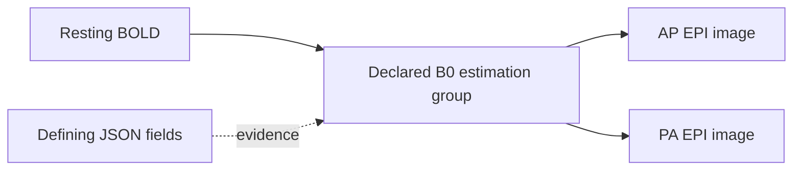

# Scientific core: explicit relationships and reproducible meaning

The immediate engineering priority is scientific interpretation: metadata, acquisition relationships, coherent selections, and the evidence needed to trust an analysis input.

An accepted release binds three scientific facts together: exact authored content, its recorded interpretation, and the assessment under which that interpretation was accepted. A correction produces another state. Historical meaning stays fixed.

## Implemented slice: explicit MRI relationships

The reusable semantics live in [bids4s' portable resolver](../../bids4s/modules/core/shared/src/main/scala/bids4s/BidsFieldmaps.scala). Sanctity records the result in its [relationship model](../modules/kernel/src/main/scala/sanctity/kernel/Relationships.scala) and [BIDS interpreter](../modules/bids/src/main/scala/sanctity/bids/BidsInterpreter.scala).

This slice resolves declarations on NIfTI images:

- `B0FieldIdentifier` names an estimation group within one participant's dataset tree.
- `B0FieldSource` connects an acquisition to every image in each named group.
- `IntendedFor` connects its named target to the image carrying the declaration.
- Each relationship retains the defining image, source JSON document and field.
- Self-reference is permitted. Several group members are represented together; multiple declared groups remain separate.
- Identical identifiers in different participants or independent datasets remain separate.
- Current-dataset BIDS URIs and deprecated participant-relative paths are supported. Legacy paths produce a finding.
- Missing identifiers/targets, malformed declarations, unsafe paths, dataset-boundary violations, unsupported targets and unpinned external datasets produce blocking findings for new acceptance.

The scientific basis is the explicit declaration rules in the [BIDS MRI specification](https://bids-specification.readthedocs.io/en/stable/modality-specific-files/magnetic-resonance-imaging-data.html#expressing-the-mr-protocol-intent-for-fieldmaps), inspected at version 1.11.2. B0 identifiers are scoped to the participant tree, which may contain multiple sessions. `IntendedFor` remains an explicit relationship kind; its presence alone does not establish that an image is a usable distortion-correction fieldmap.

Both declaration mechanisms can coexist. Their evidence is retained independently; the resolver does not silently choose precedence or select an analysis algorithm.

## The kernel contract

`ScientificRelationship` records a target artifact, a versioned interpretation's relationship kind, a vector of associated source artifacts, an optional group label, and field-origin evidence.

`RelationshipGraph.from` checks membership and evidence against the interpreted artifacts, rejects empty/dangling/duplicate groups, and orders the result canonically. Interpretation identity includes the graph and its resolver version. Shuffling inventory, group members or evidence does not change that identity.

The graph remains scientific state. It confers no access authority, and provenance does not select an execution policy.

`Interpretation.relationshipClosure(roots)` computes the transitive closure under the **recorded relationship vocabulary**, preserving groups and collecting the applicable authored metadata documents. It terminates on valid self-links and cycles.

For example, an acquisition naming a two-image estimation group yields:

This is an explainable set of declared associated inputs. It is not yet a complete fMRIPrep input bundle or a BIDS subset export. The companion slice below adds gradients and events. Implicit magnitude/phase companions, stimulus files, table transformations, reference rewriting and tool-specific requirements need further rules.

The bounded resolver accepts at most 1024 values per declaration field, 4096 characters per value, 100000 total declaration references and 100000 expanded source members. A budget failure is a blocking finding. The repository already bounds inventory and metadata bytes independently.

## Correction and historical behavior

A useful demonstration now runs in both reference and PostgreSQL lifecycle tests:

1. Accept a BOLD acquisition that names one fieldmap group containing one image.
2. Correct another fieldmap image's identifier so it joins that group.
3. Preview the affected BOLD relationship even though the BOLD file and its own effective metadata are unchanged.
4. Accept the correction.
5. Retrieve the earlier and later releases: the earlier graph still has one source, the later graph has two.
6. Export and verify that all image bytes remain unchanged.

Correction previews now contain `relationshipChanges` alongside content and metadata changes. Public release inspection includes the recorded graph; stored interpretation decoding revalidates its identity.

The first relationship slice introduced the v3 canonical identity format and `native-reference-v2` semantic profile. Historical v1/v2 interpretations decode with their original identities. A missing graph means **not assessed under this relationship profile**, rather than a claim that no relationships exist. Historical releases remain readable and exportable as recorded.

That slice introduced subset compiler `sanctity-mri-view-v2`. It requires recorded relationship coverage and rejects selected targets whose associated inputs need a fuller closure/rewrite profile. This fixes a concrete earlier gap: an `IntendedFor` fieldmap from a different session could escape the old same-session companion check and be omitted from a subset. That case has a shared lifecycle regression.

The new graph is stored in the canonical interpretation payload. No SQL relationship-query index is claimed yet.

## Implemented slice: inherited DWI and event companions

The portable [companion resolver](../../bids4s/modules/core/shared/src/main/scala/bids4s/BidsCompanions.scala) adds a second kind of relationship evidence. JSON declarations retain `MetadataField` evidence. `CompanionSelection` records the selected document, versioned rule, dataset root, matched filename entities and applicable candidate hierarchy.

The resolver supports NIfTI DWI `bval`/`bvec` files and NIfTI BOLD `events.tsv` files. It selects the lowest applicable file without merging contents. Multiple applicable files at any one directory level are ambiguous, even if a lower override exists. Nested datasets and declared derivative roots bound the search; unrelated participants, sessions and sibling directories cannot donate files. Numeric run indices follow bids4s equivalence; participant labels remain lexical. A run's event table can apply to all its echoes.

The source rules are [BIDS inheritance](https://bids-specification.readthedocs.io/en/v1.11.2/common-principles.html#the-inheritance-principle), [DWI gradients](https://bids-specification.readthedocs.io/en/v1.11.2/modality-specific-files/magnetic-resonance-imaging-data.html#required-gradient-orientation-information) and [events](https://bids-specification.readthedocs.io/en/v1.11.2/modality-agnostic-files/events.html). The library distinguishes selected, missing, ambiguous, unsupported and over-budget outcomes. Its default budget is 10,000 examined candidates per resolution.

Sanctity requires both gradient files before recording one `bids.dwi-gradients` group. Missing gradients and ambiguous companion selection block acceptance. Missing non-rest BOLD events produce a warning in this bounded profile; absent rest events do not. This admission policy does not assert full BIDS conformance.

`NativeRepository.correctCompanion` adds or replaces a bounded UTF-8 gradient/event document through the ordinary draft, preparation and acceptance flow. It retains an existing artifact's identity. The HTTP correction endpoint continues to edit JSON; this new application capability has no separate HTTP write route yet.

Correction previews identify changed selections and direct selected dependency bytes via `changedDependencies`. They do not claim transitive content-impact analysis for every relationship. Adding a local table affects its applicable acquisition while other participants keep their inherited table. Editing an existing selected table affects its consumers even when the graph's paths remain equal.

Closure contains selected companions and their applicable JSON documents. Overridden candidate tables remain evidence, and are not included as processing inputs. At that stage event content was unassessed. The event slice below adds it; stimulus-file references, implicit fieldmap companions and complete processing-bundle closure remain open.

The companion slice introduced semantic profile `native-reference-v3` and admission policy `reference-admission-v3`. Relationship evidence encoding 2 produces canonical interpretation v4. Historical v1/v2/v3 interpretation identities remain intact; a fixed v3 digest and legacy envelopes test compatibility. The combined relationship-profile identity names both resolver versions. That subset-planning version (`sanctity-mri-view-v3`) required this coverage and refused omitted event/gradient dependencies. The v4 compiler below materializes the supported closure.

Five new lifecycle cases run against both catalogs: local inherited-event replacement with exact exports and immutable history; selected-table byte correction; ambiguous event admission; complete/missing DWI gradient groups; and blocking a subset that would omit root-level events. Kernel and persistence cases cover evidence scope, identity, legacy decoding and tamper rejection.

## Implemented slice: DWI content consistency

The portable [gradient parser and policy](../../bids4s/modules/core/shared/src/main/scala/bids4s/DwiConsistency.scala) and [NIfTI header facts](../../bids4s/modules/core/shared/src/main/scala/bids4s/NiftiHeaderFacts.scala) are pure, checked APIs. Sanctity's [content-check adapter](../modules/bids/src/main/scala/sanctity/bids/DwiContentChecks.scala) supplies bounded reads over the selected, managed gradient and image files.

The named profile checks:

- One row of nonnegative finite b-values and three equally sized rows of finite vector components. Decimal/scientific notation, spaces, tabs and CRLF are supported. Malformed numbers, overflow, nonzero underflow, ragged/transposed tables and unsupported sizes become findings; no normalization or repair occurs.
- Single-file NIfTI-1 and NIfTI-2 headers in either byte order: signature, positive dimensions, supported scalar datatype/bit depth, integral voxel offset and overflow-safe minimum byte size. Uncompressed files must be at least that size.
- Three-dimensional images have one volume; four-dimensional images use the fourth dimension. Other ranks are outside this DWI profile. Both gradient counts must equal the image volume count.
- Vector norm must be within 0.01 of one. For b-values at most 50 s/mm², a vector norm at most 1e-6 is also allowed. These are explicit `bids-dwi-consistency-v1` policy choices, not numerical constants mandated by BIDS. Components retain the FSL image-axis convention; no reorientation is performed.

Reading is bounded: 4 MiB per gradient document, 32 MiB of distinct selected documents per preparation, 100,000 gradient columns and 64 numeric diagnostics per parser. Each uncompressed image contributes at most 540 bytes to header inspection. Gzip inspection reads at most 64 KiB of compressed input and decompresses only the header; an overlong gzip header produces a limit finding. Shared gradient documents are read once per preparation, then checked against each acquisition independently. Storage errors remain operational failures; cancellation releases read resources.

The generic kernel `ContentCheck` binds a named rule, target, exact input paths/digests/sizes, observed facts and findings. The same contract supports event/table checks without putting MRI concepts into the kernel. Observations do not overwrite authored metadata or become inferred query facts. The assessment includes all check findings automatically, and admission verifies every recorded input against the candidate manifest.

Checks participate in canonical assessment v2 identity and persist with the assessment. Historical assessments without checks retain v1 identities and decode without the new field. Public candidate/release assessments expose `checks`. No database migration or additional acceptance pathway is needed.

The DWI slice introduced semantic/admission profiles `native-reference-v4` and `reference-admission-v4`. The check rule also records `nifti-scalar-header-v1` and `sanctity-prefix-v1`; source fingerprints bind the implementations. Interpretation encoding stays v4.

The shared lifecycle proof accepts valid DWI, rejects an extra gradient without advancing the head, accepts a corrected b-value, and retrieves/exports both historical states with unchanged image bytes. Further cases cover malformed/nonunit vectors, big-endian NIfTI-2 gzip, short images, and one inherited gradient pair applied to acquisitions with different volume counts.

These are header and gradient consistency checks. They do not verify affine orientation against anatomy, gradient ordering against acquisition evidence, phase encoding, voxel contents, compressed payload completeness/CRC, full BIDS conformance or scanner qualification. Full managed-blob digest verification still runs at acceptance; it establishes the identity of stored bytes, not scientific correctness of their contents.

## Implemented slice: task-event content and timing

Selected BOLD event tables now use bids4s' `CheckedEvents` and `EventTiming` APIs through [EventContentChecks](../modules/bids/src/main/scala/sanctity/bids/EventContentChecks.scala). The kernel, persistence encoding and acceptance protocol are unchanged. Each result is an ordinary `ContentCheck` within assessment v2.

The strict event profile validates TSV structure, required column order, exact decimal onset/duration and optional response time, explicit missing values, and nonnegative durations. Quoted tabs/newlines, Unicode, legal negative onsets, overlap and zero-duration events are supported. Custom columns and authored bytes remain intact. Unsorted onsets warn. The permissive bids4s readers retain their previous behavior.

Acquisition context is explicit:

| Context | Comparison window | Admission behavior |
| --- | --- | --- |
| Regular `RepetitionTime` | Nominal stored volume count × TR | Exceedance warns; it is not a measured physical scan end |
| `VolumeTiming` and `FrameAcquisitionDuration` | Last relative volume onset + frame duration | Counts and supplied values must agree; exceedance warns |
| `VolumeTiming` and only `SliceTiming` | Final end unavailable | Preserve variable starts and warn; no median-TR or last-interval extrapolation |
| Timing absent | Unavailable | Warn explicitly; malformed event content still blocks |
| Invalid/conflicting timing or volume-count mismatch | Unavailable | Block acceptance |

All comparisons use the first stored volume as the event origin. Discarded-volume counts do not alter onsets. Variable volume starts are normalized by the first supplied start, with that origin recorded in the receipt.

Each check binds the exact table, image, and applicable image/event metadata documents, including inherited and overridden sources. Facts include row/missing-value counts, columns, timing mode, volume count, comparison end when known, its derivation, and effective timing fields with their origins. Timing edits therefore produce fresh checking evidence even when image and event bytes are unchanged. Missing context and absent event cells are never converted to zero.

Tables are read and parsed once per distinct selected path. Limits are 4 MiB per table, 32 MiB selected tables per preparation, 100,000 rows, 256 columns and 64 findings per portable assessment/comparison. Event numeric tokens are at most 128 characters/128 significant digits with absolute decimal scale at most 308; arithmetic preserves exact accepted decimal values. Each receipt permits at most 98 supporting metadata documents plus the image and table. Invalid UTF-8 becomes a content finding; storage failures remain operational failures, and cancellation releases resources. Event and DWI checks share the same bounded NIfTI prefix reader; no voxel array is loaded.

The current profiles are `native-reference-v5` and `reference-admission-v5`. Event rule identities include `bids-events-content-v1`, `bids-events-timing-v1`, `nifti-scalar-header-v1` and `sanctity-prefix-v1`, with implementation source fingerprints in the interpretation. Earlier releases retain their original assessments and profile coverage.

Six shared lifecycle cases exercise invalid-duration rejection with an unchanged head; corrected labels and exact historical exports; metadata corrections that change one acquisition's timing context; nonuniform timing and count rejection; missing context; unknown final frame duration; and gzip NIfTI-2 with quoted TSV. Adapter cases check shared-table reads, bounds, encoding, operational failures and cancellation.

Coverage is selected NIfTI BOLD event content and contextual timing. It does not resolve stimulus files, validate HED or arbitrary column dictionaries, qualify other recording modalities, compare TR against NIfTI time units, or certify task/scanner synchronization. Both the [BIDS event rules](https://bids-specification.readthedocs.io/en/stable/modality-agnostic-files/events.html) and [MRI timing definitions](https://bids-specification.readthedocs.io/en/stable/modality-specific-files/magnetic-resonance-imaging-data.html#required-fields) informed the profile; warnings about the comparison window are an explicit repository policy.

## Implemented slice: coherent MRI subsets

The [MRI view compiler](../modules/bids/src/main/scala/sanctity/bids/MriViewCompiler.scala) now implements `sanctity-mri-view-v4`: T1w/T2w, single-echo BOLD and DWI roots, resolved event/gradient companions, and explicit EPI fieldmap groups. The subset is still an ordinary assessed release in a separate dataset. No alternative admission path or database migration is introduced.

Planning has two pure stages around bounded effectful reads. `documents` identifies the required source TSVs and dataset description. `plan` consumes those documents and the pinned interpretation, producing retained/generated files, transformation steps and per-source dispositions (`selected`, `dependency`, `transformation-input`, `excluded`). The application verifies document sizes, digests and UTF-8, rechecks source access at each read chunk, and releases streams on cancellation. A direct planner caller must supply documents from the exact source release; `ScientificViews.prepare` enforces this boundary.

The compiler:

- Follows the recorded relationship graph and preserves explicit EPI groups, including calibration sessions. It cannot add an unselected primary acquisition or a participant outside the selected scope. Query hits for companions/summary tables are accepted only when covered by those selected acquisitions; a DWI suffix query can therefore include its local gradients without promoting them to acquisition roots.
- Keeps image bytes and paths. It localizes inherited events and gradients beside each acquisition. Unchanged tables and gradients reuse exact blobs; multiple localized copies have distinct artifact identities and recorded source mappings.
- Flattens approved effective image metadata into local sidecars. Required task/timing and fieldmap/reference fields must be authorized. Variable timing is preserved without inventing TR or final frame duration.
- Retains only `IntendedFor` targets present in the subset, writing current-dataset BIDS URIs. It preserves used B0 groups and removes unused identifiers. It never pulls excluded targets into the result to avoid rewriting a reference.
- Filters event columns through an explicit mask, preserving retained lexical values, row order and explicit missingness. Quoted TSV parsing/rendering is reusable in bids4s as `CheckedTsv`. Full retained event tables preserve original bytes; transformed tables use deterministic LF/quoting.
- Filters participant/session/scan rows and approved columns. Present session/scan tables must contain the selected keys without duplicates; scan filenames must be safe relative paths. Optional absent tables are not invented, except for a minimal participant listing. Retained participant values must agree with the source query interpretation; a quoted value interpreted differently by the older native participant reader blocks subsetting pending reinterpretation. Included calibration sessions receive their applicable summary rows.
- Projects column dictionaries for retained fields. Column authorization includes that column's definition; this is not nested dictionary-field redaction or dictionary semantic validation. Excluded dictionaries and arbitrary root documentation are not copied.
- Generates a neutral dataset description, preserving the declared BIDS version. A present source license must be explicitly retained by the metadata mask.

`DisclosureProfile` adds optional `eventFields` and sets of `sessionFields`/`scanFields`. Event access is absent by default; an authorized event mask must include onset and duration. The original two-field profile keeps its v1 identity when all new settings are absent. Profiles using the new settings have v2 identity.

The generic [projection receipt](../modules/kernel/src/main/scala/sanctity/kernel/Projection.scala) binds the source release/selection/profile/compiler specification, source content and interpretation, exact output manifest, and every output's operation plus contributing source paths/digests/sizes. Its factory checks source/output membership and exact copy claims. Admission verifies the specification and output binding. Persistence verifies canonical identity; old projection records without receipts remain readable without inventing evidence. These internal provenance records are separate from exported BIDS files; there is no new remote provenance or view API in this slice.

Bounds: 4 MiB per read or generated document, 32 MiB total in each direction, at most 10,000 output files (also subject to the repository's entry limit), 256 contributing inputs per output and 100,000 total input references. Shared event sources are read, parsed and rendered once per preparation. The planner stops accumulating generated documents at the budget, including when many acquisitions use one inherited table.

Twelve shared lifecycle cases cover MRI export/re-import; exact shared companion copies; rejected masks; stimulus refusal; summary key/path failures and plan explanations; hidden-column/source-release isolation; variable timing; shared reads/cancellation; oversized input rejection before reads; explicit rejection of EPI gradients; participant-parser disagreement; and ordinary DWI suffix selections containing local gradients. Four kernel cases cover receipt identity, membership/copy laws, admission and profile compatibility. Two codec cases cover receipt tampering and historical projections. Five portable TSV cases cover strict syntax, lexical projection and limits.

Round-trip equivalence compares supported metadata, relationships and content-check observations after accounting for permitted field removal and localized companion paths. Re-import creates new repository identities; equality of interpretation hashes across independent imports is not claimed. The tests verify that generated metadata origins are local and that later source corrections cannot change an accepted subset's receipt or bytes.

Unsupported cases remain explicit: multi-echo/file collections, SBRef/physiology, stimulus references, event HED (including nested event dictionaries), implicit phase/magnitude families, EPI gradients, external/nested datasets, arbitrary dictionary semantics and pipeline-specific requirements. The profile does not establish full BIDS conformance, fMRIPrep readiness, fieldmap geometry suitability or anonymization. The [summary-table rules](https://bids-specification.readthedocs.io/en/v1.11.2/modality-agnostic-files/data-summary-files.html), [event/stimulus rules](https://bids-specification.readthedocs.io/en/v1.11.2/modality-agnostic-files/events.html), and [fieldmap declarations](https://bids-specification.readthedocs.io/en/v1.11.2/modality-specific-files/magnetic-resonance-imaging-data.html#expressing-the-mr-protocol-intent-for-fieldmaps) define the scientific context; the coverage and budgets above are this implementation's explicit limits.

## Implemented slice: scientific file changes

[`FileEdits`](../modules/kernel/src/main/scala/sanctity/kernel/FileEdits.scala) adds a pure, bounded structural operation over one base manifest. Moves and removals are simultaneous: swapping two filenames requires no temporary path and produces the same result regardless of request ordering. A source can appear only once. Occupied destinations, duplicate outputs, directory/file conflicts, and case/Unicode collisions fail explicitly. Moves preserve artifact identity and exact blobs. Required parent directories are added; explicitly inventoried empty directories remain. Both the input and output inventories are limited to 10,000 entries.

[`ScientificChanges`](../modules/application/src/main/scala/sanctity/application/ScientificChanges.scala) separates inspection from preparation:

1. `plan(context, release, edits)` reads a pinned source and returns structural changes, proposed document repairs, and the exact prospective manifest. It performs no writes.
2. The caller inspects each repair's original file reference, replacement text, output path and rule, then supplies that plan's digest to `prepare` with a reason. Preparation recomputes the plan and rejects a mismatched digest or stale head before writing repair bytes.
3. The resulting ordinary draft is interpreted and assessed through `NativeRepository.prepare`. The preview contains file deltas, metadata origins/values, relationship changes, and before/after reverse dependency scope.
4. Ordinary atomic acceptance checks current authority, head, generation, content assessments and evidence binding. Blocking findings, including missing required DWI gradients or an unresolved declared B0 group, prevent head advancement. Existing warning-level policies, such as absent non-rest events, remain explicit assessment findings.

The new generic `DependencyImpact` walks reverse metadata and scientific relationship edges independently in the old and new interpretations. It includes transitive consumers and terminates on cycles. It catches newly applicable metadata as well as removed applicability. This is a conservative dependency scope: an artifact may depend on a changed document while retaining an unchanged effective value through an override. Field deltas explain that distinction.

The [`BidsChangeCompiler`](../modules/bids/src/main/scala/sanctity/bids/BidsChangeCompiler.scala) implements `sanctity-bids-file-edits-v1` with both library and repository source fingerprints. It supports the current raw MRI relationship profile: T1w/T2w, BOLD, DWI, EPI, JSON sidecars, events and gradients. Image renames retain participant/session placement, scientific suffix and format. Sidecar/companion relocation is explicit and reassessed; the compiler never guesses which companion should follow an image.

Repairs have two supported rules:

- `bids.intended-for.v1` follows moved target identities and removes explicitly removed targets. Changed declarations use current-dataset BIDS URIs; an empty declaration is removed. Legacy participant-relative references require unambiguous source scope. A moved legacy document is rewritten so its old relative reference cannot silently acquire a new meaning.
- `bids.scans-filename.v1` rewrites moved recording paths and removes deleted rows. It preserves column order, row order, retained lexical cell values and explicit missingness through bids4s `CheckedTsv`; quoted multiline cells survive. Duplicate, unsafe and absent source filenames are rejected. Cross-table row migration is unsupported.

`B0FieldSource` and `B0FieldIdentifier` are left authored. Removing a provider is reassessed against the complete remaining group; the compiler does not erase a scientific dependency to make validation pass. Participant/session summaries are retained, and structural relabeling of participants or sessions requires a later profile. Known unsupported reference vocabularies (`Sources`, `RawSources`, `AssociatedEmptyRoom`, `M0Scan`, `DatasetLinks`), external/nested datasets and direct edits to dataset/summary structure fail explicitly. Arbitrary strings in accessory documents are not treated as understood references. This profile does not establish full BIDS conformance or automatically migrate every modality's references.

Each repair retains the authored document's artifact identity. Unchanged documents and all image payloads reuse their exact blobs. A versioned UTF-8 receipt records the source release/content/interpretation, compiler, requested operations, repair input/output digests and sizes, prospective manifest and plan identity. It is retained through the existing activity-evidence mechanism. `ChangeEvidence` binds that receipt to the exact base and output at preparation and acceptance. Revising a draft cannot carry the earlier binding over to another manifest. Historical activities lacking the new optional field remain readable; new scientific-change activities require it. No database schema migration or second acceptance path is introduced.

Reads are verified against the source manifest and current content authority at each 64 KiB chunk. Limits are 4 MiB per source or generated document, 32 MiB total in each direction, and 4 MiB for the receipt. Reasons are required and limited to 4,096 characters. These are in-process application operations; the existing HTTP interface does not yet expose a file-change planner.

The shared lifecycle proof covers reference/scan repair, image and document lineage, exact historical export and re-import, removal accounting, missing B0 and DWI dependency rejection, old/new inheritance scope, plan/head conflicts, revocation, stale draft evidence and bounded verified reads. Kernel laws cover simultaneous swaps, collisions, parent inventory and transitive/cyclic impact; persistence tests cover receipt binding and compatibility. The [BIDS scans table](https://bids-specification.readthedocs.io/en/v1.11.2/modality-agnostic-files/data-summary-files.html#scans-file) and existing bids4s fieldmap resolver supply the reference semantics; the supported repair vocabulary remains an explicit repository profile.

## Implemented slice: explicit semantic context and profile evolution

A checked portable `BidsContext` carries the ordered registry, target specification
version (when claimed), coverage statement and named rule versions. Parsing,
manifest file roles, queries, metadata origins, companion selection and explicit
fieldmaps use that context. Sync/effect loaders retain their default behavior and
accept an explicit context. Custom compound extensions use the same path.

Sanctity records a `SemanticContext` descriptor, registry digest and context
digest in profile `native-reference-v6`; interpreter/library source fingerprints
remain part of identity. The authored `dataset_description.json` BIDSVersion is
recorded separately on `Interpretation`. The selected target version is not a
claim that the registry implements the complete official schema. Default coverage
remains explicitly partial and has no target specification version.

Interpretation encoding v5 binds the new evidence. Historical v1–v4 records keep
their old digest calculation and decode without synthetic context fields. Reads
and queries use stored interpretation facts. They never reinterpret old releases.

`NativeRepository.reinterpret(ctx, base, reason)` proposes unchanged content under
the configured interpreter. It goes through ordinary preparation, assessment and
atomic acceptance. It writes no new file blobs. Both catalogs check the immutable base content during preparation and acceptance, so a revised draft cannot disguise a content change as reinterpretation. A changed registry can make a
previously preserved suffix queryable in a new release while old selections,
metadata, assessments and exports retain their exact meaning. Current permission,
retry and stale-head checks still apply. This is an application API; a profile
administration UI/HTTP endpoint is not introduced in this slice.

Curation and projection preparation refuse implicit profile changes. BIDS edit
and MRI view compilers check the recorded source context; compiler identities
include the context digest. Adopting a new implementation/context must precede
those transformations. The rule applies to legacy records with absent context
as well: they remain readable/exportable and can be explicitly reinterpreted.

Three shared lifecycle cases exercise these laws against both catalogs, with
kernel framing/bounds tests, legacy/tamper codec coverage and upstream portable
context/loader checks. The [independent conformance corpus](../modules/app/src/test/resources/conformance/README.md)
contains pinned ds001/ds114 examples, reviewed inheritance/companion expectations,
and three negative metadata mutations. Official validator 3.0.2 with pinned BIDS
1.11.1 schema bytes agrees on the five error outcomes under documented empty-image
exclusions. This is bounded conformance evidence; an official validation result
is not automatically attached to each repository release.

## Scientific work that follows

| Order | Slice | Acceptance proof |
| --- | --- | --- |
| 1 | Explicit association groups and origin evidence — implemented | Cross-session dependencies, participant/dataset scope, correction impact and immutable history |
| 2 | DWI gradients and task-event companion resolution — implemented | Deterministic inheritance/applicability, grouped companions, explicit absence/ambiguity; no arbitrary nearest-file selection |
| 3 | DWI gradient/header consistency — implemented | Counts, finite values, named norm policy, bounded header inspection and historical check receipts |
| 4 | Task-event content consistency — implemented | Required/typed columns, timing semantics, explicit missing values and event-specific findings; exact table/header inputs |
| 5 | First coherent MRI subset profile — implemented | Supported dependencies, projected tables and rewritten references survive export and re-import with equivalent interpretation |
| 6 | Scientific change preparation — first bounded profile implemented | Rename/removal impact, reference repair proposals, before/after dependency scope and conflict handling |
| 7 | Explicit context and profile evolution — implemented | Same bytes under two profiles, stable historical meaning, contextual transformation gates, independent fixture/validator evidence |

The next scientific priority is to expand the independent corpus to acquisition relationships and image/header semantics, then qualify the next supported change/subset profile. Participant/session relabeling, additional reference vocabularies and cross-session scan-row migration remain later change profiles. Every new profile must name its coverage and preserve older interpretations.

Institutional login and additional service features remain outside this immediate scientific workstream.

## Qualification boundary

These checks establish declaration semantics, evidence, bounded closure and repository consistency. They do not establish image registration, fieldmap geometry compatibility, phase-encoding correctness, a complete BIDS validation result, anonymization, or clinical/scanner qualification. Repository lifecycle and image tests use synthetic data; the independent metadata/companion corpus adds pinned public example datasets with empty images.

Reproduce with `sbt compileAll testAll 'docs/mdoc'` in `../bids4s`, and `scripts/check-postgres.sh` in Sanctity. The latter checks both catalog implementations, stored history, acceptance/rejection, materialization, and recovery.

Verified 10 October 2026: 235 Sanctity tests (144 ordinary and 91 PostgreSQL), including 68 shared lifecycle cases on each catalog. PostgreSQL crash/retry and coordinated backup/restore passed, including current revocation and historical exports. Retained evidence: `target/postgres-check.8ZCgnu/` and its `check.log`. bids4s passed 194 JVM tests, 174 Scala.js tests, both first-contact builds and 11 executable documentation files. Five official-validator comparisons passed; their reports are retained in `target/conformance-gr6_pdnp/`.
